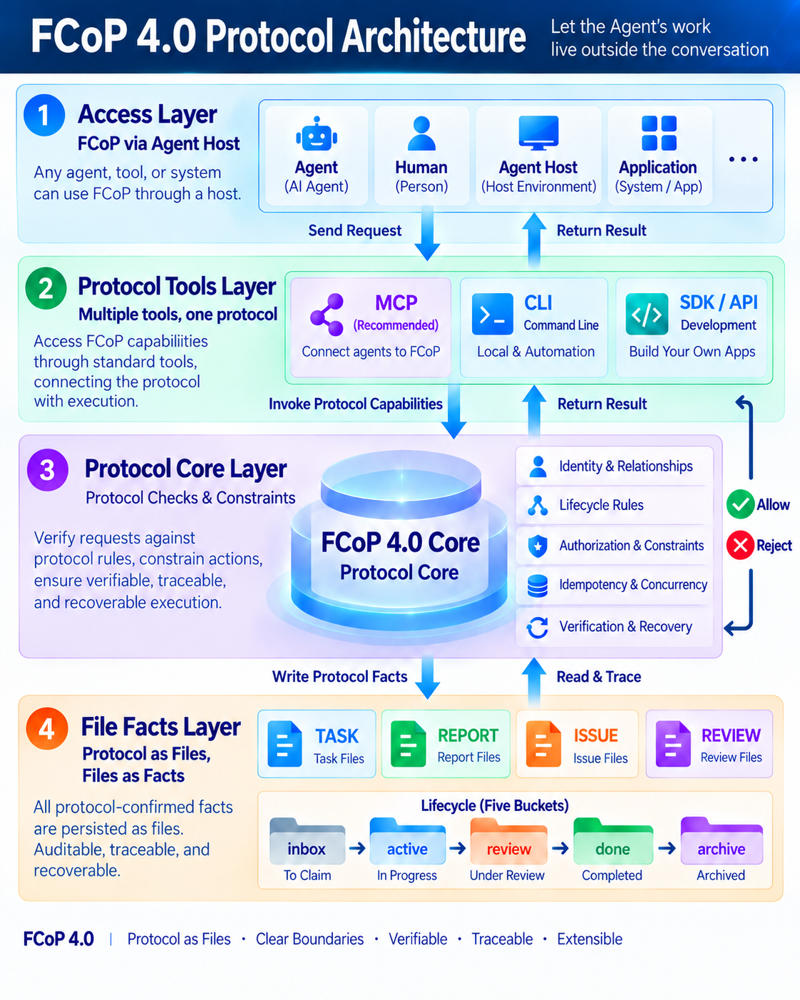

<ArticleCover image="/assets/recommended-articles/2026-09-21-file-system-as-protocol/en-cover.png" title="Filesystem as Protocol: How FCoP Uses Minimal Markdown for Agent Governance" summary="How FCoP uses Markdown, task lifecycles, and responsibility relationships to govern identity, claiming, execution, and review." version="2026-09-21" languageHref="/zh/research/2026-09-21-file-system-as-protocol" languageLabel="中文" />

<ArticleTableScroll language="en" />

In the previous article, we examined the “communication maze” and governance anxiety emerging as multi-Agent systems move into real-world use in 2026. As more and more agents exchange state, tasks, and tool calls through complex JSON, YAML, and black-box APIs, human operators are finding it increasingly difficult to see clearly who owns a piece of work, how far it has progressed, what justifies the next step, and who is responsible when something goes wrong.

As major technology companies and frontier engineering research increasingly emphasize **human-readable contracts** and **process transparency**, a practical question follows: how can we implement an Agent governance mechanism that is **lightweight, elegant, and capable of industrial-grade enforcement**?

This article focuses on an open protocol we designed and incubated ourselves: **FCoP (File-based Coordination Protocol)**. The aim is to see how it challenges the assumption that governance must begin with complex infrastructure, and how ordinary Markdown, directories, and files can be used to establish real constraints over multi-Agent collaboration.

---

## 1. Why return to the Unix philosophy of files?

One of the main intellectual influences behind FCoP is the Unix philosophy. Unix does not try to place every capability inside one giant central program. Instead, it favors small tools that each do one thing well, exchange information through simple and stable interfaces, and compose into more complex systems.

FCoP brings the same idea into multi-Agent collaboration. In the protocol, TASK expresses work to be done, REPORT represents a deliverable, ISSUE records unresolved problems, and REVIEW records inspection and decision. Markdown remains directly readable by humans while also being machine-parseable through structured fields.

So “filesystem as protocol” is not a mechanical restatement of “everything is a file.” What FCoP inherits from Unix is more important: **textual interfaces, small and explicit responsibilities, and composable tools**.

As Agent systems become more complex, a common instinct is to make governance systems equally complex by adding databases, state services, message queues, event buses, and workflow engines. FCoP asks a different question: how many facts are actually indispensable for reliable work handoff across multiple agents?

The next responsible actor usually needs to know only a limited set of things: what the task is, who currently owns it, which execution attempt is active, what has been delivered, who reviewed that delivery, and whether that review is still applicable to the current work. If those facts can be stored stably, reread later, and verified by software, governance does not necessarily have to begin with a large centralized system.

FCoP therefore does not try to reinvent a complex workflow engine. Instead, it compresses the most important responsibility relationships in multi-Agent work into a small set of stable facts, then lets the protocol control when those facts are allowed to change.

At Build 2026, Microsoft introduced ASSERT and the Agent Control Specification (ACS), which similarly separate “finding a problem” from “exerting control along the execution path”: evaluation discovers defects first, while controls are then applied at key points such as input, state, tool execution, and output. [ASSERT and ACS technical overview](https://devblogs.microsoft.com/foundry/build-2026-open-trust-stack-ai-agents/)

FCoP is not an implementation of ACS, and the two systems differ in architecture and scope. But they reflect a similar engineering principle: **governance cannot exist only after the fact, and it cannot be reduced to logs; it must be able to constrain work at the moment the work actually moves forward.**

FCoP also does not claim that filesystems should replace all infrastructure. Cross-machine high-throughput messaging, complex queries, large event streams, distributed transactions, and weakly consistent network environments are still better served by databases, message queues, or specialized coordination systems. FCoP addresses a more foundational problem inside a project workspace: how can tasks, deliverables, reviews, and responsibility relationships remain directly understandable to humans while also being re-verifiable by machines?

---

## 2. FCoP stores work facts, not conversations

FCoP does not try to preserve every Agent conversation, and it does not need to retain every internal reasoning trace. Its concern is narrower: when work moves from one role to another, which confirmed facts does the next responsible actor actually need?

The core protocol records can be summarized as four types:

| File | What it stores |
| --- | --- |
| TASK | Work content, delegation relationships, and lifecycle |
| REPORT | A deliverable produced by one execution attempt |
| ISSUE | An unresolved problem discovered during execution |
| REVIEW | A review and decision about a specific deliverable |

A simplified multi-Agent software team might look like this:

```text
ADMIN ⇄ PM                Requirements and management decisions
          │
          ▼
      FCoP protocol layer
      ├─ PM: creates and manages TASKs, reads deliverables and reviews
      ├─ DEV: claims TASKs and produces REPORT / ISSUE
      └─ QA : reads TASK and REPORT, then produces REVIEW
```

The roles above are only an example of one collaboration model; they are not a fixed role set defined by FCoP Core.

The key change is not simply replacing chat with Markdown. It is separating **a role’s own runtime context** from **the formal work facts the project depends on collectively**.

A PM does not need to enter a DEV conversation and read dozens of chat turns, and DEV does not need to verbally retell the entire implementation process to QA after the work is finished. What is handed off is not the previous conversation but the TASK, REPORT, ISSUE, and REVIEW records that have entered the protocol layer.

An Agent runtime can end, a model can be replaced, and a conversation can disappear entirely, while the work itself remains. A later responsible actor can reread the protocol files and still determine where the task came from, what stage it reached, what was delivered, and what reviews actually occurred.

This is one of the most important differences between FCoP and many “multi-Agent chat frameworks”: **collaboration facts do not depend on a conversation continuing to exist.**



> **Figure 1 — FCoP 4.0 Protocol Architecture.** FCoP is accessed through Agent Host environments, protocol tools expose standardized capabilities, FCoP Core performs protocol checks and constraints, and confirmed facts are persisted as files and lifecycle state.

---

## 3. The five buckets are protocol state, not directory convention

One of the easiest misunderstandings about FCoP is to treat `inbox`, `active`, `review`, `done`, and `archive` as ordinary folders used only to organize files.

In fact, they represent the lifecycle state of a TASK.

```text
_lifecycle/
├─ inbox/
├─ active/
├─ review/
├─ done/
└─ archive/
```

`inbox` means that a task has entered the system but has not yet been claimed. `active` means that the task is being executed. `review` means that the current execution has produced a deliverable and is waiting for review. `done` means that the task has satisfied its completion conditions. `archive` stores finished tasks that have left the current working view.

A typical TASK lifecycle can therefore be represented as:

```text
inbox → active → review → done → archive
           ↑         │
           └─────────┘
               rework
```

The important idea is not the existence of five directories but the fact that **state is materialized by location**. The lifecycle location of a TASK corresponds to its protocol stage, so the system does not need to rely on an Agent’s own claim that “I am at this step now.”

But this does **not** mean that an Agent may move lifecycle files directly. Quite the opposite: if an Agent could move a TASK from `active` to `done` simply because it believed the work was complete, the five buckets would be only a directory convention rather than a governance protocol.

FCoP adds a stricter rule: **an Agent may propose an action, but it may not directly change lifecycle facts.**

An executor may request to claim a task or submit a deliverable; a reviewer may submit a REVIEW or approve a result. Whether those actions are sufficient to move the TASK to the next stage must be re-validated by FCoP against the current state, the current execution attempt, the deliverable, the review, and the relevant authorization relationships. Only when the required conditions hold does the protocol layer execute the lifecycle transition and materialize the new state in the filesystem.

The process can be summarized as:

```text
Agent proposes a protocol action
        ↓
FCoP checks current facts and protocol conditions
        ↓
      allow / reject
        ↓
if allowed, execute lifecycle transition
        ↓
new file location becomes the new observable state
```

So “filesystem as protocol” does not mean that the filesystem itself makes decisions. It means that **the filesystem carries and materializes protocol facts, while FCoP determines which fact changes are allowed to become valid.**

This is what makes FCoP a protocol rather than merely a Markdown format.

---

## 4. The five buckets answer “where”; attempt answers “which execution”

The five buckets tell the system which lifecycle stage a TASK is in, but they do not answer another important question: if the same task is sent back and executed again, which execution attempt does the current deliverable belong to?

That is the purpose of `attempt_id`.

When a TASK begins a new execution, the system establishes an `attempt_id` for that attempt. If the task is rejected during review and returns to execution, a new attempt is created.

`task_id` and `attempt_id` therefore answer two different questions:

- `task_id`: Is this the same piece of work?
- `attempt_id`: Is this the same execution attempt?

For example:

```text
TASK-A
│
├─ attempt-1
│    ├─ REPORT-1
│    └─ REVIEW-1
│
└─ attempt-2
     └─ REPORT-2
```

TASK-A remains the same task, but `attempt-1` and `attempt-2` are two different executions.

This distinction matters because real work rarely passes on the first try. The first implementation may contain problems; the second attempt may produce a new REPORT; a third round of rework may follow. The task identity remains unchanged, but the facts produced by each execution are different.

If the system knows only `task_id`, it can easily apply the first attempt’s REPORT, test results, or REVIEW to the second attempt by mistake. FCoP separates the attempts with `attempt_id`, so the first attempt’s REPORT and REVIEW remain valid historical evidence without automatically becoming evidence for the second attempt.

The division of responsibility is simple: **the five buckets tell us where the task is; `attempt` tells us which execution of the task we are looking at.**

---

## 5. Separate identity, relationships, and state

File naming is also a useful way to understand how FCoP has evolved.

Earlier designs placed more human-readable routing information directly in filenames, including sender and recipient:

```text
TASK-...-ADMIN-to-PM.md
TASK-...-PM-to-DEV.md
REPORT-...-DEV-to-PM-....md
```

This is intuitive because a person opening a directory can often tell who sent a piece of work to whom without reading the file. But it also means that record identity, role routing, and business semantics gradually accumulate inside one filename. If the team’s role model changes, the naming rules have to change with it, and the protocol becomes more tightly coupled to one organizational structure.

The design direction in FCoP 4.x is to separate those responsibilities. Conceptually, record files can be understood as:

```text
TASK-<stable-id>.md
REPORT-<stable-id>.md
REVIEW-<stable-id>.md
```

Here `<stable-id>` illustrates the idea of stable identity rather than enumerating every exact filename rule of a specific release. The filename primarily answers “what type of record is this, and which record is it?” Sender, recipient, related task, and execution attempt are expressed through structured fields instead.

For example, a REPORT may include:

```yaml
sender: DEV
recipient: PM
subject_ref: TASK-...
attempt_id: urn:uuid:...
```

A PM therefore does not need to infer relevance from a `DEV-to-PM` filename string. The protocol relationships can directly express who created the record, who receives it, which task it belongs to, and which execution attempt produced it.

The design can be summarized in one sentence: **the filename carries identity, structured fields carry relationships and routing, and the lifecycle path carries state.**

The same principle extends to operations. Tool calls in Agent systems may be resubmitted because of timeouts. If the system cannot determine whether a request is “the same operation as before,” an ordinary retry may create a second piece of work.

FCoP therefore uses `operation_id` to identify an operation. The same `operation_id` with identical content returns the existing result, while reusing the same `operation_id` with changed content is rejected.

In our experiment, the same creation request was submitted 25 times and produced only one TASK. When the body was changed while keeping the same `operation_id`, the system returned:

```text
OPERATION_ID_CONFLICT
```

The underlying principle remains the same: establish stable identity first, then build relationships and state constraints around that identity. A network retry should not silently become another task.

---

## 6. YAML expresses responsibility relationships, not merely configuration

FCoP uses Markdown for human-readable content and YAML frontmatter for protocol relationships. The core structure of a REPORT can look like this:

```yaml
---
protocol: fcop
version: 4
type: REPORT
report_id: REPORT-...
workspace_id: urn:uuid:...
sender: DEV
recipient: PM
subject_ref: TASK-...
attempt_id: urn:uuid:...
report_kind: final
result: done
references: []
---

Deliverable after the second round of rework.
```

At first glance, this looks like ordinary structured Markdown. But the important point is not the number of fields; it is the responsibility relationships those fields establish.

`report_id` identifies the deliverable itself. `subject_ref` identifies the TASK it belongs to. `attempt_id` identifies which execution produced it. `sender` and `recipient` express where the record came from and who it is handed to.

REVIEW follows the same logic. A REVIEW cannot consist only of the word `approved`, because the protocol needs to know not merely whether the word “approved” exists, but who approved what, for which task, in which execution attempt, against which REPORT, and whether that approval is still applicable to the current state change.

A REVIEW must therefore be related explicitly to the appropriate TASK, attempt, and reviewed REPORT, while authorization itself also has a defined scope. In this way, `approved` is no longer an isolated natural-language statement but a work fact whose applicability can be checked again.

That is why, in FCoP, **“this task passed review before” and “the current deliverable has passed review” are not the same statement.**

---

## 7. The protocol matters most when it prevents an invalid state from becoming valid

The value of FCoP is not merely that the correct workflow can proceed smoothly. More importantly, when the required conditions do not hold, an incorrect action cannot become a system fact simply because an Agent believes it should.

An Agent may say “I am done,” and it may request that a task move into review, but the protocol does not accept the transition merely because the natural-language statement exists. FCoP rechecks the current TASK, attempt, REPORT, REVIEW, and authorization relationships. The lifecycle moves forward only when the current facts support the requested transition.

For example, an executor may claim a task through an operation such as:

```python
project.transition(
    task_id=task_id,
    from_stage="inbox",
    to_stage="active",
    tool="claim_task",
    actor=actor,
)
```

The important part is not these few lines of code but whether the preconditions are still true at the moment of execution.

If one process has already claimed the TASK and moved it from `inbox` to `active`, another concurrent process that attempts the same claim will cause FCoP to reread the current facts, discover that the original `inbox → active` precondition no longer exists, and reject the second transition.

Likewise, if the current attempt has not yet produced a REPORT, the task cannot move into review out of thin air. If a REVIEW belongs to a previous attempt’s REPORT, it cannot approve the current attempt’s new deliverable.

This is the purpose of the protocol: **an Agent may propose a judgment or request, but it may not turn its own judgment directly into a system fact.**

---

## 8. Experiment: what can these Markdown and directory constraints actually stop?

To verify that these constraints are executable rather than merely descriptive, we ran several local experiments against FCoP 4.0.3. The test environment used a Windows local filesystem, Python 3.10.11, and `fcop==4.0.3`.

The main results were:

| Check | Result |
| --- | --- |
| 10 rounds, 4 processes claiming concurrently in each round | 10 successes, 30 `INVALID_TRANSITION` |
| Submit for review without a current REPORT | `REPORT_REQUIRED` |
| Use a REPORT from another execution attempt | `ATTEMPT_MISMATCH` |
| Reuse an old REVIEW to approve a new deliverable after rework | `AUTHORIZATION_INVALID` |

The first test focused on concurrent claiming. In each round, four processes competed for the same TASK. Across ten rounds, this produced forty claim attempts. Exactly one process succeeded in each round; the other three received `INVALID_TRANSITION`. The final result was ten successes and thirty rejections, with no case in which the same TASK was successfully claimed by multiple executors.

The second and third tests focused on evidence boundaries. If the current attempt has not produced a REPORT, the system does not allow submission for review and instead returns `REPORT_REQUIRED`. If a REPORT from another attempt is used as the current deliverable, the system returns `ATTEMPT_MISMATCH`.

The fourth test shows the governance meaning of rework most clearly.

Suppose the first execution produces:

```text
TASK-A
  └─ attempt-1
       └─ REPORT-1
            └─ REVIEW-1
```

After QA reviews `REPORT-1`, a problem is found and the task is returned for rework. A new execution attempt is created:

```text
TASK-A
  └─ attempt-2
       └─ REPORT-2
```

`TASK-A` is still the same task, but the execution has changed from `attempt-1` to `attempt-2`, and the deliverable has changed from `REPORT-1` to `REPORT-2`.

The old `REVIEW-1` remains a real historical record, but it proves only that `REPORT-1` from the first attempt was reviewed. It does not prove that `REPORT-2` from the second attempt has been reviewed.

If the system tries to use the old REVIEW to advance the new deliverable, FCoP returns:

```text
AUTHORIZATION_INVALID
```

The rule protects a very simple responsibility boundary: **an old review is a real historical fact, but it is not authorization for the current deliverable.**

Files can of course be read, and a body may contain the words “done” or “approved,” but those words do not automatically advance the lifecycle. What determines whether the work may continue is whether the current state, current execution, current deliverable, and current authorization are consistent.

---

## 9. What does “filesystem as protocol” actually mean?

At this point, the phrase “filesystem as protocol” can be understood more precisely.

It does not mean saving every conversation as Markdown. It does not mean allowing Agents to move files between directories on their own. And it does not mean that the filesystem itself makes business decisions.

FCoP becomes a protocol because several constraints coexist: records have stable identity, structured fields preserve explicit relationships, the five buckets materialize lifecycle state, attempts separate repeated executions, and every state change must pass protocol actions and condition checks.

In other words, **Markdown stores work content, structured fields store responsibility relationships, file paths materialize lifecycle state, and the FCoP protocol determines when those state changes are allowed to occur.**

The “minimalism” of FCoP does not mean the absence of rules, nor does it weaken governance requirements. Instead, it places complexity where it actually belongs: identity, relationships, execution attempts, and transition boundaries, rather than concentrating every concern inside one centralized workflow engine.

That is why FCoP can rely on ordinary files and Markdown while still establishing real governance constraints.

---

## 10. What FCoP solves — and what it does not

FCoP does not replace testing. Nor can it infer that tests were actually executed simply because a REPORT says “all tests passed.” It does not replace QA, human review, or independent evaluation, and it does not automatically determine whether a technical claim is true.

Content-level truth still requires testing systems, code review, QA, independent evaluation, or other evidence mechanisms.

FCoP addresses a more basic layer that must be correct before those judgments can be trusted: which task are we dealing with, which execution produced this deliverable, which REPORT did the current REVIEW actually examine, and does this authorization still apply to the current work?

These questions may not sound “intelligent.” In fact, they are deliberately conventional. But if these basic relationships are uncertain, even the strongest model, Agent, or workflow system can continue operating on the wrong object.

---

## 11. Conclusion: the value of a protocol is that an Agent cannot define system facts by itself

Agent systems are becoming more complex very quickly. There are more models, more tools, more roles, more autonomous execution, and deeper cross-system integration. It is easy to assume that governing such systems therefore requires an equally complex centralized infrastructure.

FCoP proposes another answer.

It does not introduce a new database or a large orchestration language. Instead, it builds on things developers have used for decades: files, directories, Markdown, and a small number of stable structural relationships.

Filenames carry identity, structured fields carry relationships and routing, the five buckets materialize lifecycle state, attempts separate repeated executions, REPORT and REVIEW preserve delivery and review evidence, and protocol gates determine when those facts are sufficient to support the next transition.

Our experiments show that, under the tested conditions of a Windows local filesystem, Python 3.10.11, and `fcop==4.0.3`, constraints around identity, concurrent claiming, execution attempts, and authorization scope can be reproduced consistently. These results are not performance claims about cross-machine coordination, network filesystems, or large-scale throughput. But they demonstrate one important point: **industrial-grade enforceability does not necessarily require industrial-grade complexity.**

For multi-Agent teams, reliable collaboration may begin not with sending more messages between Agents, but with ensuring that no Agent can turn “I think this is finished” directly into “the system says this is finished.”

An Agent may propose an action; FCoP validates it. Once the protocol accepts the transition, the filesystem preserves the new fact.

That may be the most important meaning of “filesystem as protocol”: **the work may be executed by Agents, but the facts cannot be declared valid by the Agents themselves.**

---

[FCoP Paper (Zenodo)](https://zenodo.org/records/22855630) · [FCoP Protocol and Examples](https://github.com/joinwell52-AI/FCoP) · [FCoP on PyPI](https://pypi.org/project/fcop/) · [FCoP MCP on PyPI](https://pypi.org/project/fcop-mcp/) · [Chinese Edition (CSDN)](https://blog.csdn.net/m0_51507544/article/details/166249570) · [Chinese Edition (Juejin)](https://juejin.cn/post/7687627812326457353) · [Research repository](https://github.com/joinwell52-AI/joinwell52)

