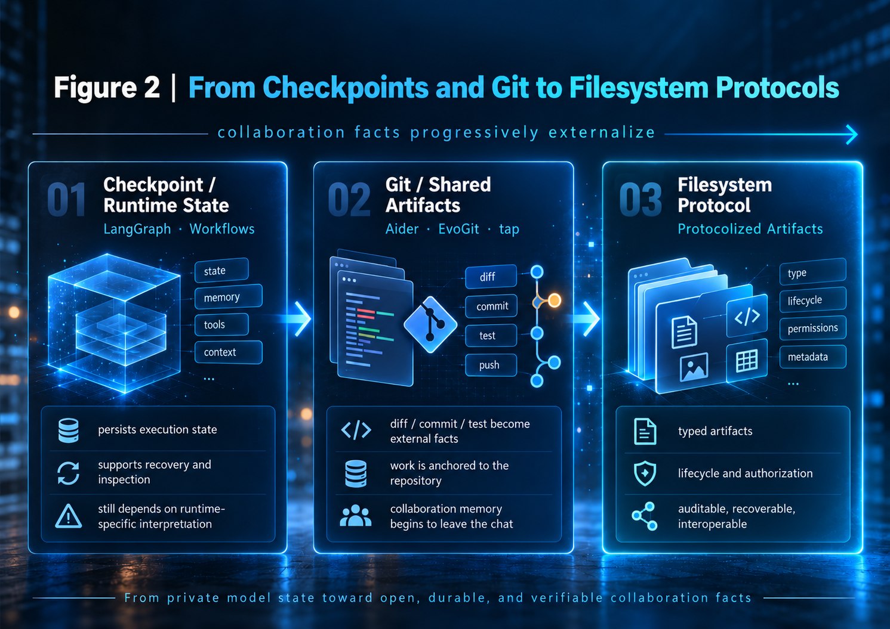
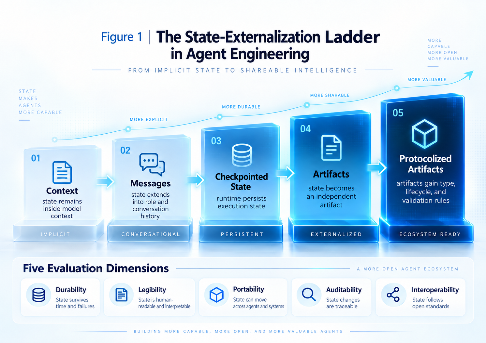

<ArticleCover image="/assets/recommended-articles/2026-09-22-beyond-black-box-externalization/en-cover.png" title="Farewell to the “Black-Box Myth”: Engineering Reflections on Mainstream Agent Frameworks and the Rise of Physical Externalization" summary="Engineering boundaries of state externalization, durability, and shared facts, from agent frameworks to files and protocolized artifacts." version="2026-09-22" languageHref="/zh/research/2026-09-22-beyond-black-box-externalization" languageLabel="中文" />

<ArticleTableScroll language="en" />

## Introduction: The Recurring Cycle of Software Engineering and the Agent Illusion

Looking back at the evolution of computing, every breakthrough primitive seems to trigger a familiar cycle: **the primitive is first mythologized → oversized black-box middleware is built around it → reality pushes back through physical and engineering constraints → the industry eventually rediscovers the low-level boundaries that abstraction could never erase.**

Distributed computing went through this in the 1990s. CORBA and DCOM tried to make remote invocation resemble a local function call as closely as possible, softening the visible boundaries of latency, partial failure, and partitioning. The Web took a different route: it accepted the network as a physical boundary and used HTTP, uniform interfaces, and looser resource semantics to reduce coupling. Enterprise integration followed a similar pattern. Heavyweight ESBs once tried to absorb message orchestration, transformation, and global coordination inside a central bus; later architectures redistributed many of those responsibilities across event streams, commit logs, APIs, and lighter contracts.

The AI Agent industry is now replaying a remarkably similar architectural temptation. A large language model begins as a **probabilistic generator**, yet once it can plan, call tools, write code, and coordinate with other models, we keep assigning it more roles: scheduler, memory system, message bus, state interpreter, and sometimes even the final judge of whether a task is complete.

When production systems repeatedly encounter **task loops, state drift, irreproducible execution, and opaque debugging**, the right question is no longer merely “can the model become smarter?” It is a more fundamental systems question:

> **Are we assigning too many system responsibilities to a component that is excellent at probabilistic cognition but poorly suited to being the sole source of durable truth?**

Over the past three years, the most important change in Agent engineering has not been that models are becoming more human-like. It is that **systems are becoming less willing to trust models to remember everything, coordinate everything, and explain everything by themselves**.

In 2023, prominent Agent systems emphasized iterative reasoning, role play, and natural-language collaboration. By 2025–2026, mainstream engineering frameworks had shifted more responsibility toward durable execution, checkpoints, state inspection, workflow state, and external artifacts. At the same time, EvoGit, tap, PheroPath, SwarmWorld, FCoP, and related work pushed coordination further out of messages and private runtimes and into Git, files, shared environments, and protocolized artifacts.

This does not mean that “the filesystem will replace LangGraph,” nor that stigmergy has been proven superior to centralized orchestration. The more restrained and more important principle is:

> **Agents may be probabilistic, but collaboration facts should not exist only inside probabilistic context.**

From Context to Messages, from Checkpointed State to Artifacts and then Protocolized Artifacts, the real change is a gradual migration of factual authority away from the model’s private context.

The rest of this article examines what papers, frameworks, and open-source projects actually support—and what they do not.

## Background: What Is Actually Changing in Agent Engineering?

The strongest idea in the original argument is the refusal to keep treating the LLM as an omniscient state bus. But to make that claim technically defensible, three misconceptions must be corrected.

**First, the problem is not that LLMs are incapable of self-correction. The problem is that they do not possess a built-in fact-type system.**

Autoregressive models can notice and fix earlier errors. The danger is that once an erroneous output enters subsequent context, it is conditioned together with verified tool observations, user facts, and model speculation. Unless the surrounding system records provenance, validation status, re-fetch rules, and rollback boundaries, there is no native marker saying: “this sentence was only your earlier guess; do not treat it as a database fact.”

Long-context research reinforces this caution. *Lost in the Middle* showed that moving relevant evidence to the middle of a long context can reduce performance for many models. [[7]](https://arxiv.org/abs/2307.03172) Later work has associated these effects with positional attention biases. Newer models have improved in some retrieval settings, so “middle information is always lost” should not be treated as a permanent law.

The engineering principle should therefore be stated as:

> **Do not require the model to maintain, over long periods, which historical statement is the current fact. Put identity, version, validity, and verification status into the system.**

**Second, natural language is not “absurd IPC,” but using open-ended language directly as the control protocol is expensive.**

IPC can be shared memory, pipes, sockets, HTTP, JSON, protobuf, or text. The real distinction is not binary versus textual. Control-plane protocols usually seek low ambiguity, explicit fields, typed errors, idempotency, and machine-verifiable boundaries. Free-form language pushes semantic interpretation back onto a probabilistic model.

AutoGen illustrates the conversation-centric route well: its paper models conversable agents and flexible conversation patterns. [[8]](https://arxiv.org/html/2308.08155v2) Its historical GroupChat design also reflects managed speaker selection and conversation-context passing. By 2026, AutoGen had entered maintenance mode and Microsoft was recommending the Microsoft Agent Framework to new users—another sign that “group chat as architecture” is no longer the only evolutionary path.

**Third, modern Agent frameworks have hybridized. They cannot be classified by a frozen 2023-era product image.**

A better classification asks **where coordination primarily lives**:

| Primary coordination locus | Typical mechanism | Representative examples | Main risk |
|---|---|---|---|
| Context-centric | Model repeatedly reads and extends context | AutoGPT Classic, original BabyAGI | Polluted history, token cost, weak recovery boundaries |
| Conversation-centric | Agents coordinate through messages, group chat, and handoff | AutoGen, MetaGPT, CrewAI Crews | Semantic ambiguity, message growth, complex termination/routing |
| Runtime-state-centric | Graph/event/workflow + checkpoint + deterministic routing | LangGraph, LlamaIndex Workflows, CrewAI Flows, current AutoGPT | Framework coupling, state-schema evolution, runtime-specific recovery |
| Artifact/environment-centric | Git, files, worktrees, shared artifacts, environmental traces | Aider, EvoGit, tap, PheroPath, FCoP, Govcraft, SwarmWorld | Storage semantics, concurrency, metadata scale, artifact governance |

These styles are not mutually exclusive. Aider still uses model context but anchors code changes in Git; CrewAI combines autonomous Crews with controlled Flows; OpenHands combines conversations/events with a real workspace and code artifacts; LangGraph ecosystems increasingly use filesystem-backed tools.

So the evolution is not:

> conversation frameworks → file frameworks

It is closer to:

> **model memory → framework memory → durable artifacts → open governance contracts.**

## Research Scope and Evidence Principles

This article primarily draws on papers and open-source projects from **2021–2026**, focusing on Agent state management, multi-Agent coordination, shared artifacts, Git/file collaboration, externalized memory, and stigmergic coordination. Papers are cited from original or formally published versions whenever possible; engineering claims are grounded primarily in official GitHub repositories, READMEs, and project documentation.

Where implementation details cannot be fully verified from public materials, the article avoids inference and states the verification boundary explicitly. Judgments about reliability, auditability, and engineering complexity are qualitative architectural analyses based on public evidence, not a unified benchmark ranking.

## Evidence Summary: Papers and Open-Source Projects

The papers most relevant to the article’s thesis include:

| Work | Date | Evidence relevant to this article |
|---|---:|---|
| [Lost in the Middle](https://arxiv.org/abs/2307.03172) | 2023; TACL 2024 | Long-context use is position-sensitive; evidence placed in the middle can reduce performance. This does not prove that models “forget,” but it undermines the idea that a context window is a reliable state database. |
| [MetaGPT](https://arxiv.org/abs/2308.00352) | 2023; ICLR 2024 | Organizes multi-Agent software work around roles and SOPs, and explicitly discusses cascading hallucination in naive chaining. |
| [AutoGen](https://arxiv.org/abs/2308.08155) | 2023 | Makes conversational agents and conversation patterns first-class abstractions for multi-Agent applications. |
| [ChatDev](https://arxiv.org/abs/2307.07924) | 2023; ACL 2024 | Decomposes software development into chat chains and adds communication/dehallucination mechanisms. |
| [EvoGit](https://arxiv.org/abs/2506.02049) | 2025-06 | Independent coding agents evolve shared code asynchronously through Git lineage without direct messaging or shared memory. |
| [Externalization in LLM Agents](https://arxiv.org/abs/2604.08224) | 2026-04 | Frames memory, skills, protocols, and harness engineering as externalization of cognitive burden. |
| [tap](https://arxiv.org/abs/2606.14445) | 2026-06 | Uses a file-first protocol, persistent Markdown messages, and Git worktree isolation for heterogeneous LLM-agent collaboration. |
| [SwarmWorld](https://arxiv.org/abs/2608.26081) | 2026-08 | Shows role differentiation and artifact reuse among initially homogeneous agents in a persistent shared environment, while preserving important limits on the superiority of interaction. |

These papers support the claim that **external structure is becoming more important**, not the stronger claim that central orchestration has been proven obsolete.

The open-source landscape is similarly hybrid. AutoGPT has evolved beyond its Classic autonomous-loop image; CrewAI combines Crews and Flows; LangGraph makes checkpoints and durable execution core infrastructure; Aider anchors model edits in Git; PheroPath attaches coordination signals to files; FCoP formalizes typed collaboration artifacts; Govcraft experiments with pressure-field coordination.

## Technical Analysis: From Where State Lives to Where System Facts Live

What makes an Agent system a “black box” is not whether it uses a graph, a database, or files. It is **which layer owns final factual authority**.

### State Carriers Define Failure Boundaries

A context window has almost no infrastructure overhead: the model can read it directly. But guesses, observations, tool results, constraints, and protocol text can collapse into one token stream. As the history grows, cost and positional retrieval risk also grow. *Lost in the Middle* is enough to show that “fits in context” and “can be reliably retrieved” are not equivalent. [[7]](https://arxiv.org/abs/2307.03172)

Chat history is more structured than a monolithic context but is still primarily an event transcript, not authoritative application state. “Agent A said the task is complete” is not the same fact as “the task passed validation and was committed.”

Checkpoint databases improve this substantially. LangGraph makes durable execution and state resume core capabilities; LlamaIndex Workflows can persist workflow state to files or databases. [[5]](https://github.com/langchain-ai/langgraph) [[29]](https://github.com/run-llama/workflows-py)

The artifact-oriented alternative changes the access relationship:

```text
Framework-mediated state:
Human -> SDK -> serializer -> checkpoint -> state

Artifact-mediated state:
Human/tool -> file/git/schema -> state
```

The second structure is easier to inspect out-of-band, but it is not automatically transparent. A 200 MB opaque JSON blob on disk is still a black box. Conversely, a PostgreSQL checkpoint with a stable open schema, versioning rules, and audit API can be highly auditable.

“Physical externalization” should therefore mean:

> **Critical collaboration facts are persisted as artifacts with independent identity, stable semantics, open read paths, and verifiable provenance, so that their lifecycle does not depend on the model session that created them.**

It should not mean:

> “written to a file = externalization complete.”

### Durability, Portability, and Auditability Are Different Properties

| Carrier | Durability | Portability | Auditability | Main note |
|---|---:|---:|---:|---|
| Prompt / context | low–medium | low | low | Transcript can be preserved, but runtime fact boundaries are weak |
| Chat-history DB | medium–high | medium | medium | Has chronology, but message ≠ verified state |
| Private checkpoint | high | medium–low | medium | Strong recovery; cross-framework interpretation depends on schema/API |
| JSON / Markdown artifacts | high* | high | high* | Depends on storage, schema, and provenance |
| Git objects / commits | high | high | high | Excellent for code/text; not ideal for every high-frequency mutable state |
| xattr | medium | low–medium | medium–low | Bound to files, but Git/copy/cross-platform visibility varies |
| Object-store artifacts | high | high | high | Namespace and atomic-transition semantics differ from POSIX |

PheroPath exposes an important paradox: **physical existence does not automatically imply universal visibility.** Hidden xattrs can be elegant, but an explicit sidecar JSON file may be easier for Git, CI, backups, and cross-language tools to consume.

### Control Flow Is Moving from Language Semantics Toward Deterministic Boundaries

CrewAI now pairs role-based Crews with event-driven Flows that support structured state, branching, and routing. [[44]](https://github.com/crewAIInc/crewAI)

LangGraph makes durable workflow and state transition part of its orchestration layer. [[5]](https://github.com/langchain-ai/langgraph)

LlamaIndex Workflows uses async functions that produce and consume events while supporting loops, parallelism, persistence, and recovery. [[29]](https://github.com/run-llama/workflows-py)

These systems are converging on a common principle:

> **“What happens next” should not always be decided by asking the model to say one more thing.**

The model is well suited to:

```text
Unstructured input
    ↓
Candidate structured decision
```

The workflow layer should own:

```text
Candidate decision
    ↓
Validation
    ↓
Authorized state transition
```

The goal is not to make every model call literally stateless. Real Agents have tool sessions, caches, memory, and side effects. The goal is to prevent any one model call from having exclusive authority over global system facts.

### Stigmergy Reduces Direct Coordination Dependence; It Does Not Eliminate Coordination

SwarmWorld, EvoGit, and Govcraft support the idea that a shared environment, Git genealogy, or shared-state pressure field can become a **first-class coordination medium**, rather than merely passive storage after a conversation. [[14]](https://arxiv.org/abs/2506.02049) [[22]](https://arxiv.org/abs/2608.26081) [[35]](https://github.com/Govcraft/pressure-field-experiment)

That does not prove that “stigmergy always beats conversation.”

A more defensible conclusion is:

> **For problems with a shared constraint surface, where local actions leave measurable environmental changes and solutions can accumulate through local improvement, stigmergic coordination deserves to be compared directly with conversation and hierarchy as an independent architectural baseline.**

Strongly transactional workflows, approval chains, and regulated processes still require explicit accountability and global invariants.

### Atomicity Is Where Physical Externalization Is Most Easily Romanticized

FCoP treats `os.rename()` as an important synchronization primitive on shared directory trees, but FCoP 4.0.3 has evolved far beyond “directory + Markdown + rename.” Its public protocol semantics include TASK / REPORT / ISSUE / REVIEW, Attempt, relations, authorization, Branch Family convergence, idempotency, and crash-safe recovery.

The attraction of filesystem state transitions is obvious:

```text
inbox/TASK-123.md
      |
      | atomic namespace transition
      v
active/TASK-123.md
      |
      | result validated
      v
review/TASK-123.md
      |
      | accepted
      v
done/TASK-123.md
```

But four concepts must remain separate:

```text
atomic visibility
≠
exclusive ownership
≠
crash durability
≠
distributed consensus
```

A same-filesystem rename can help guarantee that observers do not see a half-renamed path. It does not solve every distributed-consistency problem.

Object storage makes the distinction even clearer. General-purpose S3 historically implements renaming through copy plus delete, while S3 Express One Zone directory buckets now expose atomic `RenameObject`. [[42]](https://docs.aws.amazon.com/AmazonS3/latest/userguide/directory-buckets-objects-rename.html) [[43]](https://docs.aws.amazon.com/AmazonS3/latest/API/API_RenameObject.html)

The engineering lesson is not to force every backend to behave like POSIX. It is to separate protocol invariants from backend-specific storage primitives.

### Small Files, Orphaned State, and Recovery Do Not Disappear by Declaration

There is no universal file-count threshold at which every filesystem “fails.” The general problem is that, at scale, cost shifts from payload I/O toward namespace and metadata operations, directory scanning, indexing, watching, backup, retention, antivirus, and synchronization.

A better design uses hot/cold tiers, immutable event segments, compacted snapshots, and archival storage.

Likewise, “orphan lock” is only one ownership pattern. With immutable attempts, process death can leave an incomplete attempt instead of a permanent blocking lock:

```text
task-42/
    attempt-001/  failed
    attempt-002/  expired
    attempt-003/  accepted
```

The recovery principle is:

> **Do not recover by erasing the accident. Recover by making the accident a legitimate part of history.**

### The Real Advantage of Externalization Is Not “It Cannot Fail”

Exposing state through a filesystem or object store does not automatically solve concurrency, identity, authorization, schema migration, or recovery.

Its greatest advantage is not that it “never fails.” It is this:

> **When it fails, there is a better chance that the failure leaves facts a third party can inspect.**



*Figure 2 | From Checkpoints and Git to Filesystem Protocols: collaboration facts progressively externalize.*

## Case Deep Dive: From Checkpoints and Git to Filesystem Protocols

### LangGraph: Beyond the “In-Memory Black Box,” but Still Runtime-Defined

LangGraph explicitly positions itself as a low-level orchestration framework for long-running, stateful agents and makes durable execution, failure resume, human state inspection, and persistent memory core capabilities. [[5]](https://github.com/langchain-ai/langgraph)

So the criticism “LangGraph crashes and all state is lost” is obsolete.

The more accurate structure is:

```text
LLM / Tool Node
      ↓
Graph Transition
      ↓
Framework State
      ↓
Checkpoint
      ↓
Persistent Backend
```

The deeper question is whether a checkpoint can be understood by another language or governance tool without importing LangGraph, starting the original Python application, or reconstructing the original node semantics.

If not, the state remains partly enclosed by the runtime. This is not a defect so much as the natural price of a runtime abstraction.

A pragmatic design keeps both:

```text
LangGraph internal checkpoint
           +
external canonical artifacts
```

Internal checkpoint state serves recovery; canonical artifacts serve cross-framework fact exchange.

### Aider: The Important Lesson Is Git as a Fact Anchor, Not SPEC.md

The claim that Aider requires every task to be materialized into `SPEC.md` or checkbox files is not supported by its official architecture.

What Aider explicitly does is map the repository, make Git commits, allow ordinary Git diff/manage/undo workflows, and run lint/test after changes. [[9]](https://github.com/Aider-AI/aider) [[30]](https://github.com/Aider-AI/aider)

The important pipeline is:

```text
Prompt / conversation
        ↓
candidate edit
        ↓
working tree
        ↓
git diff
        ↓
lint / test
        ↓
commit
```

The model saying:

> “I fixed it.”

is not the fact.

The facts are:

```text
diff exists
test exit code = 0
commit hash = ...
```

This is a migration from linguistic claims to externally verifiable engineering facts.

### PheroPath: A Powerful Idea—and an Auditability Paradox

PheroPath is one of the most literal “digital pheromone” experiments. [[32]](https://github.com/zi-yue-1129/PheroPath)

It stores signals such as:

```text
DANGER
TODO
SAFE
INSIGHT
```

through filesystem extended attributes or sidecar JSON, with CLI operations such as `sniff`, `secrete`, and `cleanse`, plus temporal decay and editor visualization.

The key insight is simple:

> **Context should be attached to the object being acted upon, not only to one conversation with the model.**

But PheroPath also reveals a hierarchy inside “externalization”:

```text
exists on disk
     ≠
visible to ordinary tools
     ≠
tracked by Git
     ≠
portable across platforms
```

For governance-critical data, an explicit sidecar artifact may be less elegant than xattr but easier for Git review, CI, backup, and object-store migration.

### FCoP: From “Files as an Implementation Detail” to “Files Carry Protocol Semantics”

FCoP is a particularly useful example of **Protocolized Artifacts**.

Its formal name is **File-based Coordination Protocol**. `Filename as Protocol` is one of its core design ideas. Its paper/research record is published at DOI `10.5281/zenodo.22855630`; the latest code archive is Zenodo Record `22746175`, version 4.0.3. [[33]](https://joinwell52-ai.github.io/FCoP/) [[37]](https://github.com/joinwell52-AI/FCoP)

FCoP 4.0.3 publicly defines:

```text
TASK / REPORT / ISSUE / REVIEW
        ↓
explicit lifecycle
        ↓
Attempt / Relation / Authorization
        ↓
Root TASK + Branch Family
        ↓
family inspection + explicit convergence
        ↓
durable REVIEW / merge record
        ↓
idempotency + crash-safe recovery
```

Its significance is no longer merely “state mapped to folders.” It attempts to make collaboration facts carry explicit type, identity, state transition, authorization, relation, and recovery semantics.

FCoP also states its boundary: it is not itself a scheduler, Agent runtime, LLM SDK, database, or automatic merge-decision engine. Its value in this discussion lies in trying to make collaboration facts outlive any one model session or private runtime.

That does not make the filesystem a universal distributed-systems solution. Atomicity, backend adaptation, identity, schema evolution, binary artifacts, and security remain real engineering boundaries.

### Govcraft and SwarmWorld: Valuable Because They Do Not Fully Support the Strongest Claim

Govcraft reports 270 meeting-room scheduling trials with the following solve rates:

| Strategy | Solve rate |
|---|---:|
| Pressure field | 48.5% |
| Conversation-style | 12.6% |
| Hierarchical | 1.5% |
| Sequential | 0.4% |
| Random | 0.4% |

[[35]](https://github.com/Govcraft/pressure-field-experiment)

This shows that, on that benchmark, the stigmergy-inspired shared-state pressure field clearly outperformed the authors’ baselines.

It does **not** show that hierarchy generally succeeds only 1.5% of the time in Agent systems.

SwarmWorld provides richer but similarly bounded evidence: shared societies build broader and more resilient technology portfolios; roles emerge; much reuse begins with environmental observation; yet isolated best-of-N search can still produce competitive best single artifacts. [[22]](https://arxiv.org/abs/2608.26081)

Together they support this narrower conclusion:

> **The environment can be a first-class coordination medium, not merely passive storage written after conversation.**

### A Physical-Externalization Workflow

A practical production pattern looks like this:

```text
Task Queue / Workflow
        ↓
Canonical Task Artifact
        ↓
Agent Worker
        ↓
Candidate / Attempt Artifact
        ↓
Deterministic Validator
   ┌───────────────┐
   │               │
failed          passed
   │               │
new attempt     review / done
   │               │
   └──── evidence ─┘
```

The LLM no longer acts as the global state machine. It does what probabilistic cognition is good at: understanding open-ended problems, proposing candidate changes, summarizing, and planning. Final state transitions depend on external evidence.

## Practice Route: Do Not “Migrate to Files”; Migrate to an Open Fact Contract

The practical goal is not to rewrite the Agent stack overnight. It is to gradually reduce the private runtime’s monopoly on factual authority.

### 1. Separate Transcript, Working State, and Canonical Fact

```text
Transcript
    what the Agent said

Working State
    where the runtime currently is

Canonical Facts
    what has been verified and committed
```

“Tests pass” in a message is transcript. A validation record containing the commit, exit code, test-suite version, and timestamp can participate in a state transition.

### 2. Let Model Output Become a Candidate Before It Becomes State

```text
LLM proposal
    ↓
Schema validation
    ↓
Deterministic / externally verifiable checks
    ↓
Commit
```

The core rule is:

> **“The model says the state should change” and “the system permits the state change” must be two different events.**

### 3. Keep Runtime Checkpoints, but Add a Canonical Artifact Boundary

LangGraph, CrewAI, and workflow-runtime checkpoints remain valuable for execution recovery. There is no need to delete them in the name of externalization.

Use dual state:

```text
internal checkpoint
    -> serves resume

canonical artifacts
    -> serve collaboration, audit, and interoperability
```

During migration, dual-write and reconcile until canonical artifacts can become the cross-system authority.

### 4. Treat Storage Semantics, Attempts, and Schemas as Part of the Protocol

Do not pretend POSIX is universal. Local filesystems, general-purpose S3, S3 Express, databases, and Git all have different transition primitives. [[42]](https://docs.aws.amazon.com/AmazonS3/latest/userguide/directory-buckets-objects-rename.html) [[43]](https://docs.aws.amazon.com/AmazonS3/latest/API/API_RenameObject.html)

Prefer immutable attempts over repeatedly overwriting one state object:

```text
task-id
  ├─ attempt-001 [expired]
  ├─ attempt-002 [failed]
  └─ attempt-003 [accepted]
```

Governance fields should also be structured and validatable, rather than buried only inside natural-language prose.

### 5. Test Four System Invariants

**Safety**: unverified candidates must never become canonical facts.  
**Liveness**: failed workers must not permanently block progress.  
**Auditability**: every committed transition must trace back to its inputs and evidence.  
**Portability**: a third-party implementation must be able to interpret canonical state without the original Agent session.

If these four properties hold, the underlying store may be LangGraph, PostgreSQL, Git, a POSIX filesystem, S3, or a hybrid.

If they do not, even a directory tree can become a filesystem-shaped black box.



*Figure 1 | The State-Externalization Ladder: Context → Messages → Checkpointed State → Artifacts → Protocolized Artifacts.*

## Conclusion and Future Research

What Agent engineering needs to abandon is not one particular framework. It is a deeper myth:

> **If the model becomes capable enough, it can simultaneously serve as reasoner, state machine, database, scheduler, message bus, authorization arbiter, and auditor.**

Recent engineering evolution is steadily undermining that assumption. AutoGPT has moved from a standalone autonomous-agent image toward a workflow platform; CrewAI places Crews beside Flows; LangGraph makes checkpoints, durable execution, and state inspection foundational; Aider returns diff, commit, lint, and test to mature software-engineering tools; EvoGit, tap, PheroPath, and FCoP anchor collaboration facts in Git, files, shared environments, and protocolized artifacts. [[24]](https://github.com/Significant-Gravitas/AutoGPT) [[44]](https://github.com/crewAIInc/crewAI) [[5]](https://github.com/langchain-ai/langgraph) [[30]](https://github.com/Aider-AI/aider) [[14]](https://arxiv.org/abs/2506.02049) [[45]](https://arxiv.org/abs/2606.14445) [[32]](https://github.com/zi-yue-1129/PheroPath) [[37]](https://github.com/joinwell52-AI/FCoP)

The “rise of physical externalization” should therefore be retained, but redefined.

It does **not** mean:

> Filesystem will replace Agent frameworks.

It means:

> **Canonical collaboration state should progressively escape the exclusive custody of model context and proprietary runtime state.**

That state may live in files, Git, append-only event logs, databases, content-addressed stores, or object storage. What matters is that it be:

```text
Persistent
Explicit
Addressable
Versioned
Inspectable
Validatable
Replayable
Portable
```

Stigmergy, Physical Externalization, storage media, and concrete protocols occupy different abstraction layers:

```text
Stigmergy
    │
    │  coordination principle
    ▼
Physical Externalization
    │
    │  systems-design principle
    ▼
Filesystem / Git / DB / Object Store / Artifact Graph
    │
    │  implementation media
    ▼
FCoP / tap / PheroPath / project-specific contracts
       concrete protocols and tools
```

Mature next-generation Agent infrastructure is therefore unlikely to be “pure stigmergy” or “pure workflow.” It will more likely be hybrid:

```text
              ┌─────────────────────────┐
              │  Deterministic Workflow │
              │ policy / routing / auth │
              └────────────┬────────────┘
                           │
             candidate work│
                           ▼
┌───────────────┐   ┌──────────────────────┐
│ LLM Workers   │──▶│ Canonical Artifacts  │
│ probabilistic │   │ schema + provenance  │
└───────────────┘   └──────────┬───────────┘
                               │
                  ┌────────────┼─────────────┐
                  ▼            ▼             ▼
               Git/FS       Database     Object Store
                  │            │             │
                  └────────────┼─────────────┘
                               ▼
                       Validators / CI
                               │
                               ▼
                     Committed State
```

The most important future research questions are not “which Agent prompt is smartest,” but at least five deeper problems.

First, **artifact coordination benchmarks**: compare conversation, supervisor, graph workflow, shared artifacts, stigmergy, and hybrids under the same task, model, and compute budget.

Second, **portable Agent-state standards**: durable state still lacks a minimal cross-runtime fact contract comparable to OpenTelemetry or OCI manifests.

Third, **artifact provenance and security**: future attack surfaces include forged TASK artifacts, modified front matter, malicious pheromones, replayed stale artifacts, and filename-based routing attacks.

Fourth, **namespace economics at scale**: large Agent fleets may create millions of attempts, observations, and validation artifacts per day, forcing serious work on compaction, snapshots, content addressing, hot/cold tiers, indexing, and retention.

Fifth, **the real boundary of human–Agent isomorphism**: Markdown is excellent for human readability, while protobuf or database schemas can reintroduce runtime dependence. A durable artifact ecosystem must find a way to combine a human-readable surface with a machine-verifiable core.

Ultimately, mature Agent infrastructure should not be designed around the assumption that “the model never makes mistakes.”

That goal is unrealistic.

The better goal is:

> **Prevent mistakes from silently becoming system facts.**

Models may misjudge, hallucinate, crash, upgrade, switch vendors, or forget what they said one session earlier.

But why a task entered `DONE`, which input produced which patch, which test passed, who approved the transition, which worker failed on which version, and which constraint was valid at the time should not depend on whether the model still remembers.

**The model proposes possibilities.  
Validators judge evidence.  
Workflows constrain transitions.  
Persistent media preserve facts.  
Open protocols keep facts from belonging to any one framework.**

That is the Agent engineering worth pursuing after the black-box myth.

And this is why the most durable idea in “physical externalization” is not “Filesystem forever,” but a more fundamental systems principle:

> **Agents may be probabilistic; coordination may be emergent; but facts that have happened and been accepted by the system must be addressable, verifiable, recoverable, and auditable.**

When an Agent system reaches that point, the large language model can finally move from being imagined as the brain of the entire system back to the role it is best and safest at: **a powerful but replaceable cognitive execution unit, rather than the sole memory and source of truth for the digital world.**


---

## Sources

[[1]](https://github.com/Significant-Gravitas/AutoGPT) [[24]](https://github.com/Significant-Gravitas/AutoGPT) GitHub - Significant-Gravitas/AutoGPT: AutoGPT is the vision of accessible AI for everyone, to use and to build on. Our mission is to provide the tools, so that you can focus on what matters. · GitHub

https://github.com/Significant-Gravitas/AutoGPT

[[2]](https://github.com/langchain-ai/langgraph) [[5]](https://github.com/langchain-ai/langgraph) [[39]](https://github.com/langchain-ai/langgraph) GitHub - langchain-ai/langgraph: Build resilient agents. · GitHub

https://github.com/langchain-ai/langgraph

[[3]](https://arxiv.org/abs/2506.02049) [[14]](https://arxiv.org/abs/2506.02049) EvoGit: Decentralized Code Evolution via Git-Based Multi-Agent Collaboration

https://arxiv.org/abs/2506.02049

[[4]](https://arxiv.org/abs/2604.08224) [[47]](https://arxiv.org/abs/2604.08224) Externalization in LLM Agents: A Unified Review of Memory, Skills, Protocols and Harness Engineering

https://arxiv.org/abs/2604.08224

[[6]](https://docs.aws.amazon.com/AmazonS3/latest/API/API_RenameObject.html) [[43]](https://docs.aws.amazon.com/AmazonS3/latest/API/API_RenameObject.html) RenameObject - Amazon S3

https://docs.aws.amazon.com/AmazonS3/latest/API/API_RenameObject.html

[[7]](https://arxiv.org/abs/2307.03172) [[10]](https://arxiv.org/abs/2307.03172) [[38]](https://arxiv.org/abs/2307.03172) Lost in the Middle: How Language Models Use Long Contexts

https://arxiv.org/abs/2307.03172

[[8]](https://arxiv.org/html/2308.08155v2) [[12]](https://arxiv.org/html/2308.08155v2) Enabling Next-Gen LLM Applications via Multi-Agent Conversation

https://arxiv.org/html/2308.08155v2

[[9]](https://github.com/Aider-AI/aider) [[30]](https://github.com/Aider-AI/aider) GitHub - Aider-AI/aider: aider is AI pair programming in your terminal · GitHub

https://github.com/Aider-AI/aider

[[11]](https://arxiv.org/html/2308.00352v7) MetaGPT: Meta Programming for a Multi-Agent Collaborative Framework

https://arxiv.org/html/2308.00352v7

[[13]](https://arxiv.org/html/2307.07924v5) ChatDev: Communicative Agents for Software Development

https://arxiv.org/html/2307.07924v5

[[15]](https://arxiv.org/html/2601.13295v1) CooperBench: Why Coding Agents Cannot be Your Teammates Yet

https://arxiv.org/html/2601.13295v1

[[16]](https://arxiv.org/html/2604.07821v2) More Capable, Less Cooperative? When LLMs Fail At Zero-Cost ...

https://arxiv.org/html/2604.07821v2

[[17]](https://arxiv.org/html/2605.03310v1) Coordination as an Architectural Layer for LLM-Based Multi-Agent Systems

https://arxiv.org/html/2605.03310v1

[[18]](https://arxiv.org/html/2603.21489v2) Effective Strategies for Asynchronous Software Engineering Agents

https://arxiv.org/html/2603.21489v2

[[19]](https://arxiv.org/html/2606.19911v1) Multi-Agent Transactive Memory

https://arxiv.org/html/2606.19911v1

[[20]](https://arxiv.org/html/2606.30668v1) Emergent Culture in Minimal LLM Systems

https://arxiv.org/html/2606.30668v1

[[21]](https://arxiv.org/abs/2606.14445) [[45]](https://arxiv.org/abs/2606.14445) [[48]](https://arxiv.org/abs/2606.14445) tap: A File-Based Protocol for Heterogeneous LLM Agent Collaboration

https://arxiv.org/abs/2606.14445

[[22]](https://arxiv.org/abs/2608.26081) [[36]](https://arxiv.org/abs/2608.26081) SwarmWorld: Stigmergic technological evolution in societies of language-model agents

https://arxiv.org/abs/2608.26081

[[23]](https://arxiv.org/html/2604.05080v1) Nidus: Externalized Reasoning for AI-Assisted Engineering

https://arxiv.org/html/2604.05080v1

[[25]](https://github.com/yoheinakajima/babyagi) yoheinakajima/babyagi

https://github.com/yoheinakajima/babyagi

[[26]](https://github.com/geekan/MetaGPT) GitHub - FoundationAgents/MetaGPT: 🌟 The Multi-Agent Framework: First AI Software Company, Towards Natural Language Programming · GitHub

https://github.com/geekan/MetaGPT

[[27]](https://github.com/microsoft/autogen) GitHub - microsoft/autogen: A programming framework for agentic AI · GitHub

https://github.com/microsoft/autogen

[[28]](https://github.com/crewAIInc/crewAI) [[40]](https://github.com/crewAIInc/crewAI) [[44]](https://github.com/crewAIInc/crewAI) GitHub - crewAIInc/crewAI: Framework for orchestrating role-playing, autonomous AI agents. By fostering collaborative intelligence, CrewAI empowers agents to work together seamlessly, tackling complex tasks. · GitHub

https://github.com/crewAIInc/crewAI

[[29]](https://github.com/run-llama/workflows-py) GitHub - run-llama/workflows-py: event-driven, async-first workflows for AI applications

https://github.com/run-llama/workflows-py

[[31]](https://github.com/OpenHands/OpenHands) GitHub - OpenHands/OpenHands: AI-Driven Development · GitHub

https://github.com/OpenHands/OpenHands

[[32]](https://github.com/zi-yue-1129/PheroPath) GitHub - zi-yue-1129/PheroPath: stigmergy-based file pheromones for AI Agents · GitHub

https://github.com/zi-yue-1129/PheroPath

[[33]](https://joinwell52-ai.github.io/FCoP/) FCoP — A File-based Coordination Protocol for Multi-Agent AI Systems

https://joinwell52-ai.github.io/FCoP/

[[34]](https://github.com/joinwell52-AI) joinwell52-AI

https://github.com/joinwell52-AI

[[35]](https://github.com/Govcraft/pressure-field-experiment) [[46]](https://github.com/Govcraft/pressure-field-experiment) GitHub - Govcraft/pressure-field-experiment: stigmergy-inspired pressure-field coordination for multi-agent LLM systems · GitHub

https://github.com/Govcraft/pressure-field-experiment

[[37]](https://github.com/joinwell52-AI/FCoP) [[41]](https://github.com/joinwell52-AI/FCoP) GitHub - joinwell52-AI/FCoP: File-based Coordination Protocol for Multi-Agent AI Systems · GitHub

https://github.com/joinwell52-AI/FCoP

[[42]](https://docs.aws.amazon.com/AmazonS3/latest/userguide/directory-buckets-objects-rename.html) Renaming objects in directory buckets - Amazon Simple Storage Service

https://docs.aws.amazon.com/AmazonS3/latest/userguide/directory-buckets-objects-rename.html

[[49]](https://doi.org/10.5281/zenodo.22855630) FCoP paper / research record — DOI 10.5281/zenodo.22855630

https://doi.org/10.5281/zenodo.22855630

[[50]](https://zenodo.org/records/22746175) FCoP v4.0.3 code archive — Zenodo Record 22746175

https://zenodo.org/records/22746175

---

*Chinese Editions:* [CSDN](https://blog.csdn.net/m0_51507544/article/details/166372784) · [Juejin](https://juejin.cn/post/7688170325382955008) · [Zhihu](https://zhuanlan.zhihu.com/p/2085851673977677544)  
*Research Artifacts:* [FCoP (Zenodo)](https://zenodo.org/records/22855630) · [FCoP Repository](https://github.com/joinwell52-AI/FCoP) · [Research repository](https://github.com/joinwell52-AI/joinwell52)

