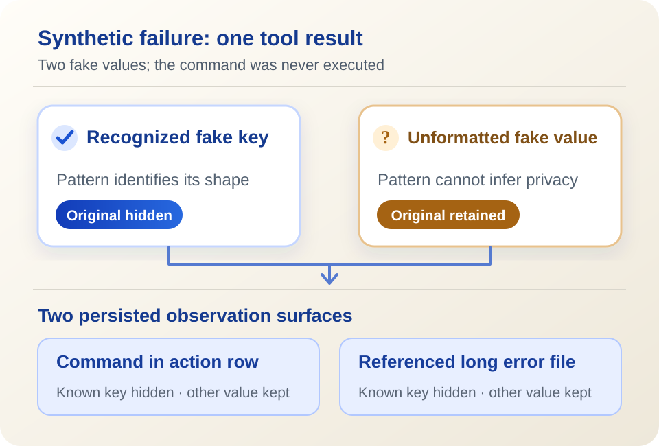

<ArticleCover image="/assets/error-log-boundary-20261102/failure-log.cover-v1.png" kicker="Engineering research · Failure and evidence" title="When an AI tool fails, what else does the log keep?" summary="A synthetic failure showed us two outcomes: a recognizable fake key was hidden, while a private marker without a known shape stayed in the record." version="2026-11-02" languageHref="/zh/research/2026-11-02-ai-failure-log-boundary" languageLabel="中文" />

<ArticleTableScroll language="en" />

# When an AI tool fails, what else does the log keep?

An AI assistant runs a command for you, and the command fails. Keeping the command, exit status, and error output sounds sensible: otherwise, how would anyone tell whether it ran and where it stopped? But error output can contain data from programs, services, and users. Some of it may not belong in an ordinary diagnostic record.

That creates a real engineering tension: **too little evidence makes failures hard to investigate; too much can retain private content indefinitely.** We tested one boundary in our own CodeFlowMu system to see what it actually keeps.

## Why these two days raised the question

On November 1, [OpenAI Agents Python improved incomplete-stream errors](https://github.com/openai/openai-agents-python/pull/5457) with request and response IDs, event counts, and the last event type, without putting prompts or model output in the error. That improves correlation; it does not repair the interrupted stream. [The MCP TypeScript SDK added tracing](https://github.com/modelcontextprotocol/typescript-sdk/pull/3115) that records spans and timing without tool arguments or results by default. Both illustrate a useful starting point: record **which attempt reached which step** before collecting the entire payload.

Yet a policy named “redaction” does not necessarily govern every observer. [LangGraph's change](https://github.com/langchain-ai/langgraph/pull/9486) separates selected tracers from other callback handlers: the policy-processed payload goes to those tracers, while other handlers still receive the actual business payload. On November 2, [Orkas changed its IPC logging boundary](https://github.com/Orkas-AI/Orkas/pull/154) to summarize failure text in logs while preserving the original error reply for the caller. These are different paths in different products, not evidence of the same CodeFlowMu defect. They led us to ask: **where does our failure text go?**

CodeFlowMu is our local multi-agent work system. It records tool calls as action evidence so work can be checked later. FCoP keeps the formal task and report ledger. This experiment concerns CodeFlowMu's **action log**, not FCoP's decision about whether a task is complete.

## One failed result, two fake private values

We pinned CodeFlowMu V3.0.129 and passed a **synthetic, unexecuted** failed tool result through its existing tool-call recording entry point. It reported a nonzero exit. The command and error text contained two fake values: one shaped like a recognized API key, and one private marker with no standard format. We padded stderr beyond 4,096 characters to trigger a separate output file, then inspected the action row and its referenced file.

| Surface | Known fake key | Other fake value |
| --- | --- | --- |
| Command in the action row | Original hidden | Original retained |
| Separately stored long error output | Original hidden | Original retained |

<figure>
  <picture>
    <source media="(max-width: 640px)" srcset="/assets/error-log-boundary-20261102/failure-log.figure.mobile.en.svg" />
    
  </picture>
  <figcaption>Two observation surfaces for the same synthetic failure. This does not depict a real credential leak.</figcaption>
</figure>

This does not mean redaction did nothing. It handled the known shape and also masks structured values under sensitive field names. The action row kept useful structure too: `failed`, failure class `unknown`, and a reference to the long output file. But a pattern rule cannot know that arbitrary text without a recognized prefix or field name is private. The category and the full text therefore coexist in the evidence path.

We also ran the 26 related existing tests. All passed. They verify the known token patterns, sensitive fields, and action-log behavior they actually cover. They do not promise to recognize every possible private string. **The passing suite and our retained-value observation are compatible.**

## Does preserving evidence require preserving every byte?

This experiment did not establish an actual data leak. The values were synthetic; no provider was contacted. We did not test read permissions, upload paths, or retention in a deployed product instance. The finding is narrower: at this module entry point, some unrecognized input is persisted in the local action row and referenced file.

The better design question is what a reviewer needs to establish that a failure occurred. Task and call identities, time, exit status, failure class, and a verifiable reference support some judgments. In a case where an external action may have happened before the error, the full output may still matter. We therefore see **action facts** and **detailed text** as materials that may need different access, retention, and deletion rules. That is a design direction to verify, not a policy CodeFlowMu has implemented.

The next investigation must identify who can read the files in an actual product instance, which reviews truly need the raw text, and what other observation paths exist. Our [bilingual evidence summary and probe](https://github.com/joinwell52-AI/joinwell52/blob/main/research/manual-runs/2026-11-02-error-log-boundary/00-report.en.md) give the pinned version and limits. The tested CodeFlowMu source is private, so public readers cannot independently replay that layer.

For engineers: **if you keep only a summary, how do you rule out an unknown external effect? If you keep the full text, who controls access and deletion?** For everyone using an AI assistant: would you want the product to say clearly where a complete error is stored and for how long?
