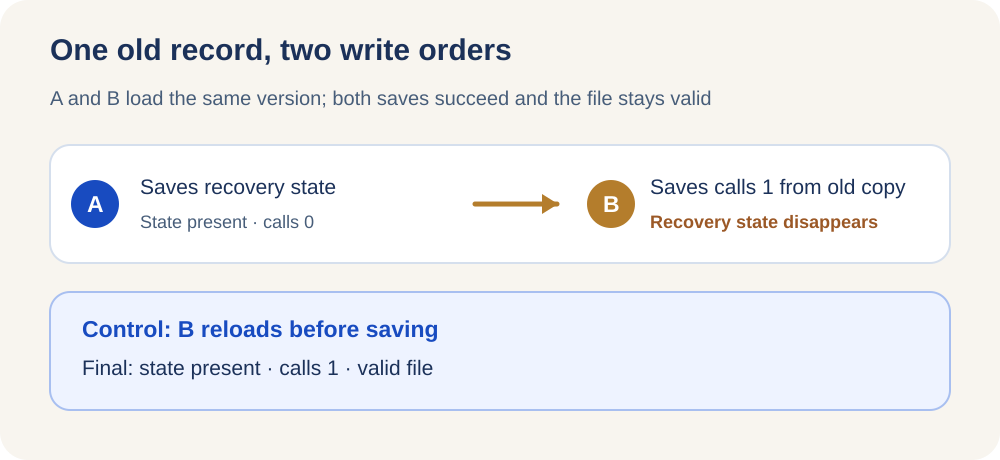

<ArticleCover image="/assets/session-write-boundary-20261103/session-write.cover-v1.png" kicker="Engineering research · Concurrent writes" title="The file is intact. Where did the other update go?" summary="Both saves returned successfully and the file stayed valid. One change was gone when we reopened it." version="2026-11-03" languageHref="/zh/research/2026-11-03-atomic-write-lost-update" languageLabel="中文" />

<ArticleTableScroll language="en" />

# The file is intact. Where did the other update go?

You and a colleague open the same work record. You mark the job as still recovering; your colleague records one tool call. Both of you save and see no error. When you open the record again, the tool count is current but the recovery state has vanished. The file is neither corrupt nor half written. **One decision was lost.**

That distinction matters in an AI team, too. CodeFlowMu, our local multi-agent runtime, stores metadata for a running session. FCoP keeps formal tasks and delivery reports as separate files. We asked a narrow question: **Does “atomic save” guarantee only an intact file, or does it also retain changes made by two writers?**

## The external change that prompted our test

A [Google ADK SQLite change](https://github.com/google/adk-python/commit/bc0b41871699a70a3bf1169bb7e7ff91d2db5e31) supplied the starting point. Its earlier path checked a session's update time before starting a write transaction. Two writers could each pass that check against the old state and then commit in turn. The change begins an immediate write transaction before the stale-state check, so the second writer checks after the first commit. This is a fix to ADK's own database path, not evidence that CodeFlowMu suffered the same incident.

Our systems have a different pair of storage objects. **Session metadata** repeatedly replaces a file under the same identity. Each **FCoP report** receives its own file identity. Calling both of these “persisted” hides the difference between preserving evidence and updating one current-state projection.

## Two successful saves, one missing field

We pinned CodeFlowMu V3.0.152 and invoked the actual `SessionStore` module in a temporary directory. No agent ran and no production task was touched. The initial tool count was zero. Writer A and writer B each loaded the same old record. A set the recovery state to “managed job running” and saved. B changed the tool count to one on its own old snapshot and saved. Both `save()` calls resolved.

| Observation | Recovery state | Tool calls | File integrity |
| --- | --- | ---: | --- |
| After A saved | Present | 0 | Valid JSON |
| After B saved its old snapshot | **Absent** | 1 | Valid JSON |
| Control: B reloaded after A saved | Present | 1 | Valid JSON |

This was a deterministic read/read/write/write interleaving, not a randomly observed race. The control changed only whether B reloaded before writing. It preserved both fields. The [English evidence record](https://github.com/joinwell52-AI/joinwell52/blob/main/research/manual-runs/2026-11-03-session-write-boundary/00-report.en.md) gives the fixed versions, scripts, observations, and limits.

<figure>
  <picture>
    <source media="(max-width: 640px)" srcset="/assets/session-write-boundary-20261103/write-sequence-mobile.en.svg" />
    
  </picture>
  <figcaption>A deterministic module-level sequence, not a race observed in a live runtime.</figcaption>
</figure>

CodeFlowMu writes a temporary file and renames it over the target. That prevents a reader from seeing half a JSON document. It does not ask whether the document still has the version on which the writer based its change. **Atomic replacement can preserve file integrity without preserving both updates.** Seventeen existing focused tests for loading, saving, and atomic replacement all passed. They did not test stale-snapshot conflict handling, so their success is consistent with this result.

## Why both FCoP reports remained

In a separate temporary workspace, we used the real FCoP `Project` API to create a synthetic task and write two reports. They cited the same task but received distinct filenames. Both bodies were still readable afterward.

This was a sequential-write control. It does not prove concurrent numbering, crash recovery, or the complete CodeFlowMu-to-FCoP path. It shows why the objects need different rules: **a report is a new piece of evidence with its own identity; session metadata is a mutable description of the current state and needs an explicit rule for stale writers.** Losing a field from a session projection would not, by itself, prove that a formal REPORT file was deleted. Preserving reports would not prove that the session state was correct.

## The next question is who gets to win

In the present source, `SessionManager` can load a record, await an SDK cancellation, and then save a cancelled state. Its natural-settlement path also loads, computes, and saves a terminal state. Both have asynchronous intervals. That makes their ordering worth testing. **Our experiment confirms the module's stale-snapshot behavior; it does not reproduce a harmful cancellation/settlement race in a real runtime or establish a production incident rate.** We therefore have not classified it as a confirmed product failure or an immediate development task.

The next falsifiable test should hold cancellation and natural settlement at a controlled point after the same read, release the writes in each order, and compare the on-disk state, report reference, and both callers' receipts. Only then can we decide whether a single writer, a version-based rejection, or a defined field merge is appropriate. Each choice must say which fact—cancellation requested, execution ended, or report filed—an older writer may never erase.

For your own system, ask what **save succeeded** actually means: “the file is intact,” or “the version I edited was still current”? If you have seen two successful saves followed by a missing change, how should the application surface that conflict?
