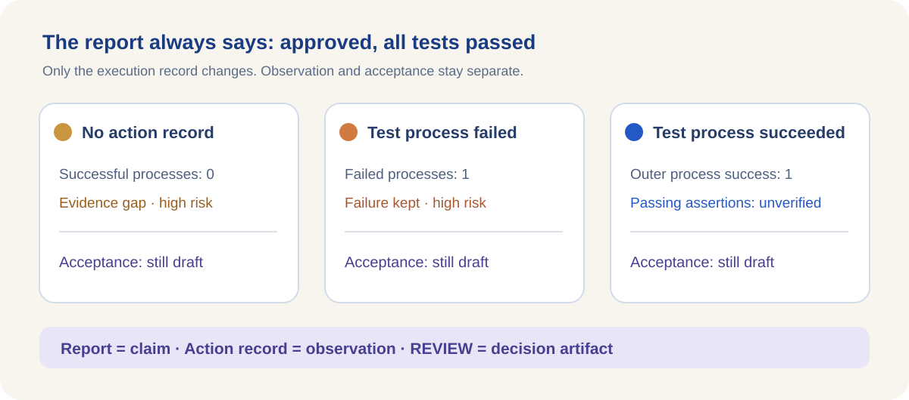

<ArticleCover image="/assets/independent-evidence-20261104/approval-claim.cover-v1.png" kicker="Engineering research · Evidence and acceptance" title="An AI says “approved and passed.” What counts as proof?" summary="A polished delivery report can coexist with missing evidence, a failed test process, or a successful process." version="2026-11-04" languageHref="/zh/research/2026-11-04-ai-claimed-approval-evidence" languageLabel="中文" />

# An AI says “approved and passed.” What counts as proof?

An AI team submits a report: “Approved. All tests passed. Task complete.” It reads like a conclusion. But what if there is no execution record? What if the test process failed? What if the process exited successfully but no one independently counted its assertions? **The same sentence has a different evidentiary value in each case.**

CodeFlowMu is our local multi-agent work system. FCoP stores its formal tasks, reports, and reviews as separate artifacts. We put that success claim through actual interfaces in both projects to see whether report text can cross into execution observation or acceptance. The task and inputs were synthetic; no agent performed live work.

## Two outside signals prompted the check

In the still-open [SWE-bench #712](https://github.com/SWE-bench/SWE-bench/pull/712), the author describes a pytest log parser in which a later printed `PASSED` line for the same test could overwrite a real `FAILED` result. The proposed patch keeps failure states from being replaced by later non-failure text. The author reports 24 passing related tests; the PR has not merged. We did not reproduce its parser bug or infer an impact on historical benchmark scores.

In [Orkas #174](https://github.com/Orkas-AI/Orkas/issues/174), a reporter says a model narrated authorization, file copying, checksum verification, and an external review while the user had not granted permission. The reporter could not find the claimed destination or visible execution evidence afterward. The account is still awaiting maintainer verification. It does **not** establish a data breach or transmission.

These are different failure surfaces: one is test output entering a parser, the other is model prose entering a delivery report. Both led us to ask a local question: **Can a sentence written by the performer become an execution fact or an acceptance decision?**

## One report, three execution records

We pinned CodeFlowMu V3.0.152 and called its evaluation observation function directly. All three scenarios used the **same PM report**, claiming approval and passing tests. We changed only the accompanying Action Evidence rows: none, one failed test process, or one successful test process.

- **No action record:** the child task lacks execution evidence, successful processes remain at zero, and risk is high. Acceptance remains a draft.
- **One failed test process:** the observation retains failure and product-failure facts, with high risk. Acceptance remains a draft.
- **One successful test process:** the record carries a claim of 78 assertions, but the observation confirms only the **outer process** succeeded. The verified passing assertion count remains null, and acceptance remains a draft.

The third row matters. Process success is an observed fact. “78 assertions” is a number carried by the record. This path has no structured, per-assertion runner verdict, so it leaves `successful_tests` null and labels the scope `outer_process_only`. It does not say all 78 assertions failed. It says **this layer cannot certify that they passed**. The [English evidence record](https://github.com/joinwell52-AI/joinwell52/blob/main/research/manual-runs/2026-11-04-independent-evidence/00-report.en.md) has the fixed source, inputs, output, and rerun scripts.

<figure>
  <picture>
    <source media="(max-width: 640px)" srcset="/assets/independent-evidence-20261104/claim-evidence-mobile.en.svg" />
    
  </picture>
  <figcaption>A module-level experiment with synthetic input: the report stays fixed while the execution evidence changes.</figcaption>
</figure>

## Why didn't “APPROVED” create a REVIEW?

In a disposable FCoP project, a worker filed a REPORT whose body contained `APPROVED`. Immediately afterward, there were **zero** REVIEW files. A reviewer then called the separate `write_review()` API. Only then did **one** REVIEW file exist, with the decision `needs_human`.

The performer can state an opinion in a report. That report does not become another person's review decision. Conversely, the existence of a REVIEW file alone does not prove that its author inspected every tool effect. **Artifact created**, **content verified**, and **approval effective** require separate checks.

CodeFlowMu's evaluation output likewise remains a draft for ADMIN inspection. Low risk, positive prose, or a successful process exit does not itself approve the task. The existing focused CodeFlowMu tests passed 18/18 and FCoP review tests passed 26/26. These regressions support the behavior of the tested entry points; they do not establish end-to-end approval safety.

## The next place to test

This experiment did not test whether real tool output can contaminate CodeFlowMu's Action Evidence, nor did it exercise a live human approval. It did not reproduce the SWE-bench or Orkas reports. We therefore have no confirmed CodeFlowMu defect to send to development review from this result.

The sharper follow-up is: **If code under test can print arbitrary text, which record proves a pass came from the test runner rather than from that code?** A controlled run should generate a real failure and a forged success line together, then trace raw output, Action Evidence, evaluation observation, and REVIEW. Only after locating the point where prose becomes fact can we decide what to change.

For everyday users, the question is simpler: when an AI says it was approved and finished the job, which would you open first: its explanation, the execution record, or the actual approval decision?
