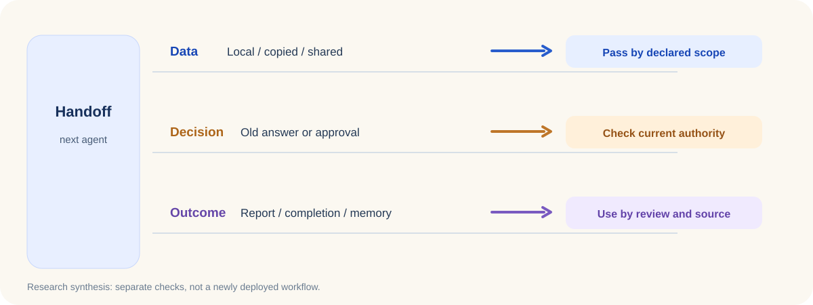

<ArticleCover image="/assets/handoff-boundaries-20261105/handoff-inheritance.cover-v1.png" kicker="Engineering research · Agent handoffs" title="When another AI takes over, what should travel with the task?" summary="We exercised four narrow open-source paths and compared them with CodeFlowMu's task, review and authorization checks. Each thing carried across a handoff needs its own evidence." version="2026-11-05" languageHref="/zh/research/2026-11-05-what-an-agent-inherits" languageLabel="中文" />

<ArticleTableScroll language="en" />

# When another AI takes over, what should travel with the task?

Imagine a development agent passing a task to a testing agent. The tester opens the same project folder, sees the previous agent's notes and report, and can even find the earlier conversation. An obvious question follows: **does the earlier approval travel with them too?**

Assigning a new worker changes who is responsible. Task data, the workspace, a pending human decision, and experience that may later become memory each have different origins and conditions of use. We are building CodeFlowMu, a local multi-agent work system that uses FCoP for formal tasks, reports and reviews. In our [daily two-layer research review](https://joinwell52-ai.github.io/joinwell52/en/runtime/daily-intelligence/2026-11-05), changes in AG2, LangGraph, Paradev and Anthropic's cookbook pointed at the same engineering question from four directions: **what actually survives a handoff?**

We pinned versions, exercised four narrow code paths, then checked CodeFlowMu's existing implementation and tests. These were separate boundary experiments, not one production team built from four frameworks. The [public evidence and rerunnable probes](https://github.com/joinwell52-AI/joinwell52/blob/main/research/manual-runs/2026-11-05-handoff-boundaries/00-report.en.md) include inputs, outputs and limits.

## First: the task data

[AG2 1.3](https://github.com/ag2ai/ag2/releases/tag/v1.3.0) lets a delegated variable stay local, be copied to a child, or be shared. We placed one of each in a parent scope, derived two child scopes, and changed values from one child. The local value was absent from the child. After the child changed the copied value to `1`, the parent and sibling still held `0`. After it changed the shared value to `1`, all three saw `1`. The child could not declare a new shared key.

That is an answer about **data movement**, not permission to act. The scope API also does not synchronize concurrent writes for an application. We did not run a model-driven parent-child conversation, so this probe cannot validate AG2's entire delegation flow.

## Second: an answer to an earlier question

In a local checkpoint graph using [LangGraph 1.2.20](https://github.com/langchain-ai/langgraph/releases/tag/1.2.20), we placed two human questions in sequence: approve the plan, then approve the execution. The first question received one ID; after its answer, the second received a different ID. We deliberately submitted a nonexistent ID, the first question's consumed ID, and the second question's ID after completion. All three were rejected. Only two answers addressed to the current questions produced a final result.

This probe enabled the version's internal strict-resume setting and used an in-memory checkpointer. It shows that **an answer can be tied to the pending question**. It does not establish the default behavior of a remote deployment. Enterprise approval also needs the approver, target, action, deadline and actual executor checked.

## Third: the workspace and the conversation

The automation target planner in [Paradev 2.0.5](https://github.com/ParadevAI/Paradev/releases/tag/desktop-v2.0.5) treats workspace reuse and agent-session continuation as separate choices. We ran its original planner from a pinned Git object. Reusing a workspace while starting a fresh agent session is a valid combination. Requesting continuation without a pinned workspace turns reuse on. One less obvious result: when an existing target already reuses its workspace, changing hosts leaves reuse and continuation enabled in the plan while listing the new host for verification.

That is **planner output**. This release has no Windows desktop asset; we did not run its desktop app or cloud dispatch. Nor did we verify that the new host was accepted or that an old authorization remained valid. An enterprise system must answer three separate questions: where are the files, can the conversation continue, and may this actor still execute?

<figure>
  <picture>
    <source media="(max-width: 640px)" srcset="/assets/handoff-boundaries-20261105/handoff-inheritance-mobile.en.svg" />
    
  </picture>
  <figcaption>A synthesis of the research questions, with each checkpoint grounded in a probe or a CodeFlowMu test. This is not a newly deployed workflow.</figcaption>
</figure>

## Only then: what becomes lasting experience?

Anthropic's [dreaming cookbook](https://github.com/anthropics/claude-cookbooks/pull/959) explores distilling completed sessions into longer-lived memory. We ran its official helper module over 11 transcripts provided in the repository. Empty input, a zero budget, and a file count above the limit were rejected before distillation. A still-running analyzer thread did not count as completed input coverage. The estimated list price was about $0.70; it was an estimate, not a model bill.

We did not invoke paid Managed Agents or generate a memory store. The local result still exposes a useful boundary: **preserving old content and promoting it to organizational experience are separate decisions.** A failed task, an unreviewed report or a record without a clear source needs to keep that status when summarized.

## Back to our own agent team

CodeFlowMu hands work among PM, development, QA and operations roles. At a pinned commit we ran six focused test suites: 77 tests passed. The informative results are narrower than the total. A worker report marked `done` does not itself become the PM's review decision. A downstream task requiring upstream success does not start merely because a report exists. Commands from stale task rounds or revisions are rejected. Technical automation requires a scoped grant. In a separate direct probe of the real session-contract functions, changing the host, workspace, role or allowed governance tools produced a corresponding conflict field.

One older end-to-end fixture stopped at Python output parsing on this machine. It is excluded from the 77 passes and was not used to infer a product defect; the evidence page records its failure point and scope.

These existing boundaries address **who may decide and which facts can move work forward**. They do not prove that a real UI, model conversation, host takeover and external tool effect remain consistent through one complete handoff. We therefore did not turn the upstream approaches into a CodeFlowMu defect claim or development ticket.

The next experiment is concrete: take one task through **PM assignment → worker report → reviewer takeover**. Change the workspace or host in between, revoke an approval, replay an old answer, and observe data, current authority and delivery evidence at each step. A contradiction along that path would give us a reason to consider a change.

For builders, one immediate check is: **what does your “continue task” action actually restore: files, conversation, pending work, or execution authority?** For people using these teams, which experience should the next AI retain, and which decision should it ask you to make again?
