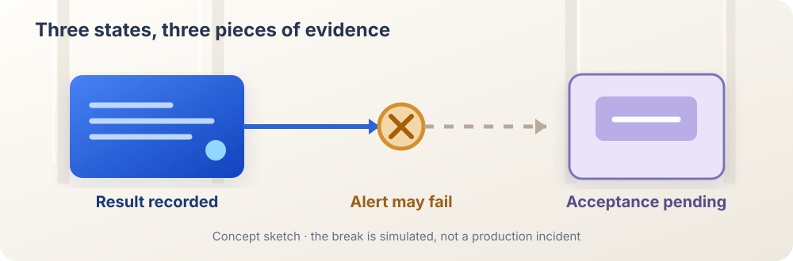

<ArticleCover image="/assets/async-supervisor-20261109/completion-signal.cover-v1.png" kicker="Engineering research · Async teams" title="When the background AI finishes, will its supervisor know?" summary="We exercised an async-agent completion notifier and compared it with CodeFlowMu's report intake tests. A finished job, a delivered alert, and an accepted result each need evidence." version="2026-11-09" languageHref="/zh/research/2026-11-09-when-worker-finishes" languageLabel="中文" />

<ArticleTableScroll language="en" />

# When the background AI finishes, will its supervisor know?

Imagine giving a colleague a job. They finish and place the result in a shared folder, but do not manage to tell you. The work may be there. If you are waiting for a signal to review it, the job still feels open.

An AI team has the same seam. A supervisor agent stays available to a person while worker agents run longer jobs in the background. That is more useful than making every request wait behind one long task. But once a worker finishes, **where is the result, how does the supervisor hear about it, and what makes the work accepted?**

We are building CodeFlowMu, a local multi-agent collaboration system that uses FCoP files for tasks, reports, and reviews. Our [November 9 research review](https://joinwell52-ai.github.io/joinwell52/en/runtime/daily-intelligence/2026-11-09) gathered developments around async supervisors, persistent work, recovery, and delivery evidence. [LangChain's article on async agents](https://www.langchain.com/blog/agents-are-going-async) and its [reference repository](https://github.com/langchain-ai/async-deep-agents/tree/6cafef62b2783a3d16edacd7df151ad1a33ee7a5) gave us a precise question to test against our own engineering: when the supervisor can keep talking, how does it learn that a worker has finished?

## Completion and notification take different paths

The reference implementation gives each background job an identity and a way to check its status. The supervisor may poll a job, or a worker may notify it on completion. The README is explicit: **proactive completion notification is optional application wiring**. The Python and TypeScript worker examples leave that wiring commented out. Launching background work does not by itself create a dependable “please review this” message.

When enabled, the example notifier submits a new run to the supervisor's thread after the worker finishes. This lets the supervisor react without polling. Yet the alert and the job result have different survival conditions. Delivery can fail while the result remains queryable. Delivery also does not mean the supervisor has inspected the work.

We imported the [actual Python notifier from a pinned commit](https://github.com/langchain-ai/async-deep-agents/blob/6cafef62b2783a3d16edacd7df151ad1a33ee7a5/graphs/python/src/middleware/completion_notifier.py) and replaced only the remote client with a deterministic stub. We invoked the same completion callback twice on one notifier instance, changing only parent identity and whether the first delivery raised an error. No model or hosted service was called. The [English evidence record and runnable probe](https://github.com/joinwell52-AI/joinwell52/blob/main/research/manual-runs/2026-11-09-async-supervisor/00-report.en.md) contain the inputs and outputs.

| Condition | Delivery attempts to supervisor | Local flag afterwards |
| --- | ---: | --- |
| Parent identity present; delivery succeeds | 1 | Notified |
| Parent identity present; synthetic delivery failure | 1; no retry on second callback | Notified |
| Parent thread identity missing | 0 | Not notified |

The second row matters most. The reference module marks itself notified before attempting delivery. A failed attempt becomes a warning; the second callback sees the flag and does not retry. This demonstrates **local behavior of this reference module under a controlled failure**. It does not establish that LangChain's hosted platform loses a task result. The repository already says error handling is the adopting application's responsibility. It does establish that one boolean cannot mean both “I attempted to send” and “the supervisor received it.”

<figure>
  
  <figcaption>Mechanism sketch. Result, alert, and acceptance are separate. The amber break represents our simulated delivery failure, not a production incident.</figcaption>
</figure>

## How our supervisor takes over

In CodeFlowMu, a worker writes its result as an FCoP REPORT. The Runtime receives the report and wakes the project-manager role (PM) to review it. This differs from the reference notifier: the report is an inspectable artifact; waking PM is an action that draws attention to it. FCoP defines task location and transition events. Scheduling and queueing PM belong to Runtime.

At a [pinned CodeFlowMu-open commit](https://github.com/joinwell52-AI/CodeFlowMu-open/tree/ed5634c718b9e238c44bb70851020c9793546fe6), we ran three relevant component test files: **19/19 tests passed**. The meaningful checks cover waking PM from worker reports, queueing and deduplicating when PM is busy, starting one PM session for a same-thread batch, recording a late report idempotently by report ID, and avoiding review when no report exists. These are tests of existing behavior, not features we built in this study.

The comparison narrows our conclusion. A simulated delivery failure in the reference notifier **is not evidence of the same defect in CodeFlowMu**. Passing component tests in CodeFlowMu also does not certify real-model, UI, process restart, or network-disconnect behavior. Each result supports only the boundary we actually exercised.

## Who rediscovers the result?

A job can produce three different statements: the worker says “finished,” the system says “I alerted the supervisor,” and the supervisor says “I checked and accepted it.” Collapsing them into one green “done” is especially misleading around approvals, disconnections, and recovery.

Our next question remains untested: **PM is waiting on a human approval; a worker writes a finished report; the first wake fails and Runtime restarts. Is the report rediscovered? Is only one intake request queued? Does the original approval question remain intact?** That requires an end-to-end comparison. Today's evidence does not justify a CodeFlowMu development task.

If you design agent teams, inspect where the result lives, how a failed alert is rediscovered, and who owns final acceptance. If you use one, would you want a background worker to tell you immediately that it has finished, or a supervisor to check the work first and then report a supported conclusion?
