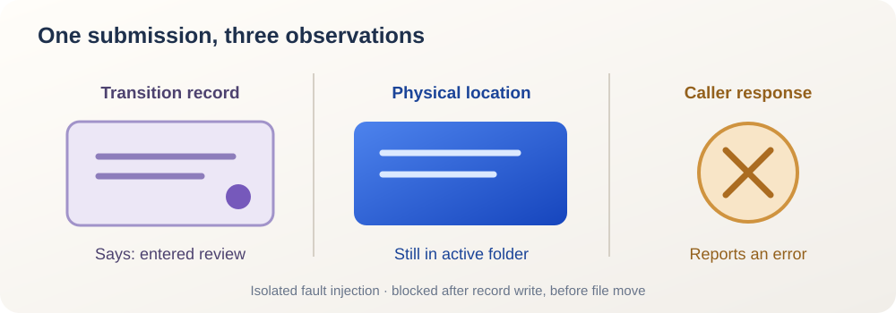

<ArticleCover image="/assets/task-transition-20261111/task-threshold.cover-v1.png" kicker="Engineering research · Task recovery" title="The task never moved. Why does its record say it entered review?" summary="A controlled submission failed while the task stayed in the active directory, yet its metadata already said review. We compared retry and lost-receipt paths to ask how an agent team proves a transition completed." version="2026-11-11" languageHref="/zh/research/2026-11-11-task-moved-after-record" languageLabel="中文" />

<ArticleTableScroll language="en" />

# The task never moved. Why does its record say it entered review?

You ask an AI worker to submit a task. The call errors. The task file is still in the “active” folder, so it looks as if submission never happened. But the file itself already says “review,” with a transition recording the report. **Which should you trust: the error, the file's location, or the record inside it?**

We are building CodeFlowMu, a local multi-agent collaboration system. FCoP files hold its tasks, reports, and lifecycle history. Moving a worker's task into review looks like one action, but the runtime writes a transition, updates metadata, moves a file, and returns a response. An interruption can leave those pieces at different points.

Our [November 11 research review](https://joinwell52-ai.github.io/joinwell52/en/runtime/daily-intelligence/2026-11-11) led us to [Paperclip's merged recovery change](https://github.com/paperclipai/paperclip/pull/20674). For its particular `write_document` operation, Paperclip stores the new revision and an idempotency receipt in one database transaction. After a restart, a saved receipt can replay the result; under that transaction guarantee, an absent receipt means the earlier write did not commit. **The database is Paperclip's implementation choice; CodeFlowMu still uses FCoP task files, and this study does not propose adding a database.** We tested a question in our own file-based workflow: what can our system prove after a task transition stops midway?

## Stop submission at the threshold

We invoked the real `LifecycleKernel.submitReview` from a [pinned CodeFlowMu-open commit](https://github.com/joinwell52-AI/CodeFlowMu-open/tree/ed5634c718b9e238c44bb70851020c9793546fe6) on an isolated temporary task. A regular file occupied the target review-directory path, forcing an error after the transition metadata was written and before the task file moved. This is an injected **write-before-move failure**, not a reproduced production incident. We then removed the obstruction and retried the same request. Finally, we simulated losing a successful response by sending the request once more. The [evidence record](https://github.com/joinwell52-AI/joinwell52/blob/main/research/manual-runs/2026-11-11-lifecycle-atomicity/00-report.en.md) gives the steps and observed values.

| Observation | Caller receives | Physical folder | Task metadata | Transition entries |
| --- | --- | --- | --- | ---: |
| First call, target blocked | `EEXIST` | active | review, pending | 1 |
| Obstruction removed, same request retried | success | review | review, pending | still 1 |
| Successful response presumed lost, request retried | “expected active, got review” | review | review, pending | still 1 |

<figure>
  
  <figcaption>Controlled experiment diagram: the record, physical location, and caller receipt are separate observations. The amber gap comes from our injected destination obstruction, not a production incident.</figcaption>
</figure>

The first row is the trap. The call really failed, but “nothing happened” is false: the transition and target state were already recorded. The second row shows useful recovery behavior in this tested path: the retry completes the move without adding another transition. The third row points the other way. If the move succeeded but only the response was lost, a blind retry gets a stage mismatch. That error does not prove the earlier operation failed.

## The record moves before the artifact

The source order explains the result. `TransitionRecorder.append` writes the target stage and transition event into the task file. `submitReview` then writes the pending-review fields. `moveTask` finally renames the file into the review directory. We also ran the [targeted lifecycle tests](https://github.com/joinwell52-AI/CodeFlowMu-open/blob/ed5634c718b9e238c44bb70851020c9793546fe6/packages/codeflowmu-runtime/src/lifecycle/__tests__/LifecycleStateMachine.test.ts): **28/28 passed**. Those tests cover normal transitions and several authority and repeat-call cases. They do not negate our injected failure because they exercise different conditions.

CodeFlowMu uses a project write lease to serialize these calls. Serialization does not make the metadata write, file move, and returned result one atomic transaction. In FCoP, physical location describes the current stage; the transition list records history. When they temporarily disagree, the safe observation is “needs reconciliation,” not an arbitrary choice of one as final.

Paperclip offers a useful contrast, within a narrow scope. Its transactional receipt protects **that specific document write**; it is no general exactly-once guarantee for tools. Our file transition cannot gain the same guarantee merely because a transition entry exists. Different storage models, same human question: **how far did the previous request actually get?**

## What proves that a retry is the same operation?

We confirmed a bounded intermediate state and two retry outcomes. We did not run a real process crash, a complete model session, or a production deployment, and we have no evidence of an affected user. The next engineering question is sharper: recovery must relate **request identity, actual task location, transition history, and a replayable outcome**. Seeing a task in review does not by itself prove that this caller's last request put it there; another authorized request might have moved it first.

CodeFlowMu's proposed target is concrete: **keep FCoP task files and identify one submission by `task_id + report_id + actor`.** If the file remains active and the last submission event belongs to that report, finish the move. If the file is already in review and the event matches, return the prior success to the retrying caller. If the report or actor differs, return “needs review” rather than crediting someone else's transition. Startup recovery should check the same record-versus-location split. This is a design to implement and test, not a capability established by today's probe.

The next tests ask whether that rule remains correct after a rework report changes, two authorized actors race, or a process is killed during a file write. Today's local injection cannot answer those cases.

If you build agent teams, inspect what your product says after a failed submit: “not submitted,” or “outcome being checked”? If you use one, which would you rather see when the page and task file disagree: a definite location, or an explicit notice that the last submission is being reconciled?
