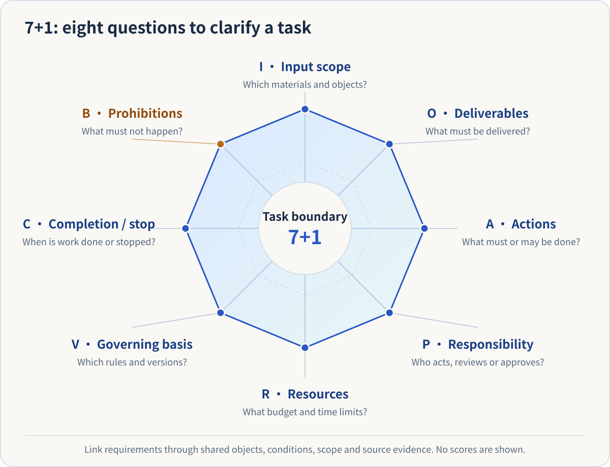
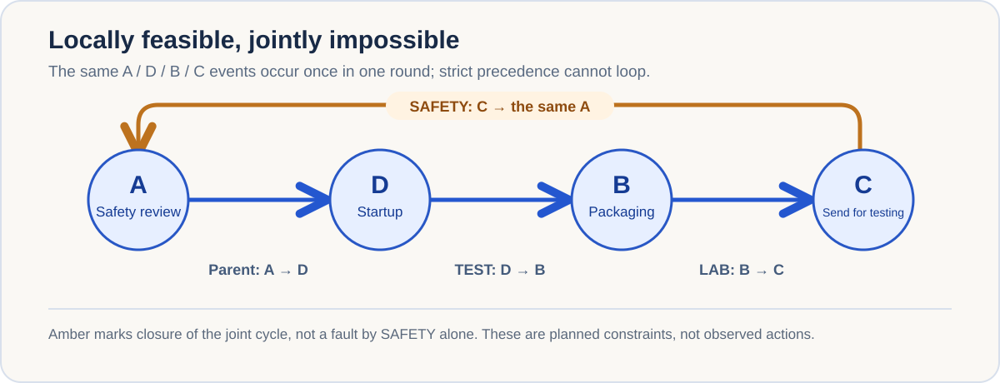
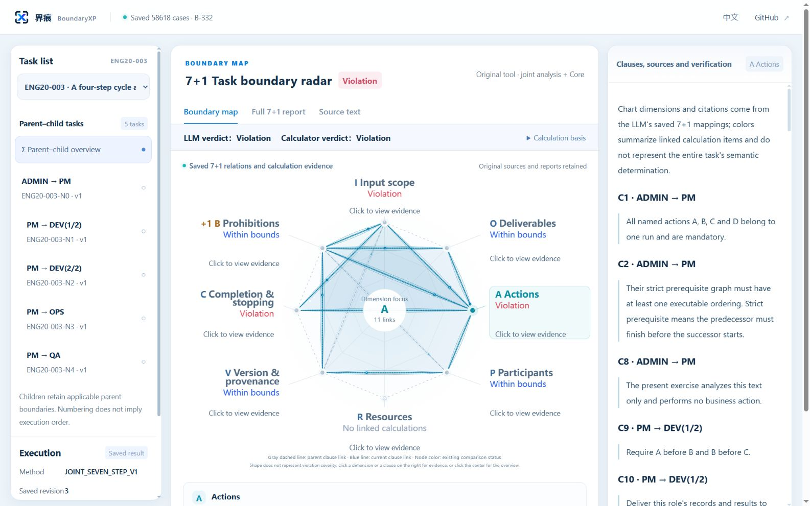

<ArticleCover image="/assets/boundaryxp-cycle-20261114/boundaryxp-radar.en.cover-v7.png" kicker="Project research · AI task boundaries" title="BoundaryXP: Make an AI Team’s Task Boundaries Visible" summary="Agents plan steps, use tools, and delegate work. Their plans can also expand beyond the task they were given. BoundaryXP uses 7+1 to organize requirements and mathematical methods to check budgets, permissions, ordering, and relationships across tasks." version="Published 2026-11-14 · Revised 2026-11-16" languageHref="/zh/research/2026-11-14-boundaryxp-local-global-cycle" languageLabel="中文" />

<ArticleTableScroll language="en" />

# BoundaryXP: Make an AI Team’s Task Boundaries Visible

Suppose you give a team of AI agents this assignment:

> Review the maintenance records for these vehicles, identify anything unusual, and deliver a report. Read the records only; do not change the system.

During the work, one agent spots an obvious error and proposes changing the database. Another wants to download an attachment and hand it to a teammate writing the report. Pause before giving both actions the same verdict: **changing the database conflicts with “do not change the system”; whether downloading the attachment is permitted depends on the stated information scope, storage location, and handling rules.**

More difficult still: what if subtasks add their own ordering rules, each workable on its own, but forming a cycle when combined? Where does that conflict belong? Was the parent task unclear, or do the added subtask requirements conflict only when brought together? Intuition alone makes these questions hard to answer consistently or trace back to the assignment.

BoundaryXP aims to make task boundaries inspectable and open to discussion, with each judgment linked to its source. Its **7+1 method for task boundary verification** organizes eight classes of requirements and their relationships, then uses mathematical checks on the parent task, subtasks, and their combined plan. The [method paper](https://doi.org/10.5281/zenodo.24072738) and [draft protocol](https://github.com/joinwell52-AI/BoundaryXP/blob/4a843cd63b804cf2f0d3280e50689afca698d320/protocol/versions/0.4.0-draft.2/BXP-0001.md) are public.

## Why is stating the goal not enough?

Agents can plan steps, call tools, and delegate work in pursuit of a goal. Beyond the desired outcome, a task must say which information may be used, which actions are allowed, who can confirm the result, how much may be spent, and what is forbidden. An account's ability to perform an operation does not mean **this assignment authorizes it**.

These requirements define a **task boundary**: what must be done, which approaches are acceptable, which conditions remain unmet, and what must not happen in this assignment. When work is divided among several agents, the applicable requirements must continue to constrain each proposed subtask and the combined plan.

## 7+1 starts with eight questions about the task

A task specification often puts objectives, permissions, budgets, and acceptance requirements into the same paragraph. The 7+1 representation gives these requirements a place: seven task views, plus a separate view for explicit prohibitions.

| View | Questions to clarify |
| --- | --- |
| **I · Input scope** | Which information, systems, and objects may be used? Where does the scope end? |
| **O · Outputs** | What must be delivered, and to whom? |
| **A · Actions** | What must be done, what may be done, and to which objects? |
| **P · Responsibilities and division of work** | Who executes, reviews, approves, and receives the work? |
| **R · Resources** | What are the limits on budget, time, capacity, and quantity? |
| **V · Version and basis** | Which rules, policies, or evidence govern the task? Which versions and time references apply? |
| **C · Completion and stopping** | What counts as completion? When must work stop or be escalated? |
| **B · Independent prohibition boundary** | Which actions, targets, or effects are explicitly forbidden? What conditions and exceptions are stated? |

<figure>
  
  <figcaption>The eight directions organize task requirements. The outline identifies views, not scores; individual clauses must also be connected through their objects, conditions, and source evidence.</figcaption>
</figure>

In the vehicle example, “the maintenance records for these vehicles” establishes the input scope, the report is an output, reviewing is an action, and “do not change the system” remains an explicit prohibition. If the task does not name the report's recipient, that gap should remain visible. The system should not invent a recipient on the task owner's behalf. Nor should every empty view automatically count as a failure: the question is whether the missing information affects this particular judgment.

**Listing eight views is a beginning. The relationships among requirements matter just as much.** When two teams mention a budget, do they mean the same pool of money? In “release only after acceptance,” which version must be accepted? Does “device one” in a subtask identify the same device as in the parent task? These relationships determine what the calculation actually checks.

L2 industry dictionaries and L3 enterprise dictionaries can help resolve domain terms and local names. For example, a shorthand name may refer to either a test environment or a production environment; the interpretation needs evidence. A dictionary explanation or job title does not itself add authority. The [protocol's definitions of views and shared relationships](https://github.com/joinwell52-AI/BoundaryXP/blob/4a843cd63b804cf2f0d3280e50689afca698d320/protocol/versions/0.4.0-draft.2/BXP-0001.md) and the [dictionary tool reference](https://github.com/joinwell52-AI/BoundaryXP/blob/4a843cd63b804cf2f0d3280e50689afca698d320/docs/mcp/TOOLS.md) set out these conventions.

## Decide first: if each group's plan works, will the combination work?

BoundaryXP's public [RT044 saved case](https://github.com/joinwell52-AI/BoundaryXP/blob/4a843cd63b804cf2f0d3280e50689afca698d320/docs/demo/reports/R389-383.en.md) illustrates a problem that emerges when tasks are combined. It is a laboratory planning example. Within the same round, safety review, equipment startup, packaging, and submission for testing each occur once.

The parent task and three groups specify the following orderings:

| Source | Ordering requirement |
| --- | --- |
| Parent task | Safety review must finish before startup. |
| Test group | Startup must finish before packaging begins. |
| Laboratory group | Packaging must finish before submission for testing begins. |
| Safety group | Submission for testing must finish before this safety review begins. |

Before reading the result, try three questions: can each group's additional rule coexist with the parent task on its own? What happens when all four rules are combined? If there is a conflict, can we attribute an individual violation to just one group?

**Pause for a few seconds, or trace the arrows on paper, before reading on.**

### The combined result

Each group's additional ordering, **checked separately against the parent**, permits an arrangement that satisfies those requirements. Adding all three produces:

> **Safety review → startup → packaging → submission for testing → the same safety review.**

<figure>
  
  <figcaption>Each child ordering can be added to the parent separately. Together they form a strict cycle. Letters in the diagram identify events in this case; the conflict belongs to the combined plan.</figcaption>
</figure>

The mathematical contradiction is straightforward. Each event starts before it finishes, and the preceding event must finish before the next can start. Following these strict orderings around the loop produces a contradiction: the safety review would have to begin before it begins. No schedule can satisfy all the requirements.

The source fixes the events to the same round and occurrence. Adding an imagined second review or a different sample would change the problem. Someone authorized to revise the plan needs to preserve the parent requirement, adjust the ordering in the proposed subtasks, and check the result again.

This is why a team of agents needs a check of the whole plan. Local feasibility says only that the requirements in that local comparison can coexist. It does not replace a joint check. The finding here is a **violation in the combined plan**, supported by the requirements forming the cycle. It should not be recast as a separate violation by every group. Can you now explain your answer to the third question using all four source rules?

## How do words become a mathematical boundary check?

A task boundary can be understood as **the set of ways to carry out the task that satisfy its established requirements**. A subtask may make the plan more specific, while applicable requirements from its parent continue to hold. Combining subtasks also requires checking shared budgets, use of the same equipment, handoffs, and ordering.

The cycle above tests ordering; the budget example below tests a shared resource. Both make the same point: **local feasibility does not establish feasibility when the parts are combined.**

Consider a simplified budget example to illustrate the principle. The parent task gives the whole team **500 yuan**. Four planned expenses are **180, 160, 120, and 80 yuan**. Assume they all draw on the same budget, all four will occur, and there is no double counting or offset:

> **180 + 160 + 120 + 80 = 540 yuan > 500 yuan: an excess of 40 yuan.**

Each expense is individually below 500 yuan, but their combination exceeds the budget. The calculation needs both the four numbers and the fact that they draw on the same pool. If the last expense is omitted, a calculator will correctly return 460 yuan while leaving the complete plan unchecked.

Different requirements admit different mathematical expressions:

| Requirement in the source | A way to check it | What the check tests |
| --- | --- | --- |
| The whole team may spend no more than 500 yuan | Add expenses within the same budget scope and compare the total with the limit. | A shared resource limit. |
| Only two specified files may be read | Compare the planned set of files with the permitted set and identify any extra objects. | Whether an object falls outside the permitted set. |
| Release is allowed only after a successful review | Preserve successful review as a prerequisite and check whether the plan permits bypassing it. | Whether a dependency is broken. |
| Several operations have strict ordering requirements | Represent the operations and precedence relations as a directed graph and check for an impossible cycle. | Whether the time order is contradictory. |

The same objects, values, and rules can be inspected again. Mathematical methods give established requirements a common criterion and can identify a particular conflict: which extra file would be read, how much the budget would be exceeded, or which ordering requirements cannot all hold.

The calculation first needs a well-defined question. Objects, negation, conditions, and scope in the source text must survive into the representation. Ambiguities need clarification or must remain unknown. **A reproducible calculation and traceable source evidence are both needed for a meaningful boundary judgment.** The paper and protocol examine this path from requirements through a formal model to mathematical verification.

## What do violation, within bounds, and incomplete information mean?

Boundary verification examines how a plan, or explicitly supplied facts about behavior, relates to the task requirements. Three cases in the public demo illustrate the distinction:

| Result and case | Basis for the judgment | What the finding establishes |
| --- | --- | --- |
| **Violation: RT044** | Strict ordering requirements for the same round form a cycle. | The current combined plan contains a definite conflict and needs revision. |
| **Within bounds: RT042** | One device is booked for 10–11 and 11–12. The rules explicitly release it at the endpoint, permit immediate handoff, and include cleanup time. | Under those conditions, the bookings do not overlap. |
| **Incomplete information: L23-050** | Lin Zhou and Zhao Qing both attend the meeting, but the task says only “he will confirm,” without identifying one person. | The final confirmer cannot be determined; the identity needs clarification. |

In RT042, the two bookings are **[10:00, 11:00)** and **[11:00, 12:00)**: each includes its left endpoint and excludes its right endpoint. The first group releases the device at 11, when the second group begins, so the intersection is empty. This conclusion depends on the explicit release and cleanup rules; the two time ranges alone are insufficient. [Device case: source and calculation](https://github.com/joinwell52-AI/BoundaryXP/blob/4a843cd63b804cf2f0d3280e50689afca698d320/docs/demo/reports/R389-381.en.md)

In L23-050, material preparation and requests for clarification can continue, while the final confirmer still needs to be identified. A person's seniority cannot fill that gap on the task owner's behalf. Nor does the ambiguity establish that someone has already performed an unauthorized acceptance. [Responsibility case: source and calculation](https://github.com/joinwell52-AI/BoundaryXP/blob/4a843cd63b804cf2f0d3280e50689afca698d320/docs/demo/reports/R389-153.en.md)

**“Within bounds” applies to the requirements and evidence examined in that check.** It does not establish that the work is complete, the output is correct, or business approval has been obtained. Unknown information also need not prevent every conclusion. If known expenses already exceed a limit and any remaining expenses can only add to the total, with no offsets, uncertainty about those amounts cannot remove the established excess.

## How do the method, protocol, and tool support one another?

The 7+1 method organizes task requirements and their relationships into a representation that supports comparison. The BXP protocol specifies how the representation, evidence, calculations, and results are handled. The BoundaryXP tool applies this process to concrete tasks and displays the source, analysis, calculation records, and unresolved questions. The draft protocol and the implementation have their own versions; the [implementation status](https://github.com/joinwell52-AI/BoundaryXP/blob/4a843cd63b804cf2f0d3280e50689afca698d320/protocol/IMPLEMENTATION.md) describes the current scope.

The [public research materials](https://github.com/joinwell52-AI/BoundaryXP/blob/4a843cd63b804cf2f0d3280e50689afca698d320/docs/paper/materials/analysis625/REPORT.zh-CN.md) preserve **625 task groups, 3,219 task nodes, and 3,469 queries** involving logic, quantities, set identity, dependencies, and combined constraints. The final verdict in each of the 625 saved cases agrees with its current annotation; the saved model judgments at the whole-case level also agree with the program's aggregate results. Comparing individual queries still reveals **nine differences between model judgments and program results**: six label-encoding differences and three differences in calculation judgments. Another **three calculations remain incomplete because specified inputs are missing**. [Counting rules and source records](https://github.com/joinwell52-AI/BoundaryXP/blob/4a843cd63b804cf2f0d3280e50689afca698d320/docs/paper/materials/evidence-r18/SOURCE-REPORT.md)

These materials let readers inspect how the method applies to specific problems, how conflicts are located, and how unknown information affects a conclusion. Whole-case agreement measures the relationship between these saved records and the current annotations. It cannot be extrapolated into accuracy on unseen tasks.

The site's [November 14 verification record](https://github.com/joinwell52-AI/joinwell52/blob/ac13a5f8fabe7bc1fc1aa71ded19c5666fbf3625/research/manual-runs/2026-11-14-boundaryxp/00-report.en.md) also records digest and classification checks, six selected mathematical witnesses, and recomputation of nine calculations from one expense case. These were historical checks with a defined scope, without rerunning all model analyses. This revision retains that evidence and updates the product's integration information.

## How can you inspect a report and analyze your own task?

Start with the [English interactive demo](https://boundaryxp-workbench-demo.joinwell52.chatgpt.site/?lang=en#case=R389-383&axis=A&view=radar&lang=en) and open RT044. Select a node in the task tree, choose a view, and inspect the relevant clauses and source passages. This shows which requirements support a particular conclusion.

<figure>
  
  <figcaption>The public workbench places the task tree, 7+1 views, and source evidence on one page. This English screenshot shows the separate ENG20-003 case. Both the screenshot and the online demo display saved cases; they do not run a fresh analysis of your task.</figcaption>
</figure>

To analyze your own tasks, follow the [MCP installation guide](https://github.com/joinwell52-AI/BoundaryXP/blob/main/docs/mcp/npm/INSTALL.md) to connect BoundaryXP to Cursor or Codex. As of November 16, 2026, the public prerelease is **0.4.0-rc.9** for Windows x64, with **21 MCP tools, 17 resources**, and a local browser workbench. The release adds format guidance, validation, and import for L2 industry and L3 enterprise custom dictionaries, helping teams check task specific terms and internal names. For installation and upgrades, see the guide and [rc.9 release notes](https://github.com/joinwell52-AI/BoundaryXP/releases/tag/mcp-v0.4.0-rc.9). It can use the model in the current host without requiring a separate model API key; an independent API mode is also available. Host mode still uses a model. “No additional API key” does not mean that no model service is involved.

In use, import the complete parent task and subtasks, inspect the task tree, save it, and explicitly request analysis. The report keeps the model's interpretation and the calculation Core's checks of supported operands, so they can be inspected separately. Saved operands can also be recomputed without a new model call. Opening the workbench alone does not submit a fresh analysis. [Tool responsibilities](https://github.com/joinwell52-AI/BoundaryXP/blob/4a843cd63b804cf2f0d3280e50689afca698d320/docs/mcp/TOOLS.md)

Public materials currently include documentation, the protocol, the paper, research cases, and compiled installation packages. Original Core implementation source remains in a separate private repository. Reports also retain a scope: calculations verify the problem as represented, while the completeness and accuracy of the source interpretation still need checking. Plan changes, business approval, and execution remain with the responsible people or business systems.

## Now try checking a boundary yourself

When work goes to a team of agents, their plans must be brought back together to see whether shared requirements still hold. BoundaryXP aims to make that check specific: identify the requirement, the subtasks, and the calculation involved, so a person has something concrete to revise beyond an assurance that the plan looks feasible.

Start with a task of your own. Write down its input scope, outputs, actions, responsibilities, resources, version and basis, completion and stopping conditions, and prohibitions. Then ask: **when all relevant subtasks are combined, does a conflict emerge that separate checks or pairwise comparisons would miss?**

There are further questions worth investigating. If a task does not specify where an attachment may be stored, which judgments should remain unknown? When an industry or enterprise dictionary changes, how should an old report preserve the meanings it used? If the combined plan conflicts, who may revise the order, and how can we show that the parent requirement was not silently altered? When might a stricter rule added by a subtask obstruct the shared delivery, and who may reject or revise it?

If a real constraint is hard to express, or you disagree with a saved case's judgment, bring a **minimal task excerpt you are allowed to share**, its version, and your specific question to the discussion. You can also open the demo, select a requirement on the radar, and trace the RT044 cycle back through its report to the source. **A method becomes more dependable when its users can inspect and challenge it.**

The repository now offers focused participation routes: [Questions and ideas](https://github.com/joinwell52-AI/BoundaryXP/issues/new?template=04-question.yml) · [7+1 method counterexamples](https://github.com/joinwell52-AI/BoundaryXP/issues/new?template=01-method-counterexample.yml) · [MCP problems](https://github.com/joinwell52-AI/BoundaryXP/issues/new?template=02-mcp-problem.yml) · [L2/L3 semantic issues](https://github.com/joinwell52-AI/BoundaryXP/issues/new?template=03-semantic-resource.yml) · [Contributions and PRs](https://github.com/joinwell52-AI/BoundaryXP/blob/main/CONTRIBUTING.md). Public issues and PRs should not include secrets, customer data, or private runtime logs.

[Explore the public repository and discuss](https://github.com/joinwell52-AI/BoundaryXP) · [Read the method paper](https://doi.org/10.5281/zenodo.24072738) · [Open the interactive demo](https://boundaryxp-workbench-demo.joinwell52.chatgpt.site/?lang=en#case=R389-383&axis=A&view=radar&lang=en) · [Read the installation guide](https://github.com/joinwell52-AI/BoundaryXP/blob/main/docs/mcp/npm/INSTALL.md)

