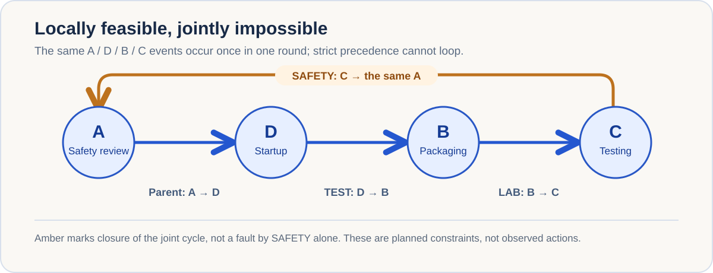
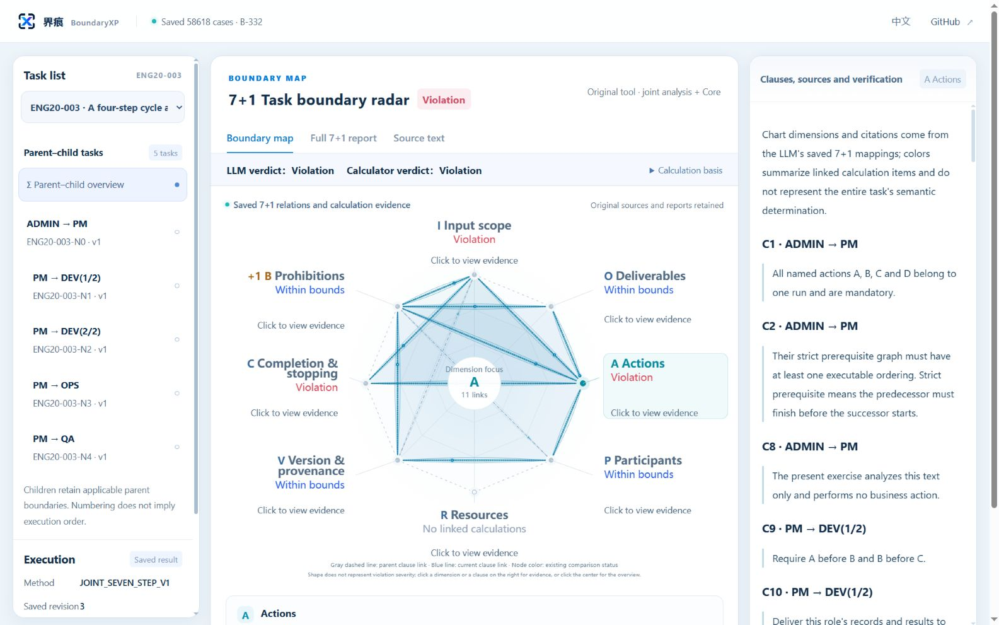

<ArticleCover image="/assets/boundaryxp-cycle-20261114/boundaryxp-cycle.cover-v1.png" kicker="Product study · AI task boundaries" title="BoundaryXP: Make an AI Team’s Task Boundaries Visible" summary="Every AI subtask may look feasible while the combined plan is impossible. BoundaryXP links 7+1 task requirements to source evidence and deterministic checks, with a paper, live demo, and MCP integration." version="2026-11-14" languageHref="/zh/research/2026-11-14-boundaryxp-local-global-cycle" languageLabel="中文" />

<ArticleTableScroll language="en" />

# BoundaryXP: Make an AI Team’s Task Boundaries Visible

Give an AI team a job and it can quickly split the work among planners, executors, and reviewers. If every member says “my part is feasible,” does that mean the job as a whole can be done?

**BoundaryXP** is a task-boundary analysis tool built for that question. It examines a complete task and its subtasks, links requirements back to source text, checks both individual and combined plans, and explains whether a plan is **violated, within bounds, or unresolved**. It now has a [public product repository](https://github.com/joinwell52-AI/BoundaryXP), a [paper on its 7+1 method](https://doi.org/10.5281/zenodo.24072738), an [interactive demo](https://boundaryxp-workbench-demo.joinwell52.chatgpt.site/), and an [MCP package](https://github.com/joinwell52-AI/BoundaryXP/blob/main/docs/mcp/npm/INSTALL.md) for compatible AI hosts.

## One example shows why the tool exists

In a laboratory task specification, four events must be scheduled in the same round: safety review, equipment startup, packaging, and sample testing. The parent task requires review to finish before startup. Three groups add their own orderings: startup before packaging, packaging before testing, and testing before review.

Each group's addition is feasible **when checked alongside the parent on its own**. Joined together, the requirements say:

> Safety review → startup → packaging → testing → safety review.

The first event must wait for the last. The plan has no starting point. BoundaryXP's public [RT044 saved case](https://github.com/joinwell52-AI/BoundaryXP/blob/main/docs/demo/reports/R389-383.en.md) preserves one parent, six children, and ten queries. The parent and each child ordering pass their separate feasibility checks; **the joint query reports a violation**. The source fixes the events to the same round and occurrence, so an imagined second packaging step cannot dissolve the loop. This is a counterexample in a task specification, not an actual laboratory accident.

<figure>
  
  <figcaption>The conflict arises from the combination. It does not show that any one group violated the parent on its own.</figcaption>
</figure>

**[Open the RT044 demo to inspect the task tree, 7+1 radar, and source evidence →](https://boundaryxp-workbench-demo.joinwell52.chatgpt.site/?lang=en#case=R389-383&axis=A&view=radar&lang=en)**

<figure>
  
  <figcaption>BoundaryXP’s English demo screenshot shows the separate ENG20-003 case: the task tree, linked boundary map, and source clauses remain visible together. The demo replays saved results rather than running a fresh analysis.</figcaption>
</figure>

The product's value is more than a red status label. It retains **which requirement came from which passage, which occurrence it describes, and how it connects to another subtask**. Whoever revises the plan can inspect the complete path and recheck it after changing an ordering.

## 7+1 makes requirements connectable and inspectable

“7+1” does not mean eight scores or eight agents. BoundaryXP organizes task requirements into seven views: **input I, output O, actions A, people and responsibility P, resources R, version and basis V, completion and stopping C**. A separate **prohibition boundary B** records what must not happen. In everyday terms: what goes in, what must come out, who acts, under which rules, when the work ends, and what is forbidden.

The important part is the **relationship among those views**. In RT044, TEST's packaging must be the same event as LAB's packaging; SAFETY's review must be the parent's review. If a system mistakenly links different occurrences, precise arithmetic solves the wrong problem. BoundaryXP keeps identity, ordering, and source provenance together so a cross-team plan can be checked as a whole.

For domain-specific terms, BoundaryXP can also bind **L2 industry and L3 enterprise dictionaries**, recording the selected versions and digests so a role, device, or action can be interpreted against inspectable context. A dictionary helps interpret a task; a role name does not grant business authority. The [dictionary tools](https://github.com/joinwell52-AI/BoundaryXP/blob/main/docs/mcp/TOOLS.md) are documented with the product.

This is why the demo has more than pass and fail. Three cases are especially revealing:

| Demo case | Boundary question | What to inspect |
| --- | --- | --- |
| [RT044: joint violation](https://boundaryxp-workbench-demo.joinwell52.chatgpt.site/?lang=en#case=R389-383&axis=A&view=radar&lang=en) | Feasible parts form an impossible cycle | Task tree, source orderings, joint conflict |
| [RT042: within bounds](https://boundaryxp-workbench-demo.joinwell52.chatgpt.site/?lang=en#case=R389-381&axis=R&view=radar&lang=en) | Instrument use at 10–11 and 11–12 touches at the release time | No overlap under the stated half-open intervals |
| [L23-050: unresolved](https://boundaryxp-workbench-demo.joinwell52.chatgpt.site/?lang=en#case=R389-153&axis=P&view=radar&lang=en) | “He will confirm” does not identify one final owner | Missing identity remains unresolved |

Together they show the intended behavior: **report a known conflict, avoid inventing a conflict, and preserve a genuinely missing fact.**

## From a paper to Cursor and Codex

The [BXP paper](https://doi.org/10.5281/zenodo.24072738) states the 7+1 relational method and the conditions under which formal boundary checks hold. Its [public research materials](https://github.com/joinwell52-AI/BoundaryXP/blob/main/docs/paper/materials/manuscript.en.md) include 625 saved task groups, 3,219 nodes, and 3,469 queries. Against a pinned public revision, we reran the classification script, six selected mathematical witnesses, and nine saved cost checks; all passed. Our [rerun record](https://github.com/joinwell52-AI/joinwell52/blob/main/research/manual-runs/2026-11-14-boundaryxp/00-report.en.md) lists the commands and scope. The numbers show the size and traceability of the research package. **The 625/625 whole-case agreement is agreement within current saved records, not accuracy on unseen tasks.**

The fastest way to understand the product is the [interactive demo](https://boundaryxp-workbench-demo.joinwell52.chatgpt.site/): open a case, move between the parent-child tree, eight-axis relations, source passages, and full report. It replays B-332 saved results.

To bring BoundaryXP into an AI workflow, start with the [MCP installation guide](https://github.com/joinwell52-AI/BoundaryXP/blob/main/docs/mcp/npm/INSTALL.md). The current **0.4.0-rc.6 prerelease** targets Windows x64 and connects to compatible hosts such as Cursor and Codex through standard MCP. It offers **18 tools, ten resources, and a local browser workbench**. The package includes the compiled Core, so there is no separate BoundaryXP server to set up. Fresh analysis uses a model API that the user configures. The public repository contains the paper, cases, documentation, and release packages; original Core implementation source is maintained separately.

The workflow is deliberately explicit: **import and preview** a complete task tree; **save** the confirmed revision; request one model analysis; let Core check supported structures and operands deterministically; then inspect **source text, model judgment, calculation receipt, and unresolved items**. Saved operands can be recomputed without another model call. Opening the workbench does not silently submit an analysis, and a boundary finding is not business authorization. The [tool reference](https://github.com/joinwell52-AI/BoundaryXP/blob/main/docs/mcp/TOOLS.md) makes each tool's effects clear.

## What BoundaryXP makes possible to ask

In multi-agent work, the missing piece is often not an answer but **which version of the task, which source passage, and which exact object that answer refers to—and whether all parts can coexist**. BoundaryXP preserves those links, turning “why violated?”, “why within bounds?”, and “what is still unknown?” into questions a human can investigate.

Its boundary is visible too: deterministic Core checks the problem as represented; it cannot automatically prove that a model understood every source sentence. The public demo replays saved results, and an analysis result does not grant execution authority. Those distinctions make the tool more useful for serious evaluation with real task specifications.

**[Try the BoundaryXP demo →](https://boundaryxp-workbench-demo.joinwell52.chatgpt.site/)** · [Explore the public repository](https://github.com/joinwell52-AI/BoundaryXP) · [Read the paper](https://doi.org/10.5281/zenodo.24072738) · [Connect through MCP](https://github.com/joinwell52-AI/BoundaryXP/blob/main/docs/mcp/npm/INSTALL.md)

If your agents each say their subtask is feasible, **who has checked the boundary of the plan they form together?**
