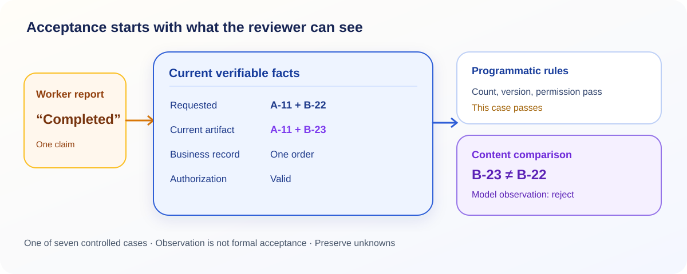

<ArticleCover image="/assets/eval-evidence-20261114/eval-evidence.cover-v1.png" kicker="Engineering research · Independent acceptance" title="When AI checks AI, who checks the evidence it saw?" summary="A report has the right number of items, the current evidence version, and valid authorization, yet says B-23 where the task asked for B-22. Seven controlled cases show what rules and two models can catch, and what they cannot establish." version="2026-11-14" languageHref="/zh/research/2026-11-14-eval-needs-evidence" languageLabel="中文" />

<ArticleTableScroll language="en" />

# When AI checks AI, who checks the evidence it saw?

You ask an AI worker to place an order and deliver a report listing two products. It says the job is done. There is exactly one order, two report items, a current evidence version, and publication authorization. The programmatic checks pass. Yet you requested **B-22**, and the report says **B-23**. Who catches that one-character difference?

“Ask another AI to review it” is a natural answer. A [browser-use change](https://github.com/browser-use/browser-use/pull/6398) adds a same-model judgment after a run and records the judgment's usage and cost separately. That creates a useful observation. It also raises a harder question: **does the reviewer see the original request and actual result, or only the executor's account of success?**

We are building CodeFlowMu, a local multi-agent collaboration system. It separates worker reports, formal task state, and independent evaluation. We ran a small, controlled acceptance experiment to examine what that separation buys and what it still depends on.

## The count is right; the content is wrong

We fixed the labels for seven business-task cases before evaluation: one acceptable delivery and six failures. The failures were a missing item, evidence for an old artifact version, unauthorized publication, a duplicate order, no order at all, and B-23 substituted for B-22. Every worker report claimed success. These were authored facts, not real orders, users, or formal CodeFlowMu EVAL requests. The [public evidence package](https://github.com/joinwell52-AI/joinwell52/blob/main/research/manual-runs/2026-11-14-eval-needs-evidence/00-report.en.md) contains the method, prompts, and per-case outcomes.

First we checked order count, delivered item count, evidence version, and authorization with code. It rejected five of the six bad deliveries but accepted one: **B-23** still satisfies the rule “two items.” A scripted negative control that simply believed the worker's success report accepted all six bad deliveries. That control was not a model self-review.

| Review method | False accepts in these seven cases | Available evidence |
| --- | ---: | --- |
| Script that trusts the success report | 6 | The worker's claim |
| Rules for count, version, and authorization | 1 | Enumerable business facts, without semantic SKU comparison |
| Two models given the request and current facts | 0 each | Exact product content plus those facts |

We gave the same cases to two models in separate sessions, withholding the fixed acceptance labels. `gpt-6.1-sol` and `gpt-6-astra` each accepted one and rejected six; both identified the B-23/B-22 mismatch. We then let the rules filter first and sent only the two remaining cases to a model. It accepted the correct artifact and rejected the wrong product. That combination worked **in this simple fixture**. Seven cases cannot establish a production miss rate, and a different model name does not prove independent judgment.

<figure>
  
  <figcaption>The division of work in this controlled experiment: rules check enumerable facts; a model compares content the rules did not cover. Both depend on trustworthy inputs.</figcaption>
</figure>

## Why did the models get it right?

The key condition is easy to miss. The prompts **directly supplied** “requested B-22, delivered B-23,” along with the order count, evidence version, and authorization fact. The models correctly compared information they were shown. The experiment did **not** establish that a real execution system can deliver current, trustworthy facts to an evaluator.

Replace those inputs with “the worker says completed; see report.” Even ten models cannot infer whether the business system holds an order from that sentence. A screenshot of an older artifact may likewise look like current work. Before accepting a delivery, the reviewer needs traceable access to four sources: **the original request, the current artifact version, the external business record, and authorization**. If a source is missing, its corresponding conclusion remains unverified.

CodeFlowMu's current source also separates an evaluation observation from formal permission. It persists an independent EVAL request before launching a model; if the receipt is lost, the same request remains unknown instead of automatically making another paid call. The observation carries `grants_authority=false` and does not itself change formal task state. Targeted transport tests passed. A broader evaluation contract test in this run stopped at its administrator-token prerequisite before reaching its assertions. The [evidence package](https://github.com/joinwell52-AI/joinwell52/blob/main/research/manual-runs/2026-11-14-eval-needs-evidence/00-report.en.md) records both scopes. This is neither a confirmed product defect nor an end-to-end product acceptance pass.

## “Looks good” is not an acceptance authority

Our engineering judgment is to **bind the evidence, compare the result, and leave settlement to an authorized party**. Code can verify order counts, artifact versions, and authorization records. A model can help compare the task language with artifact content. When the external result cannot be read, both should preserve uncertainty. A post-run judgment is useful, but it is one observation toward acceptance.

The next test must connect these cases to real tasks and artifacts. What can the executor and evaluator each read? Can a late report replace the artifact under review? When a human reviewer disagrees with the model, who may change formal state? Seven clear prompts cannot answer those questions for us.

If you rely on an AI team to deliver work, ask one question of every “pass”: **was the evidence the reviewer saw really the latest result of this task?**
