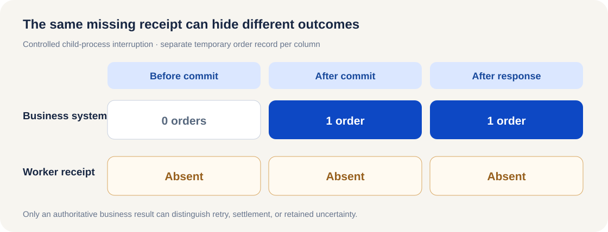

<ArticleCover image="/assets/order-receipt-20261114/order-receipt.cover-v1.png" kicker="Engineering research · Recovery" title="The order went through. The AI worker saw only a timeout. Should it retry?" summary="The business system committed an order while the AI worker saw a timeout. We killed a process at three boundaries and used a blind retry without an idempotency key as a control." version="2026-11-14" languageHref="/zh/research/2026-11-14-order-receipt-lost" languageLabel="中文" />

<ArticleTableScroll language="en" />

# The order went through. The AI worker saw only a timeout. Should it retry?

Suppose an AI worker places an order for you. After thirty seconds, it sees a timeout. It has no order number and no saved success receipt. Asking it to try again might finish the job—or ship two orders. **A timeout tells you who missed the reply, not whether the order happened.**

This has a real engineering counterpart. [Paperclip's recovery change](https://github.com/paperclipai/paperclip/pull/21522) describes a task mutation that committed on the server while its client timed out after 30 seconds. The client recorded an unknown outcome, and later runs kept hitting that uncertainty. Paperclip added settlement from final records on its own server, while retaining the fence when the result really is unknown. That raised a question for our work: **what evidence is available when an AI worker calls a separate business system?**

We build CodeFlowMu, a local multi-agent collaboration system. FCoP files preserve formal tasks, reports, and reviews. An order, however, belongs to the business system. A task file saying “executed” cannot establish that an external order succeeded; a missing local receipt cannot establish that it did not.

## Break the call at three points

We built an isolated order experiment. One child process submits an order to a temporary SQLite database; another process handles recovery. This is a research fixture, not a live CodeFlowMu integration or internet call. We terminate the child **before commit, after commit but before response, and after response but before its local receipt**. Recovery looks up the original operation key in the business record before deciding whether to retry. The [script, method, and observed output](https://github.com/joinwell52-AI/joinwell52/blob/main/research/manual-runs/2026-11-14-order-receipt-lost/00-report.en.md) can be rerun.

| Interruption | Actual orders before recovery | Worker receipt | Decision from business record | Orders after |
| --- | ---: | --- | --- | ---: |
| Before commit | 0 | absent | Retry after confirmed absence | 1 |
| After commit, before response | 1 | absent | Find and settle the original order | 1 |
| After response, before local receipt | 1 | absent | Find and settle the original order | 1 |

<figure>
  
  <figcaption>Evidence boundary in the controlled experiment: all three local receipts are absent. The business system's order record decides whether retry is justified.</figcaption>
</figure>

The first two rows look identical to the worker: no receipt. The business facts are opposite. That difference changes the next action. In the first row, an authoritative lookup establishes absence before a retry. In the second, another submission could create a duplicate. Our fixture's operation key has a database unique index, so its own repeat call cannot insert a second order. This is a property of the fixture, not a guarantee every external service offers.

We then removed the operation key and blindly retried after the order committed but its response was lost. The result was **two actual orders**. This is a deterministic program control, not a model making an autonomous mistake. It shows what a retry policy can do when it treats a client error as proof of nonexecution.

## Who can say the work is complete?

Paperclip can use its own server's final records to settle the operations it controls. In current CodeFlowMu source, incomplete original-call evidence remains `unknown` with automatic retry disabled; explicit recovery also refuses a path whose effect is unknown. **Eighteen focused tests** of recovery, approval binding, and PM review scope passed. Nine call-effect tests stopped during Windows private-directory setup because this process was not elevated, so their assertions did not run. The [evidence record](https://github.com/joinwell52-AI/joinwell52/blob/main/research/manual-runs/2026-11-14-order-receipt-lost/00-report.en.md) separates these results.

Three facts have different owners: **task facts** show what the worker was assigned and reported; **call receipts** show what the client observed; **business records** show what the external system ultimately did. Settlement depends on reading the third and binding it to the original operation. We have neither found a new CodeFlowMu defect nor established that it can automatically settle an arbitrary external business API.

The recovery rule is plain: retry when authoritative evidence proves no commit; return the original result when it proves a commit; otherwise keep the outcome unknown and ask for reconciliation. **Keeping work moving does not always mean executing it again.**

The next questions are harder. When another Host takes over, does it still have the original operation identity and permission to query? Does an independent evaluator inspect the actual business order, or only the worker's polished success report? We ran bounded cross-process handoff and rule-checking fixtures, but have not completed real two-Host or model-judge comparisons. Those questions remain open.

If you use agents to operate business systems, ask the provider one practical question: **“After a lost response, can I look up the final result by the original operation identity?”** If the answer is no, automatic retry should not be presented as the only way to continue.
