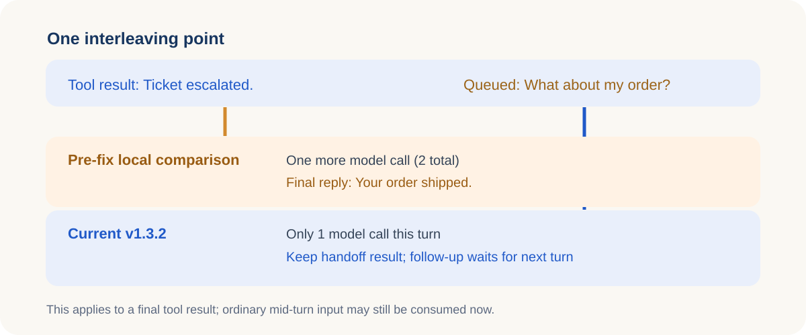

<ArticleCover image="/assets/handoff-turn-20261116/handoff-turn.cover.png" kicker="Engineering research · Agent handoff" title="The ticket was escalated. Why did the AI answer about shipping?" summary="A tool says the ticket was escalated just as the user asks about an order. In a bounded AG2 before/after comparison, one extra model call replaces the handoff result with a shipping answer. We compare that turn boundary with CodeFlowMu's delivery evidence." version="2026-11-16" languageHref="/zh/research/2026-11-16-handoff-new-message" languageLabel="中文" />

<ArticleTableScroll language="en" />

# The ticket was escalated. Why did the AI answer about shipping?

A user says, “I need a person.” The AI calls a tool, which returns “Ticket escalated.” Almost at the same moment, the user asks, “What about my order?”

If the AI immediately handles the follow-up before ending the turn, its final answer may become “Your order shipped.” The handoff happened, but its result has been replaced by a second answer. To the user, the promised human handoff seems to have disappeared. To the next worker, the last sentence no longer says clearly what the previous turn accomplished.

That is the boundary addressed by [AG2 contributor coder-abu's PR #3639](https://github.com/ag2ai/ag2/pull/3639). AG2 is an agent development framework. Here, a tool can require its result to end the turn, or hand the call to a client for completion. Before the fix, AG2 skipped its normal tool loop but still drained input queued during the turn and called the model once more. The extra response replaced the final tool result. During a client handoff, the model could even continue before the client's tool result came back. The fix returns the forced result first and leaves queued input for the next turn **on the same stream**.

## Turn “almost simultaneous” into a repeatable test

We pinned AG2 v1.3.2 and used its scripted model and event subscription. The first request asks for a person. A final tool returns `Ticket escalated.` When the tool result arrives, the test queues `What about my order?`; the scripted model has `Your order shipped.` ready as an answer. These strings are test data, not a real order status.

To isolate what changed, we inserted only the pre-fix `_execute_turn` function body into the rest of the current runtime, then compared it with the current function:

| Same interleaving point | Final reply for this turn | Model calls in this turn |
| --- | --- | ---: |
| Pre-fix loop body with the current remaining runtime | `Your order shipped.` | 2 |
| Current v1.3.2 loop body | `Ticket escalated.` | 1 |

We also ran three relevant AG2 regression tests: retaining a final tool result, resuming a client handoff after its tool result, and consuming ordinary mid-turn input in the current turn. All three passed. The “pre-fix” row is a **function-level causal comparison**, not a full run of an old release or a live model provider. The [public experiment script, pinned versions, and results](https://github.com/joinwell52-AI/joinwell52/blob/main/research/manual-runs/2026-11-16-turn-boundary/00-report.en.md) make that limit explicit.

The fix does not mean every new message must wait. Ordinary tools may still consume input during the current turn if the model is continuing. The important distinction is that **once a tool has ended the turn or handed control to a client, a follow-up must not silently reopen that result.** AG2's PR also notes that adapters creating a fresh stream for every request need a separate answer about where queued input lives.

## Compare our multi-agent system

CodeFlowMu is our local multi-agent collaboration system. It too can send a person's new instruction to a running worker, but it does not implement AG2's stream. Our comparison therefore asks a more basic question: **was a message saved, delivered to the native process, or consumed by the model in this turn?**

Our local probe crossed CodeFlowMu's actual native delivery method. If the process had already ended, it returned `not_live` and wrote nothing to the process. If the process ended during a write without a native delivery receipt, it returned `unknown` and saved the input. Looking up the same request again retained `unknown`, with no second write. Twenty-seven relevant coordination and delivery regressions passed. Two full integration cases stopped at the prerequisite for a trusted administrator test environment; **we did not count them as passing**.

These observations show that the tested local boundary does not equate “saved” with “the model received it.” They do not establish how every live Host assigns a turn at the handoff instant, or make a chat follow-up into a newly authorized formal task. FCoP records formal task, report, and acceptance facts across employees. A Host's conversation turn is a separate boundary. They need to be linked, not used as evidence for each other.

## The next question

This research did not confirm a CodeFlowMu product defect or produce a development review item. The next valuable experiment is to send a follow-up **during work, at handoff, and after process exit** on the same real Host, then compare the final reply, native delivery receipt, model-call count, and any new execution attempt. Without that evidence, AG2's fix is not a CodeFlowMu ticket.

For engineers designing multi-agent work, the case raises a genuine choice: when a worker has already produced a handoff result, should new input wait for the next turn on the same stream, require redelivery, or start a separate session? Products may choose different experiences. They still need to show the user **what the previous turn delivered, where the new message went, and who is allowed to continue**.

Our AG2 comparison used a pinned version, scripted model, and one substituted function. The CodeFlowMu comparison used a controlled child-process stand-in. The [English experiment record](https://github.com/joinwell52-AI/joinwell52/blob/main/research/manual-runs/2026-11-16-turn-boundary/00-report.en.md) lists versions, the public rerun probe, and the limits of the restricted product evidence.
