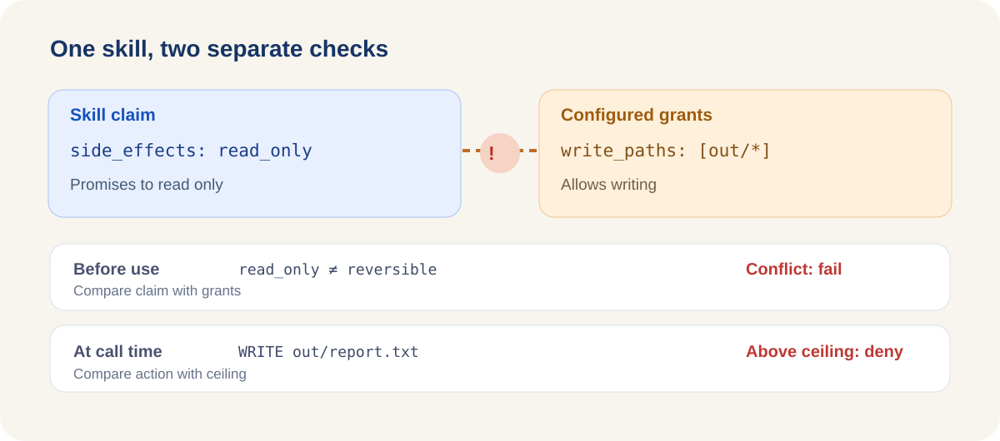

<ArticleCover image="/assets/skill-side-effect-20261119/skill-side-effect.cover.png" kicker="Engineering research · Skill boundaries" title="The skill says read-only. The permission grants write. Which wins?" summary="One skill promises to read. Its permission file allows writing. We brought the two claims together at validation and at the operation boundary." version="2026-11-19" languageHref="/zh/research/2026-11-19-skill-says-read-only" languageLabel="中文" />

<ArticleTableScroll language="en" />

# The skill says read-only. The permission grants write. Which wins?

You install a “code review” skill for an AI team. Its instructions sound restrained: read the change, identify risks, and leave the files alone. Then you notice a line in its permission file allowing writes to `out/*`.

The important question is not whether the author probably meant to write a report. It is **what the system does when a skill's claim and its effective permissions disagree, both before installation and when a tool call arrives.** A task's read-only boundary cannot be proved by the skill's name.

## One contradictory skill

[Mansura Habiba's Bulbasaur repository](https://github.com/mansura-habiba/bulbasaur-skill-cli/pull/25) recently merged a concrete approach: declare a side-effect ceiling for a skill, compare it with permission grants using the same operation-cost model, and apply the ceiling again to attempted operations. This is the author's own project, not an official AGENTSAFE implementation.

At the pinned merge revision, we made two synthetic skills. Both declared `read_only`. One allowed writing to `out/*`; the other had an empty write allowlist. We ran the actual validator, then asked the actual runtime decision code about a read and a proposed report write. **The probe requested decisions only; it did not modify a file.**

| Skill and proposed action | Before-use validation | At-operation decision |
| --- | --- | --- |
| Read-only claim with `out/*` write grant | Fails: `declared=read_only`, `implied=reversible` | Writing `out/report.txt` denied by the side-effect ceiling |
| Same conflicting configuration | Same | Reading `in/change.diff` allowed |
| Read-only claim with empty write allowlist | Passes | Writing `out/report.txt` denied by the empty allowlist |

All 13 upstream side-effect contract tests passed at this revision, as did our six additional assertions. These are two different checks: **validation compares the promise with the configured permission; the runtime compares the attempted operation with the actual ceiling.** Keeping only the second check would let a contradictory configuration reach deployment.

## Asking the same question of CodeFlowMu

CodeFlowMu is our local multi-agent collaboration system. It has skill registration and a separate path that derives facts from proposed tool operations and checks negative boundaries. We ran two bounded comparisons against a pinned clean revision, **without executing a tool**.

First, its skill-record schema accepted a tool marked `low` risk that also listed a write permission; adding `side_effects: read_only` was rejected. The current record format **does not express Bulbasaur's side-effect ceiling**. That is not proof that a low-risk skill can write freely: `risk_level` is not a read-only promise, and a schema-valid record is not an operation authorization.

Second, we proposed reading and writing the same protected source path, changing only the tool name. The real operation-fact classifier marked the read as `read`, without a protected-write match. It marked the write as `write` and matched `NEG.PROTECTED.BOUNDARY.WRITE`. Six assertions passed. Thus, the tested action classifier did not mistake a write for a read merely because a skill is described as “review.” This stops at fact classification, not a full approval or execution. The current skill injector explicitly runs in stub mode; we did not reproduce a deployed read-only skill writing a file.

## Three pieces of evidence for one call

For a multi-agent team, ask three separate questions: What does this task permit? What does this skill promise and what permissions does it hold? What will this particular tool call actually change? The answers come from different places and must not impersonate each other.

Bulbasaur offers a useful order of checks: catch the declaration–permission conflict early, then decide again before an operation. CodeFlowMu can classify the tested action and protected target, but this round did not establish that skill claims, task authority, and each call are already joined in one contract. We **have not confirmed a product defect or opened a development item**. Before assessing a change, we need a live-skill experiment tying a versioned skill, effective grants, FCoP formal task boundaries, and operation facts to the same call.

If your team uses AI skills, put three columns beside one ordinary “read-only” skill: **its claim, its configured grants, and one actual request**. Which column still depends on a guess? That is where evidence is missing. The pinned revisions and exact scope are in our [English experiment report](https://github.com/joinwell52-AI/joinwell52/blob/main/research/manual-runs/2026-11-19-skill-side-effects/00-report.en.md).
