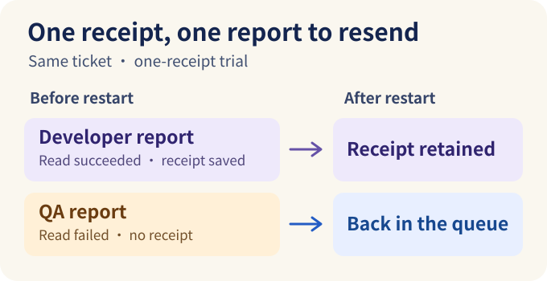

<ArticleCover image="/assets/digital-employee-handoff-20261122/handoff.cover.png" kicker="Digital employees · Team handoffs" title="Two digital employees filed reports. Which one should come back after a restart?" summary="Two workers file reports for one ticket. The lead acknowledges just one. Three restart trials show how per-report receipts recover the unfinished handoff." version="2026-11-22" languageHref="/zh/research/2026-11-22-digital-employee-handoff-receipts" languageLabel="简体中文" />

<ArticleTableScroll language="en" />

# Two digital employees filed reports. Which one should come back after a restart?

In our controlled trial, two digital employees file reports for the same ticket. The developer explains what changed. The tester explains what they checked. The project lead reads the developer’s report, but the attempt to open the tester’s report fails. Then the system restarts. Both files are still on disk. Which one should return to the lead’s queue?

We used this scenario to test CodeFlowMu, the multi-agent collaboration system we’re building. The lead is a digital employee too, responsible for delegating work, gathering reports, and reporting back to the requester. Resend both and the lead has to revisit a report already received. Skip both and the tester’s report may sit on disk while nobody follows up. **Progress has to be recoverable for each individual report.**

## Same files, three recovery outcomes

We wrote two synthetic reports for the same ticket in a temporary project and let the system queue them for a busy lead. Every trial started with the same files. We varied how many successful reads the first process acknowledged before exiting. Then we started a fresh process against the same project.

| Successful read receipts before exit | Reports requeued by the new process |
| --- | --- |
| None | Implementation and verification |
| Implementation only | Verification only |
| Both | Neither |

We began each trial with a simulated failure to read the verification report and checked that the failure produced no receipt. In the one-receipt trial, the implementation report and its receipt both survived on disk. The verification report alone returned to the queue.

## What the files and receipts tell you

The report file records what the worker submitted. A receipt records which report the lead received for this ticket. On the path we tested, a successful read event writes a receipt for that file to disk. The new process checks the reports one by one and requeues those with no receipt. The old in-memory queue can disappear while the files and receipts preserve enough information to rebuild it.

We restarted processes running CodeFlowMu Runtime 3.1.11. The watcher, dispatcher, and receipt store were real. A simulated lead session supplied the read events. The figure shows which report returned to the queue. How the model uses a report, whether the lead accepts it, and which revision the acceptance covers still need a trial with the full team workflow.

## What happens when the work has a second version?

A CrewAI fix addresses a nearby problem. A worker could rewrite a file at the same path, only for the second save to hit the cache and return the first version’s URL. Our trial asks which report needs another delivery attempt. The CrewAI case asks which revision the report actually points to. A complete handoff needs evidence for both. [CrewAI fix](https://github.com/crewAIInc/crewAI/pull/9595)

Try one ticket in your own system. Let two workers file reports, acknowledge just one, and restart. Check which report comes back. Then submit a second revision and find out which version the lead and the reviewer actually see. If the reviewer signed off on version one, what status does your system show for version two?
