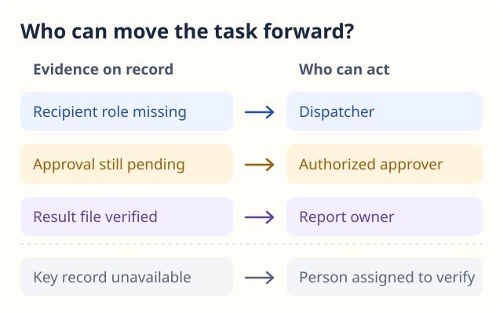

<ArticleCover image="/assets/covers/2026-11-23-digital-employee-handoff-triage.png" kicker="Digital employees · Team handoffs" title="The agent still hasn’t filed its report. Who should the manager ask?" summary="Nine local runs in CodeFlowMu show how an undelivered task, a pending approval, and a saved result can all produce the same report queue response." version="2026-11-23" languageHref="/zh/research/2026-11-23-digital-employee-handoff-triage" languageLabel="简体中文" />

<ArticleTableScroll language="en" />

# The agent still hasn’t filed its report. Who should the manager ask?

You assign an agent to reconcile a payment. By afternoon, there’s still no report. Do you send the assignment again, check with the approver, or ask the worker to hand over the result? Each response makes sense at a different point in the job. Reassigning a finished reconciliation duplicates the work. Chasing a report from someone who never got the assignment won’t move it along.

The question came up while we were studying AG2. Its workflow can record a timeout when the next participant has been silent for too long. A manager who gets that warning still has to decide **who can move the work forward**. We took the same reconciliation assignment and stopped it at three different points in CodeFlowMu, our local system for coordinating multiple agents. We ran each scenario three times. [AG2’s turn-timeout change](https://github.com/ag2ai/ag2/pull/3703)

## One assignment, three stopping points

We let CodeFlowMu dispatch the task, persist the approval record, and settle the session using its normal runtime code. A test adapter stood in for the model. In the third scenario, the probe wrote a reconciliation result to the temporary workspace and read it back.

| Where work stopped | What we read back | Who can take the next step |
|---|---|---|
| The task never reached the worker | The dispatcher recorded that the recipient role could not be found. No session started in any of the three runs | The person assigning the work can check the recipient before sending it again |
| The worker was waiting for approval | The session started, an approval request remained pending, and the requested action had yet to run | The authorized approver can decide on the request |
| A result was ready, with no report filed | The session ended. The saved file showed 120 expected, 120 received, and a difference of zero. The formal report directory was empty | The person responsible for delivery can verify the existing result and file the report |

We fed the observed session and report facts from all nine runs into the repository’s report-queue function. Each returned “waiting for report.” **The six runs covering approval and unfinished delivery even returned the same reason: the session ended without a report.** Leaving both cases on “wait” gives neither the approver nor the person responsible for delivery a clear cue to act.

*The first three rows reflect the local experiment. Below the dotted line is a proposed response when a key record is missing.*

## Give the next person evidence they can act on

“Waiting for report” describes what the manager sees. A handoff that helps the manager act also needs to explain who owns the next step and what evidence points to them. An explicit delivery failure points to the person who assigned the work. A pending approval tied to the assignment points to the approver. A verifiable result tied to the same assignment gives the person filing the report something to build on.

The harder cases come when a record is missing. If the approval request can’t be read, handing the job straight to the person filing the report could skip an unresolved decision. If the result file can’t be found, the session record still tells you that the session ended. The next step can be a targeted check assigned to someone who can perform it: verify the approval status or locate the result for this particular attempt.

This local comparison exercised CodeFlowMu’s underlying records and called one queue function directly. A live host, the full product UI, and business acceptance are outside the experiment. The nine controlled runs show that different stopping points can produce the same queue result. They give no estimate of how often that happens in practice. The comparison used CodeFlowMu Runtime 3.1.11. [See the evidence for all nine runs](/assets/digital-employee-handoff-20261123/controlled-runs.json)

The next time an agent goes quiet, ask **who could pick this up in ten minutes using the records we already have, without doing the work again?** The harder design question is what to do when one of those records is temporarily unavailable. Someone still needs to own the investigation, while the original action may already have happened.
