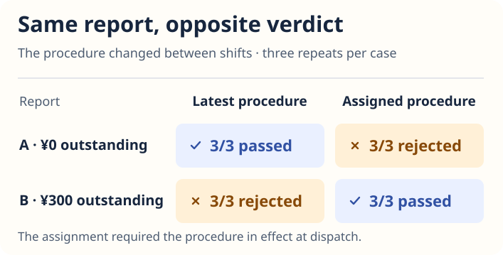

<ArticleCover image="/assets/covers/2026-11-24-sop-version-handoff-reader-v2.png" kicker="Digital employees · Handoff and review" title="Why did the reviewer get it wrong when an AI worker took over?" summary="Two reports on the same rent payment have correct arithmetic, yet the review reverses the verdict. A handoff experiment examines which procedure applies, when it can change, and what work can be carried forward." version="2026-11-24" languageHref="/zh/research/2026-11-24-sop-version-handoff" languageLabel="简体中文" />

<ArticleTableScroll language="en" />

# Why did the reviewer get it wrong when an AI worker took over?

Imagine a car rental company assigning rent reconciliation to AI workers. The morning reconciliation agent starts the assignment, and another agent takes it over in the evening. A separate review agent checks the payment records and the procedure before deciding whether to accept the report.

The assignment shows ¥3,000 due, ¥2,700 received, and a provisional ¥300 waiver awaiting approval.

When the job was assigned, procedure V1 counted approved waivers only. The report should leave the ¥300 difference open. V2 was published that afternoon and allowed provisional waivers to count. One line on the assignment says **to finish this attempt under the procedure in effect when the job was assigned**.

| Report | Calculation | Conclusion |
|---|---|---|
| Zero balance | 3,000 − 2,700 − 300 | The account reconciles. |
| ¥300 outstanding | 3,000 − 2,700 | The waiver is still pending. |

**Which report would you accept?** Make the call using the assignment, then consider what happens if you open the afternoon procedure first.

The second report should pass under the original terms. In our experiment, the reviewer recalculating under V2 accepted the zero balance and rejected the ¥300 balance. Both subtractions were correct. The worker and reviewer had assumed that publishing a new procedure made it apply to this open assignment.

We ran the handoff in **CodeFlowMu**, the local multi-agent coordination system we develop. **FCoP**, its file-based coordination protocol, defines how assignments, reports, and reviews are recorded and linked. Scripts simulated the two roles under separate test identities and called the product interfaces with synthetic accounting data. We used that setup to check what evidence survives a handoff. Live model behavior is the next question.

## The reviewer did the math. What did it miss?

We set the expected result before running the experiment. The assignment still used V1, so it should show ¥300 outstanding. We held the accounting data and assignment terms fixed and varied two things: whether V2 appeared before handoff, and whether the incoming worker opened the current procedure or retrieved the copy specified by the assignment. Each of the four combinations ran three times. We applied both review strategies to every report, for 12 runs and 24 review decisions.

In the first six runs there was no update. The current and assigned copies were both V1. All six reports showed ¥300 outstanding, and both strategies accepted them. The shortcut of opening the current procedure looked reliable while the two versions were identical.

In the six runs with an update, opening V2 produced three zero-balance reports. Retrieving V1 produced three reports with ¥300 outstanding. Recalculating under V2 accepted the first three in error and rejected the other three in error. The assignment-based check reached the expected verdict on all six. For the same report and bank record, the two review strategies returned opposite verdicts.

*Report A shows zero and Report B leaves ¥300 outstanding. Each combination was repeated three times. The current-version strategy recalculated the amount. The assignment-based strategy also checked the version and file fingerprint. The experiment did not isolate the contribution of each of those checks.*

## Can the next shift find the right copy?

The question grew out of a fix in **StaffDeck**, OpenBMB’s open-source platform for publishing operating procedures to AI workers. Its database initialization used to migrate some procedure IDs. In the regression example, an expense procedure published as `sop_expense_policy` could be renamed to `skill_expense_policy` in storage while published references still pointed to the original ID. The fix preserves published IDs and restores a previously renamed ID when it can confirm the relationship and finds no conflict. The test checks that the original ID still retrieves the procedure after database initialization and that the agent can still see it.

That test answers whether the procedure is still findable. We took the next question to CodeFlowMu: if the identifier still works but the text changes, how does the evening shift know which version applies to the morning assignment? [StaffDeck fix and regression test](https://github.com/OpenBMB/StaffDeck/commit/389d5d331cf40eb5f0aae83c4fa24f4ed10b0003)

| What the incoming worker needs | What it establishes |
|---|---|
| Procedure identifier | Which procedure to look up |
| Version | Which revision it retrieved |
| Assignment terms or effective approval | Why that revision applies to this job |
| Retrievable source text | What the procedure actually says |

We tested that last condition separately. We left the V1 reference and fingerprint on the assignment, kept V2 available, and removed the V1 text. The retrieval program reported the missing source. The assignment stayed active, with no report or review filed. A fingerprint can verify a recovered copy. The worker still needs the text to read its clauses.

## What if the assignment really does switch to V2?

We prepared two separate assignments at the same point in the work. The morning reconciliation script verified the same synthetic ¥2,700 bank payment on each and calculated zero eligible waiver under V1. A second test identity examined the evidence and filed a review record. Neither assignment had a final report yet.

After V2 came out, a test administrator approved the switch for one assignment only. The decision said to keep the existing payment check and reassess the waiver under V2. The other request stayed pending. We changed both the worker and reviewer identities and reopened the work through the task interfaces.

| Result after handoff | Switch pending | Switch approved |
|---|---:|---:|
| Procedure used | V1 | V2 |
| New payment checks | 0 | 0 |
| New waiver calculations | 0 | 1 |
| New waiver reviews | 0 | 1 |
| Balance confirmed in review | ¥300 | ¥0 |

Both assignments retained their original payment verification records, with matching fingerprints before and after handoff. We read back the two formal reviews and checked their references to the corresponding reports and earlier evidence. Only the approved assignment cited a switch decision effective for its own attempt. Both assignments reached the review stage. In this paired test, the approval specified what to retain and what to redo. The script followed that decision.

## When does yesterday’s evidence stop supporting today’s result?

Suppose the bank later reverses the ¥2,700 payment. The original verification file can remain byte for byte identical, while the conclusion that the money is still in the account no longer holds. The file fingerprint helps establish what record was carried forward. The original material and the conditions under which it was checked establish whether the result still applies.

In this case, the payment check depends on the bank record and the verification conditions. The waiver depends on its application, approval status, and the applicable procedure. The balance depends on both results. When just the waiver treatment changes and the payment evidence still applies, the payment check can carry forward. A reversal calls for another payment check and a revised balance.

## What must an AI worker receive at handoff?

**The assignment defines the work, a role skill guides the investigation, and tools exposed through the Model Context Protocol (MCP) give the agent a way to do it.** The reconciliation agent reads the assignment and the rule it specifies, checks the bank and approval records, and files its report. The review agent gets a reference to that specific report, opens the source material and applicable rule, and makes a separate judgment.

The experiments exercised the recordkeeping side of this design. FCoP provides retrievable, linked files for the assignment (`TASK`), report (`REPORT`), and review (`REVIEW`). The report identifies the assignment and attempt. The review points to the report it examined. CodeFlowMu carries the same assignment and attempt through the handoff and lets each role look up approvals scoped to that work. An earlier agent’s chat or reasoning can suggest where to look. The files and original materials establish what was submitted, what took effect, and what evidence is available.

A tool receipt can show that the worker retrieved V1. An operation log can show that it ran the payment check. Interpreting the rule remains the job of the reconciliation agent and its independent reviewer. The organization authorizes any change to the procedure for open work, and the workflow carries that decision and its evidence to the relevant roles.

## What should a second agent add?

Separate calculations can agree when both reviewers inherit the same mistaken premise. The next tests introduce live agents and measure what independent review actually checks.

1. **Report first or evidence first?** Give both groups the same assignments and records. One reads the report first. The other checks the source and records an initial judgment before seeing it. Include correct reports and reports with correct arithmetic under the wrong rule. Compare false approvals and false rejections. A measurable improvement would give us grounds to change the review skill.
2. **Did the worker retrieve V1, and did it apply it correctly?** In one case, the report claims it opened V1 but the complete tool log has no matching call. In another, the receipt confirms retrieval, yet the report deducts a waiver that V1 disallows. Score the missing operation evidence separately from the incorrect interpretation.
3. **Which earlier steps need to be repeated?** Give the incoming agent one case where only the waiver treatment changes and another where the bank reverses the payment. Leave the rework list open. Record necessary steps it missed and valid work it repeated. Then check whether the handoff files captured the evidence and conditions each prior result depended on.

For each comparison, define the expected outcome first and hold the model version, role skill, permissions, and tools constant. The results will guide two different design choices: what the handoff record needs to say so a new worker can continue, and what the reviewer needs to investigate to produce evidence that can change the original verdict.

## Experiment notes and records

The first round included 12 runs and 24 review decisions, with 12 formal reviews from the assignment-based strategy, plus one check with the original procedure missing. The second round was a single paired follow-up. The accounting data, identities, and approvals were test fixtures. Scripts selected steps and applied the accounting rules. No language model was called. The repetitions check consistency on the controlled path. Full business acceptance was outside the tested stage.

The public summaries show amounts, verdicts, call counts, and recorded states. Re-running the study externally would also require the full scripts, commands, procedure texts, and detailed redacted logs. The summaries identify CodeFlowMu revision `0d2d4e742ef2f3cb48e3ce09cc47f0c03053dc5f` and FCoP 4.0.5. The first round also records FCoP MCP 4.0.5.

- [Twelve runs and the missing-procedure check](/assets/sop-handoff-20261124/controlled-runs.json)
- [Paired follow-up for the two assignments](/assets/sop-handoff-20261124/selective-migration-runs.json)
