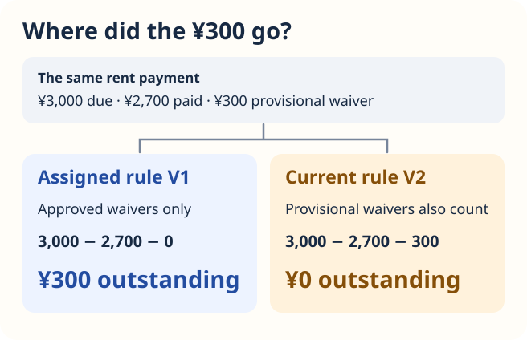

<ArticleCover image="/assets/covers/2026-11-24-sop-version-handoff.png" kicker="Digital employees · Handoff and review" title="The procedure changed between shifts. How should the next agent reconcile the account?" summary="One assignment, one rent payment, and two versions of the procedure. Twelve comparisons show how independent review can miss a change in the rule it applies." version="2026-11-24" languageHref="/zh/research/2026-11-24-sop-version-handoff" languageLabel="简体中文" />

<ArticleTableScroll language="en" />

# The procedure changed between shifts. How should the next agent reconcile the account?

Just before handoff, the supervisor opens the rent reconciliation report. The bottom line says **¥0 outstanding**. Beside it is the review: **passed**.

He is about to sign off when he remembers the waiver request from the morning shift. Only ¥2,700 of the ¥3,000 rent came in. Someone still needs to approve the remaining ¥300. He opens the request. It still says *provisional*.

The evening worker read the right payment record. The reviewer worked the numbers independently. Where did the ¥300 go?

## The ledger stayed the same. What counted had changed.

Run it back. Under the morning procedure, only approved waivers count. Subtract the ¥2,700 payment and zero in eligible waivers from the rent, and ¥300 remains open. By the next shift, the revised procedure also counts provisional waivers. The payment record and waiver request are unchanged. The balance on the report drops from ¥300 to zero.

Zero might have been the right answer on a new assignment issued under the updated procedure. This assignment, though, said to **finish the current attempt under the procedure in effect at dispatch**. The evening worker used the copy open in front of them. QA ran a separate calculation using the same copy. Neither copied the other’s answer. Both missed the rule written into the assignment.

That scene comes from a local experiment with synthetic data. The idea started with a StaffDeck change that keeps the same public procedure ID available after the database is reopened. A stable ID keeps a reference usable. It also gives us a question to test: when the next shift follows that reference, will it find the exact text the morning shift used? [StaffDeck’s change and regression test](https://github.com/OpenBMB/StaffDeck/commit/389d5d331cf40eb5f0aae83c4fa24f4ed10b0003)

*The local experiment used the same ledger inputs. The ¥300 difference comes from whether a provisional waiver qualifies under the two versions.*

## Put the “correct” report back on the reviewer’s desk

In CodeFlowMu, our local multi-agent coordination system, we created, claimed, and submitted the reconciliation assignment through the real task and report interfaces. A test harness drove the handoff and review. For the first six runs we kept the procedure unchanged. The worker could open the current copy or retrieve the version named in the assignment. Either way, ¥300 remained open, and both review methods agreed. At that point the two approaches looked interchangeable.

Then we updated the procedure to V2. In three runs the incoming worker used the current copy. In another three the worker retrieved V1 from the assignment. We checked each filed report twice: once by recalculating under the current rule, and once against the original assignment. The two sets of reports traded places on the reviewer’s desk.

| What changed between shifts | What the worker read | Reported balance | QA using the current copy | QA using the assigned version |
|---|---|---:|---|---|
| No update, six runs | Both paths reached V1 | ¥300 | All six passed | All six passed |
| Updated, three runs | Current V2 | ¥0 | All three passed | All three rejected |
| Updated, three runs | Assigned V1 | ¥300 | All three rejected | All three passed |

You might expect a reviewer using V2 to let the zero balances through. The surprise comes when they see the three correct ¥300 balances and send all three back. A second pair of eyes really did check the work. But when both pairs of eyes rely on the current page, **review can mistake a change in the rules for a mistake by the worker.**

In the experiment, QA read each filed report using its own identity, checked the assignment and attempt, then went back to the task for the procedure. The original-version judgment was filed as a formal review of the specific report. We could trace both mistakes: which provisional waiver entered the calculation, and which version prompted QA to reject a correct balance.

## Can the previous shift hand over the old procedure too?

In one more run, we removed the original text. The assignment still held its ID and file digest, and the new version still opened. The incoming program knew which version was missing, but had nothing to read. The task stayed active without a report. **A fingerprint can verify the file in your hands. It cannot give you back a file you’ve lost.** To pick up the job, the evening shift needs to be able to open the exact procedure the previous shift used.

We exercised the real task and report interfaces. The rules for review and archiving were supplied by the harness. Live models, a complete desktop handoff, and business acceptance remain untested. [See all 12 comparisons and the missing-version control](/assets/sop-handoff-20261124/controlled-runs.json)

Now imagine the update is a safety check that must take effect that evening. The next shift needs to follow the new procedure, and the reviewer still needs the old text to explain what the previous shift did. The supervisor from the opening scene now needs two records: **who decided this assignment had to switch, and which earlier results can still be used.** If another reviewer takes over tomorrow, will they be able to find both answers?
