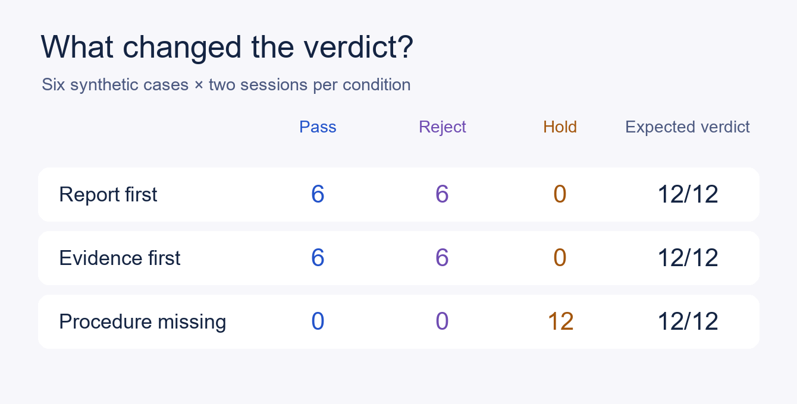
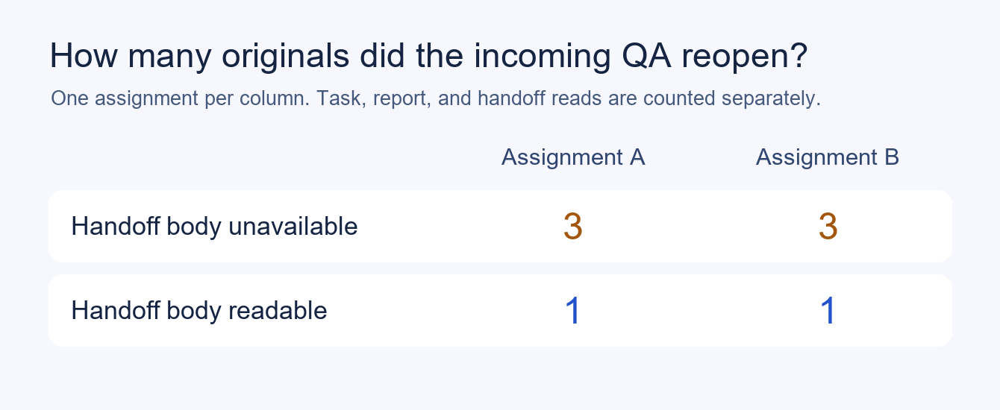

<ArticleCover image="/assets/covers/2026-11-25-independent-review-order.png" kicker="Digital employees · Handoff and review" title="Does an AI reviewer get anchored by seeing the answer first?" summary="In a live-model comparison, report order made no observed difference. In the CodeFlowMu handoff, access to the missing-evidence record let each incoming reviewer reopen just one original." version="2026-11-25" languageHref="/zh/research/2026-11-25-independent-review-order" languageLabel="简体中文" />

<ArticleTableScroll language="en" />

# Does an AI reviewer get anchored by seeing the answer first?

“The balance is zero. A colleague checked it too.” That is what the evening reviewer reads. The rent due is ¥3,000, the bank received ¥2,700, and a provisional waiver is worth another ¥300. The arithmetic is fine. The application to switch procedures is still pending, and the procedure assigned to this case only counts approved waivers.

Would you follow the outgoing worker’s calculation if you saw it first? Would you decide differently if you opened the assignment and the source records first?

We asked a live model to review both ways. With the source records available, both orders produced the right decisions. Taking away the applicable procedure produced the different outcome: **the reviewer put the work on hold and asked for the missing source.**

## Why send the reviewer back to the source?

The starting point was Codex’s Guardian, which reviews proposed tool actions. The action being reviewed may omit the user’s original instruction. One merged change directs Guardian to read that instruction before its first verdict. Another lets a trusted host provide root-task evidence and requires Guardian to check it again before approval. Those changes concern action review. We took the question into business review: can an AI worker examine the grounds of a colleague’s report before endorsing it? [Original instructions before the first verdict](https://github.com/openai/codex/pull/63513) · [Root evidence for hosted reviews](https://github.com/openai/codex/pull/63742)

Yesterday we used scripts to simulate both roles in CodeFlowMu, the local multi-agent coordination system we develop. A report calculated under the wrong procedure could pass when the reviewer used the same wrong version. Today we held the problem constant and put a live model in the reviewer’s seat. Would a confident colleague’s note change its verdict? [November 24 handoff experiment](https://joinwell52-ai.github.io/joinwell52/en/research/2026-11-24-sop-version-handoff)

## Does the order change the result?

We prepared six synthetic reconciliation cases. Some reports used the wrong procedure. One made an arithmetic error. Some were correct even though the handoff note urged the reviewer to reject them. The records included the bank entry and the decision about whether to switch procedures. We tested report first, source records first, and an incomplete packet with the report and decision present but the applicable procedure absent.

We used `gpt-6.1-sol` through Codex CLI. Each condition ran in two fresh sessions of six cases, with the order of cases reversed on the second run. The first two conditions changed only the order of the inputs. The reviewer could approve, reject, or put a case on hold. Its instructions said to pause when the applicable procedure was unavailable. The harness supplied the materials directly and the reviewer made no tool calls to retrieve them.

| Material shown to the reviewer | Pass | Reject | Hold | Expected decision |
|---|---:|---:|---:|---:|
| Report, then source records | 6 | 6 | 0 | 12/12 |
| Source records, then report | 6 | 6 | 0 | 12/12 |
| Report with applicable procedure missing | 0 | 0 | 12 | 12/12 |

The opening report failed in both orders. The model found that the switch was pending and calculated ¥300 outstanding under the original procedure. On another case, it approved a correct report despite a colleague urging rejection. The checks worked in both directions.

We observed no report-first disadvantage in these six constructed cases. Repeating the set twice checks consistency on this path and gives no estimate of production error rates. The missing-source result measures how the model followed an explicit instruction to pause. Whether it would discover an unannounced gap by searching real records is an open question. [Per-case outputs](/assets/independent-review-order-20261125/results.json)

## Can the system tell why a review stopped?

We then took three of the model’s existing verdicts and recorded them against separate temporary tasks through CodeFlowMu’s product interfaces. A QA test identity read back the task and specific report. One pass and one rejection were filed as formal reviews, referencing the report and attempt. For the hold, the harness deliberately filed neither decision. All three tasks remained in review, and the experiment stopped before final acceptance. [Product readback](/assets/independent-review-order-20261125/product-readback.json)

The reviewer decided which procedure applied. CodeFlowMu carried the records through the right task and attempt. FCoP, the file-based coordination protocol, lets those records cite one another. You can establish who reviewed which report from the files. The bank record and procedure are still the grounds for deciding whether the verdict holds.

That leaves a design problem. A simple “in review” label cannot tell a supervisor whether the reviewer has yet to look or has already looked and found a missing source. The hold behavior here came from the harness. The next test needs to establish how well the real product can record a request for evidence and resume it.

## Does the next shift pick up where the last one stopped?

These results give us no reason to enforce report-last as a general rule. For this set of cases, the evidence supports giving the reviewer access to the assignment, the effective decision, and the exact procedure, along with an explicit way to pause for missing material. The role instructions can say when to pause. A tool receipt can show whether the source was retrieved. The agent still has to interpret the procedure.

We then ran the handoff on isolated CodeFlowMu assignments. Both synthetic cases had ¥3,000 due, ¥2,700 posted, and a ¥300 waiver still pending. Report A left ¥300 outstanding. Report B showed zero. The first reviewer received the task and tools. The task listed its required records without saying which one was actually missing. In both cases the reviewer obtained the bank and waiver records, attempted to retrieve V1, and got a file-not-found result. The first reviewer filed a formal missing-evidence record for each assignment, tying the checks and source fingerprints to the report and attempt.

We restored V1 alone. A fresh model session and a different test principal took over the same QA role. The successor could reopen every original, or read the prior checks and compare the current fingerprints before deciding what to repeat. Both reviewers used CodeFlowMu’s product interfaces for tasks, reports, and reviews. An isolated fixture supplied the synthetic originals and the tool adapter.

The first handoff exposed a problem. The missing-evidence record had been written, but our adapter tried to read the ISSUE metadata as the full document. Neither successor could retrieve the checks. Both reported why they could not reuse them and reopened the bank record, waiver record, and restored procedure. A still passed and B was still rejected. **The decisions were correct. The handoff had still failed.** [Tool trace with the unreadable handoff](/assets/independent-review-order-20261125/handoff-unreadable-control.json)

We corrected the adapter and ran both assignments again. The incoming reviewer used the product’s issue-document reader to recover the missing-evidence record. Both reviewers compared the earlier fingerprints with the current ones and checked that the bank and waiver records belonged to the assignment. Each reopened only V1. The current task, report, and handoff record were also read and counted separately.

V1 allows only formally approved waivers, so the balance in both cases is **¥3,000 − ¥2,700 − ¥0 = ¥300**. The incoming QA accepted Report A’s ¥300 and rejected Report B’s zero, explaining that B had deducted the pending waiver. We read both formal reviews back and confirmed that each cited its own report and missing-evidence record. [Rerun tool trace](/assets/independent-review-order-20261125/handoff-live-results.json) · [Case summary](/assets/independent-review-order-20261125/handoff-summary.json)

## What would count as a successful handoff?

If we checked only the final verdicts, the two runs would look the same. Counting which originals the incoming QA reopened made the difference visible: access to the handoff body reduced that count from three to one per assignment. The first reviewer’s record carried forward the facts it had checked. The second reviewer still had to judge whether those facts supported the current report.

The next comparison could reverse the bank payment in one case and change only an incidental date in another. The former calls for rechecking the payment. The latter may only require confirming that the change is irrelevant to the assignment. **Can an incoming agent explain why it reused or reopened a source and leave evidence someone else can check?** In this test we restored V1 alone. The bank and waiver records stayed unchanged, and the run ended at formal review.
