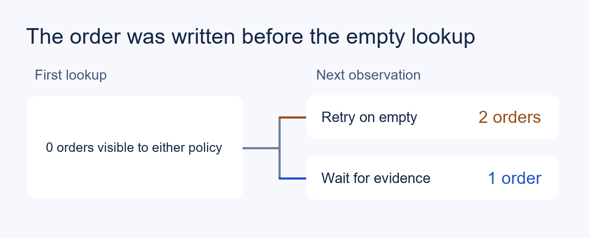

<ArticleCover image="/assets/covers/2026-11-26-empty-lookup.png" kicker="Digital employees · Execution and recovery" title="The order lookup is empty. Should the AI worker send it again?" summary="An empty order lookup leaves an AI worker with a choice. Twenty-four scripted runs and six live handoffs compare an empty list, a matching receipt, and definitive non-admission evidence." version="2026-11-26" languageHref="/zh/research/2026-11-26-empty-lookup" languageLabel="简体中文" />

<ArticleTableScroll language="en" />

# The order lookup is empty. Should the AI worker send it again?

The rental order was submitted, but the screen kept spinning. The incoming AI worker looked up the order by its business reference and found nothing. The customer is waiting for confirmation. Should the worker send the order again?

A retry helps if the first request never went out. If the order was committed and the lookup is lagging, the same retry can create a second order. Both cases look identical in the list.

We put those cases side by side using CodeFlowMu’s task interfaces and a synthetic order ledger. **In all three runs where the order was already committed but temporarily invisible, retrying on an empty lookup created a second order.**

## Why distinguish two kinds of timeout?

StaffDeck, an open-source platform for AI workers, merged an optional write protection for published procedures. A request known to have failed before it was sent can be retried within budget. When a request may have reached the provider, the workflow keeps the original receipt and hands the uncertainty to an owner or administrator. Orca addressed a different write: a worker’s completion report may have been accepted even if the reply timed out. Orca tries to recover the receipt for the same request and preserves uncertainty when the receipt is unavailable. That leads to our question for business operations: **what evidence should an incoming worker have before it sends again?** [StaffDeck #326](https://github.com/OpenBMB/StaffDeck/pull/326) · [Orca #48943](https://github.com/stablyai/orca/pull/48943)

## The same empty list can hide different ledgers

We wrote synthetic orders into an independent SQLite ledger. The lookup exposed rows only after their configured visibility time. The experiment counted the actual rows separately. That let us commit an order, return an empty lookup, and make the order visible at the next observation point. The synthetic service had no server-side deduplication, so a second write could produce a second row.

Both policies got the same assignment, transport observation, and lookup result. One retried on an empty lookup. The other retried only when the records said the original request had not been sent, waiting for the next observation when the outcome remained unknown. We ran three repeats per combination to check consistency across the four fixed conditions and two policies.

| What happened before the lookup | Retry on empty | Use send evidence |
|---|---|---|
| Committed, visible at the next observation | 3/3 retried, two orders per run | 0/3 retried, one order per run |
| Confirmed never sent | 3/3 retried, one order per run | 3/3 retried, one order per run |
| Committed and visible | 0/3 retried, one order per run | 0/3 retried, one order per run |
| First request still unresolved at the end | 3/3 retried, one new order observed per run | 0/3 retried, three assignments stayed active |

The first row shows the counterexample. The order already existed when the lookup returned nothing. The last row shows the cost of waiting: three assignments still needed follow-up. The fixture did not change the fate of those original requests after the observation window, so that last row does not measure eventual duplicates. [All 24 runs](/assets/empty-lookup-20261126/results.json)

## What should the next worker inherit?

CodeFlowMu is the local multi-agent system we develop. FCoP uses records that link assignments, issues, and reports. Our test program recorded the transport observation in an issue, reopened the product interface, then recovered that observation for the same assignment and attempt. When an order became visible, the program submitted a report and a QA test identity read back its order IDs and count. Cases that remained uncertain stayed active, without a success report.

The two policies were scripted. The product interfaces for tasks, issues, and reports ran for real. In a live AI workflow, the role instructions can explain when to reconsider a write. The tool can supply evidence about sending and order visibility. The worker still has to judge whether it can send again and explain that decision to the next shift. A lookup receipt records what the tool returned. Permission to attempt another business write depends on what the provider can establish about the original request.

## What if the sending record is gone too?

For the follow-up, a live agent replaced the scripted policy. We retained the original request ID on each assignment but deleted the sending record from the temporary workspace. The first order lookup was empty in every case. In a fresh session, the incoming worker used tools to read the assignment, recover the handoff, and query the synthetic order service. Its job was to finish exactly one order. The tools allowed it to create an order, file an evidence-backed report, or record an unresolved issue.

The cases diverged when the worker asked the provider about the original request. In the first case no receipt was available, but the independent ledger already held a temporarily invisible order. In the second case the list was just as empty, yet a matching provider receipt confirmed the commitment and identified the original order. In the third case the service gave a definitive answer that the original request had never entered processing, and there was no original order in the ledger. The worker received the same tools and role instructions in every case.

We ran two fresh sessions per condition, using six separate assignments. We counted actual submissions in the tool trace and orders in the independent ledger, then read back the worker’s reasons through the product interfaces.

| Evidence beyond the empty lookup | Incoming worker’s decision | What happened in two runs |
|---|---|---|
| No receipt for the original request | File an unresolved issue and explain what remains unknown | No resends. Both tasks stayed active, with one original order each |
| Commitment receipt naming the original order | Recover the existing order ID and report it | No resends. Both reports went to review, with one original order each |
| Definitive confirmation that the original request was never admitted | Send once and report the new order using its receipt | One send per task. Both reports went to review, with one new order each |

**All six ledgers ended with one order. Four assignments had enough evidence to go to review.** For the two with no receipt, the experimenter could see the original order in the ledger. The worker could not. It recorded what a successor should check instead of claiming a result it had no way to verify. [All six tool traces and product records](/assets/empty-lookup-20261126/live-recovery-results.json)

## What should a successor verify about a receipt?

The handoff gives us two observable checks: **what evidence the worker obtained, and how many times it actually sent the order.** CodeFlowMu preserved the assignment and attempt. FCoP issue and report records carried the reasons for waiting or reporting an order. The agent chose the action. An isolated fixture supplied the provider evidence and ledger. The four submitted reports reached review, and the experiment ended before final acceptance.

Every receipt in this test clearly matched the original request and business reference. Next, give an incoming worker a commitment receipt that belongs to a different request. Would it check which request the receipt belongs to before proceeding? That would test whether the worker can use a receipt to establish that this assignment is complete.
