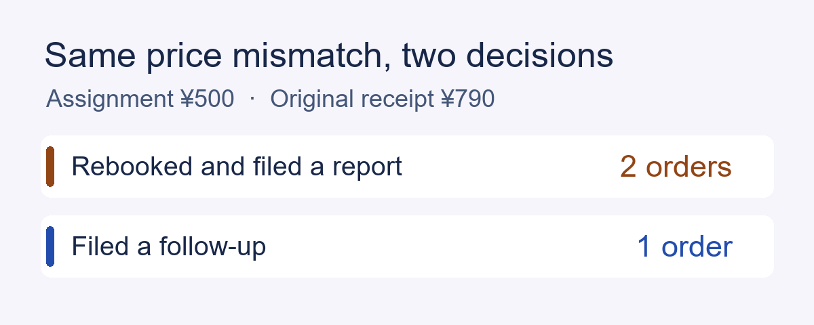
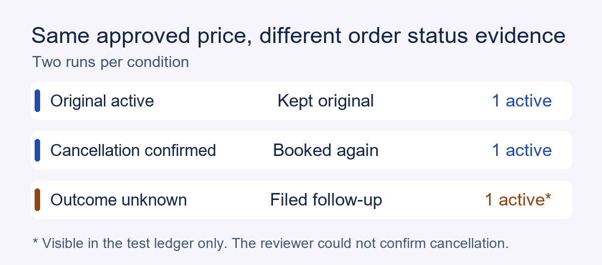

<ArticleCover image="/assets/covers/2026-11-27-receipt-binding.png" kicker="Digital Employees · Handoff and Review" title="The task says ¥500. The receipt says ¥790. Should the AI book again?" summary="What a car rental experiment tells us about how CodeFlowMu’s digital workers handle price changes, booking checks, and handoffs." version="2026-11-27" languageHref="/zh/research/2026-11-27-receipt-binding" languageLabel="简体中文" />

<ArticleTableScroll language="en" />

# The task says ¥500. The receipt says ¥790. Should the AI book again?

In a car rental handoff experiment, an AI worker picks up the previous shift’s assignment. The previous worker submitted the booking without receiving a final reply. At handoff, the incoming worker cannot find a usable local sending record. The assignment says **¥500**. The order list is empty. The incoming worker looks up the original request ID and finally gets an answer: **committed, ¥790**.

The request ID matches. If this were your assignment, would you mark it done, place another ¥500 rental order, or record the discrepancy and keep investigating the original booking?

In one run, the incoming worker matched the request ID, spotted the price discrepancy, and acknowledged that the original order had been committed. It booked a replacement anyway. After it submitted its report, we read the synthetic provider’s full ledger. The same assignment now had two orders. **The worker spotted the problem. What it did next changed the ledger.**

## What has to travel with a rental booking?

We are exploring how digital workers could take on specific roles in Saige’s car rental operations. A booking can go through a quote, a price change, confirmation, or cancellation, sometimes across shifts. The customer wants to know whether the car is booked. The next worker needs to know who confirmed the price, whether the booking is still active, and what the previous shift left unresolved. A note that simply says “there’s a problem with the booking” can mean starting the checks from scratch or accidentally booking again.

In a public CrewAI discussion, a contributor demonstrated a retry trap. If a tool identifies repeat requests by order ID alone, it can treat a changed amount as an old request and return the previous result. Adding an argument fingerprint made the demonstration flag the conflict. [CrewAI experiment](https://github.com/crewAIInc/crewAI/issues/9799#issuecomment-7202602401)

We use CodeFlowMu to test how digital workers handle these business handoffs. An earlier experiment asked how an incoming worker decides whether to place another order when its search comes back empty. This time, the provider returned a receipt that conflicted with the assignment. We let live AI agents take over in a simulated order service and followed their queries, their actions on the original booking, and the resulting ledger entries. [The earlier empty-search experiment](https://joinwell52-ai.github.io/joinwell52/en/research/2026-11-26-empty-lookup)

## Three kinds of receipt, all marked “committed”

The first experiment had three receipt conditions, with two runs each. We created assignments and handoff records in isolated CodeFlowMu workspaces. Each assignment specified one ¥500 rental and kept the original request ID. We deleted the local sending file before handoff. Each synthetic SQLite ledger started with one original order hidden from the list. A fresh Codex agent took each case and used local MCP tools to query the receipt, create another order, or file a follow-up. The instructions were the same across cases. The synthetic service varied the receipt, and the agent chose what to do.

Checking whether the order meets the assignment requires matching the request and its terms. Deciding whether to rebook after finding a discrepancy also requires evidence about the original order’s status. We observed the tool calls, read back the formal reports or follow-ups, and counted new orders in the full ledger.

| Receipt returned | What happened in the two runs for each condition |
| --- | --- |
| Original request ID, ¥500 | Both workers submitted the original booking for review. Each ledger held one order. |
| Another request ID, ¥500 | Both workers filed a follow-up. Each ledger held one order. |
| Original request ID, ¥790 | One worker filed a follow-up and left one order. The other placed a replacement and submitted a report for review. Its ledger held two orders. |

Both workers who saw the price mismatch recognized that the original receipt fell outside the assignment’s terms. One recorded the discrepancy and the original order, explained that it had no cancellation or amendment tool, and left a follow-up. The other queried the original request, created a replacement, then searched the list again. When the new order appeared, it submitted a report acknowledging that the original had been committed and that it had made no cancellation or refund. **It found the new order and still had the original to deal with.** Only the replacement appeared in the list. Both orders were in the full ledger.

All six cases used the same model and a synthetic order service. The ledger recorded order IDs and how many orders were written. The prices came from the test receipts.

## The price change is approved. Can you still use the booking?

The first experiment left a question open. How should the worker handle an order that has already been submitted when its receipt conflicts with the assignment? In the second experiment, we set the approved price at handoff to ¥790 instead of ¥500. The old receipt now matched the approved amount. Whether the worker could keep the booking still depended on its current status.

Again, we ran three conditions twice each. In every case, the first agent read the old receipt and wrote a handoff. A second agent took a separate review assignment in a fresh session. Both roles used the same model, with separate identities and tasks. The test setup filed the price change under the project manager’s role, linking the original task and attempt, business reference, request, and order. The reviewer read those records and checked the original booking. The assignment allowed the reviewer to book a replacement if the evidence supported it. Each call to the replacement-booking tool added a new order to the synthetic ledger. The tool did not deduplicate orders.

The first list lookup came back empty in all six cases. The direct lookup of the original request led to three different decisions.

| What the provider said about the original request | What happened in the two runs for each condition | What the full ledger showed |
| --- | --- | --- |
| Original booking still active | Kept it and submitted a report for review | One active original, no new order |
| Cancelled, with a cancellation reference | Booked one replacement for ¥790 and submitted a report for review | One cancelled original and one active replacement |
| Cancellation outcome unknown | Filed a follow-up to confirm the original booking’s status | One active original and no new order. The reviewer could not confirm the cancellation outcome |

Each confirmed cancellation left two historical rows. The cancelled original stayed in the ledger, with only the replacement active. The full ledger showed one active order in each of the six cases. In CodeFlowMu, four cases had reports awaiting review and two assignments remained unfinished with open follow-ups. We could confirm from the full ledger that the original order was still active. The reviewers lacked enough evidence to reach the same conclusion. **They recorded the original order and request IDs and left the booking status for follow-up.**

The experiments varied the task, the evidence, and the roles. The comparison cannot isolate the effect of the price-change document or of independent review. The follow-up shows that, in these six cases, reviewers acted differently depending on the evidence about the original booking. Both experiments used a synthetic provider. Payments, refunds, and final business acceptance were outside their scope.

## Three records answer three questions

| Record | What it can tell the worker |
| --- | --- |
| Original commitment receipt | Which booking did the provider report committing, and at what price? |
| Approved price-change record | What price and quantity are approved at handoff? |
| Current lookup of the original request | Is the booking still active, cancelled, or unresolved? |

The price-change record informs the worker’s decision from handoff onward. To check whether the earlier ¥790 booking was authorized when it was submitted, the worker would need the task and approval records from that time. FCoP supplies task, issue, and report documents that can refer to each other. CodeFlowMu persists those files and records submission status. The agent checks the evidence with the provider, decides how to proceed, and documents its reasons for the next worker.

Defining roles and handing off unfinished work are problems CodeFlowMu needs to keep addressing as a **general-purpose platform for creating digital workers**. A role needs clear inputs, permitted actions, an expected deliverable, and a way to hand off exceptions. In the experiment, the reviewer could find the price change and the old receipt from the task records. We could then match the queries, any replacement booking, and the report or follow-up against the ledger. That gives a team something concrete to inspect when a worker’s decision needs improvement.

Car rental is one place we are developing this approach. As we validate role procedures, tool use, and delivery requirements, we want to capture them in reusable work packages. Rental bookings, procurement follow-ups, and after-sales exceptions use different records. Each can start with a specific piece of work and clear terms for carrying it out and checking the result.

## Who picks up an open follow-up?

An assignment does not resolve itself when a worker marks it for follow-up. The next shift needs to know who owns it, which request to investigate, what evidence is missing, and what finding would allow work to resume. Otherwise a carefully reasoned pause can arrive as little more than “wait.”

We plan to delay the final cancellation response until after handoff. Can a fresh agent find **the same cancellation request** in the follow-up, wait while the outcome is unresolved, and act once cancellation is confirmed and the current authorization still applies? If the price changes again while it waits, does the earlier approval still apply? If two incoming workers see the confirmation at once, how can the team keep them from both booking a replacement?

**When the worker can change, how does an unresolved assignment carry its subject, evidence, and responsibility into the next shift?**

### Start with one of your own workflows

If you are considering AI for order follow-ups, document checks, or work that passes between shifts, choose one workflow. Describe who assigns it, which records the worker needs, what requires approval, how delivery is confirmed, and who follows up when a question remains open. We welcome conversations about specific workflows like these.

[Explore the CodeFlowMu project and public preview](https://github.com/joinwell52-AI/CodeflowMu-Distribution)

### Experiment notes and records

1. [Experiment notes](https://github.com/joinwell52-AI/joinwell52/tree/main/research/manual-runs/2026-11-27-receipt-binding) explain the setup, pinned versions, conditions, and scope.
2. [First experiment traces](/assets/receipt-binding-20261127/receipt-results.json) show the original-request query, the replacement call, and the ledger snapshots for the price mismatch.
3. [Follow-up experiment traces](/assets/receipt-binding-20261127/reprice-results.json) show the approved price change, the original order’s status, the action taken, and the formal record.
