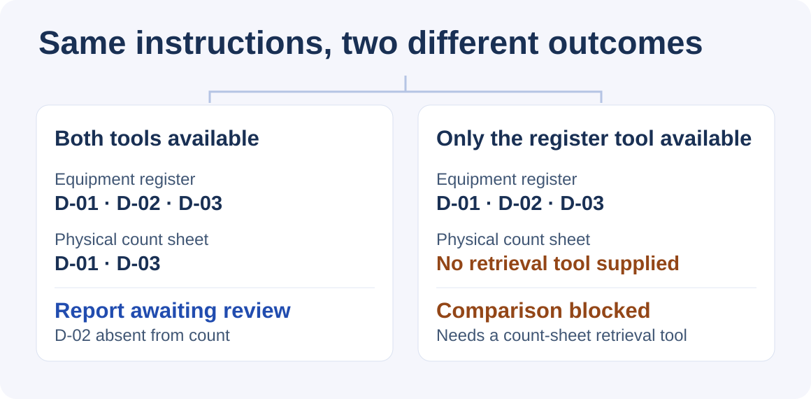

<ArticleCover image="/assets/covers/2026-11-28-work-package-portability.png" kicker="Digital Employees · Work Packages" title="Can an AI worker check an equipment list without a terminal?" summary="One equipment-list assignment, three tool setups. A CodeFlowMu experiment traces what each AI worker could read and what it could hand back." version="2026-11-28" languageHref="/zh/research/2026-11-28-work-package-portability" languageLabel="简体中文" />

<ArticleTableScroll language="en" />

# Can an AI worker check an equipment list without a terminal?

The storeroom register lists three equipment IDs: `D-01`, `D-02`, and `D-03`. You give an AI worker a simple assignment. Compare the register with the physical count and report which IDs are absent from the count sheet.

The worker can read the register. Its environment supplies neither a tool for reading the count sheet nor a terminal, the window where you enter commands and run programs. What can it confirm? What should it leave for follow-up? We ran the same assignment under three instruction and tool conditions to see what the worker actually handed back.

## How far can the same instructions travel?

A work package is like the operating guide you give a new employee. It says where to get the records, how to compare them, and what to hand back. A guide can tell the worker to open the count sheet. The working environment still has to provide a way to open it. If the guide supplies only commands, the worker needs a terminal to run them.

MCP is a protocol that connects AI applications with external tools. In this experiment, the worker uses it to call tools that read the register and the count sheet.

Paradev is an open-source workspace for running multiple AI coding agents in parallel. It comes with guides that tell the AI how to carry out tasks such as looking up its assignments. Those guides originally listed terminal commands only, so a chat application connected to Paradev lacked instructions for using its available tools. [Paradev project overview](https://github.com/ParadevAI/Paradev)

Paradev’s change #10267 added MCP instructions wherever an existing tool covered the step. A chat application connected to Paradev’s tools can now follow the guide and call the task-list tool to answer “What tasks are assigned to me?” Steps that still need the terminal are marked as local-only. The author checked tool names and parameters. The change was not tested end to end in Claude.ai, ChatGPT, or Grok. [Paradev #10267: Tool instructions for chat applications without a terminal](https://github.com/ParadevAI/Paradev/pull/10267)

That change prompted us to run an equipment-list assignment in CodeFlowMu, a system that organizes digital workers and stores their tasks and reports. We wanted to see how the instructions and the tools actually available shaped what the worker could deliver.

## The guide lists two tools. The environment supplies one.

We used Codex to run three AI workers in separate sessions with the same model. Each received an identical assignment. The comparison rules and synthetic inputs stayed the same. We varied the retrieval instructions and the tools actually supplied. All three workers could read the assignment and guide and write a report. The assignments and reports went through the actual CodeFlowMu interfaces, and the completed case was submitted for review.

| Case | Method described in the guide | Retrieval tools supplied | What the worker handed back |
| --- | --- | --- | --- |
| 1 | Command-line steps only | No terminal and neither retrieval tool | Read neither record, filed a blocker, and left the assignment open. |
| 2 | Instructions for both MCP calls | Register and count-sheet tools | Read both records, reported `D-02` absent from the count, and submitted for review. |
| 3 | Same guide as case 2 | Register tool only | Recorded the IDs it read, identified the missing count-sheet tool, and left the assignment open. |

In case 2, the worker read both records. You can do the same comparison with the IDs it received.

- Register IDs: `D-01`, `D-02`, `D-03`
- Count-sheet IDs: `D-01`, `D-03`

`D-02` was registered and did not appear on this count sheet. To determine whether it was missed during a scan, lent out, or lost, the team would need a physical check or another record.

<figure>
  <picture>
    <source media="(max-width: 580px)" srcset="/assets/work-package-portability-20261128/inventory.en.mobile.svg" />
    
  </picture>
</figure>

Cases 2 and 3 used the same guide. The only difference was whether the count-sheet tool was available. The worker in case 3 still retrieved the register. It handed back the three IDs and explained that the environment needed a way to read the count sheet before it could complete the comparison. **It handed back useful unfinished work.** The person responsible now knows which capability to provide and which check remains.

## Take one assignment into the new environment

Use one assignment to check three things in the new environment.

- Can the worker actually retrieve both required records?
- Can you trace the reported discrepancy to specific IDs in the two records?
- If the work stops short, does the report say what the worker read, what remains missing, and what it needs to continue?

CodeFlowMu stores tasks and reports through FCoP, a file-based coordination protocol. The records let us verify which case submitted a discrepancy report and which two stayed open. Each condition ran once. Installing and running the same package across real working environments remains to be tested.

Back to case 3. Once the count-sheet tool is available, could a different worker tell what has already been checked and what remains? If the register changes meanwhile, which version should that worker use?

**What does an unfinished assignment need to carry so the next worker can pick up where it left off?**

### Experiment materials

- <a href="https://joinwell52-ai.github.io/joinwell52/assets/work-package-portability-20261128/experiment-report.html#english" target="_blank" rel="noopener">Experiment report</a> records the instructions, actual tool conditions, results, and limits.
- <a href="https://joinwell52-ai.github.io/joinwell52/assets/work-package-portability-20261128/results.json" target="_blank" rel="noopener">Tool traces and formal report readback</a> show what each worker read, what it handed back, and how the assignment was left.
