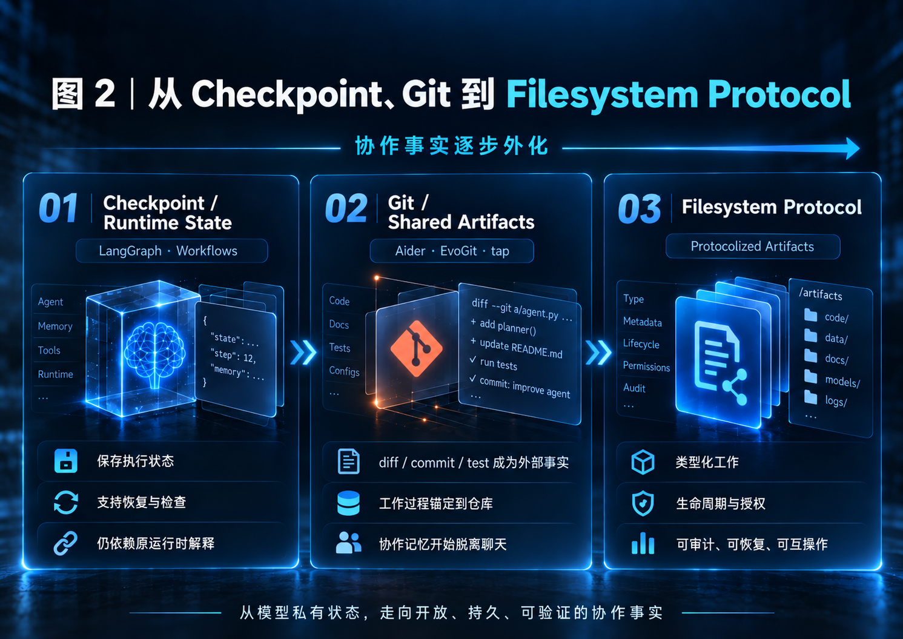
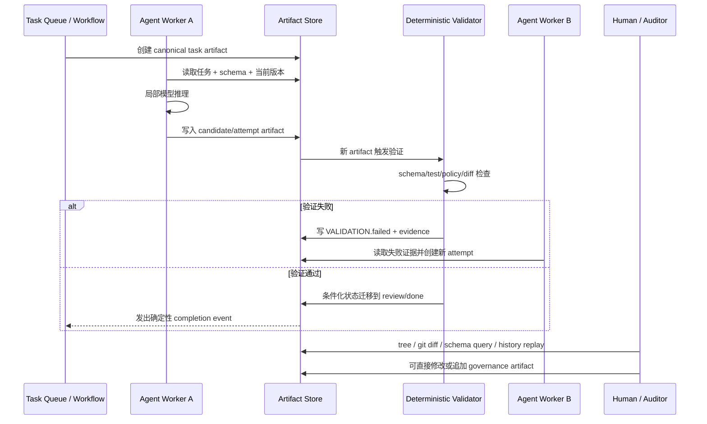
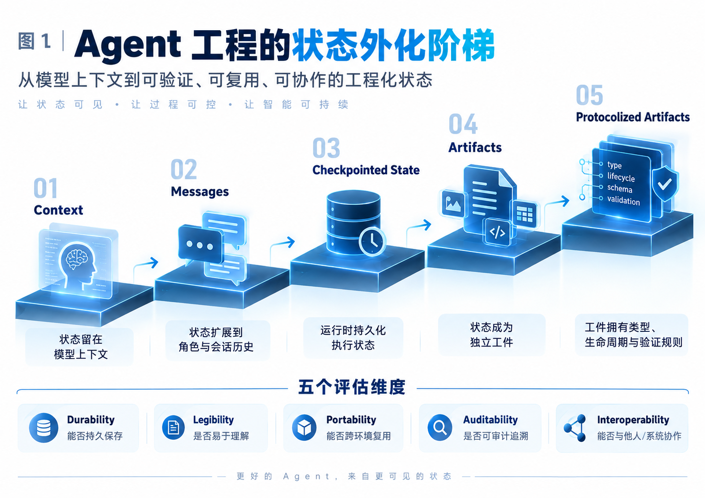

<ArticleCover image="/assets/recommended-articles/2026-09-22-beyond-black-box-externalization/zh-cover.png" title="告别“黑盒神话”：主流 Agent 框架的工程反思与“物理外化”范式的崛起" summary="从主流 Agent 框架到文件与协议化工件，分析状态外化、持久化和协作事实的工程边界。" version="2026-09-22" languageHref="/en/research/2026-09-22-beyond-black-box-externalization" languageLabel="English" />

<ArticleTableScroll language="zh" />

## 引言：软件工程的周期律与 Agent 幻象

回顾计算机工程演进史，每当一项突破性的计算原语诞生时，技术社区几乎都会经历同一个周期律：**早期神化原语 → 制造过度工程化的庞大黑盒中间件 → 遭遇现实物理与工程规律的反噬 → 最终重新承认那些无法被抽象抹去的底层约束。**

1990 年代分布式计算兴起，行业曾试图用 CORBA 和 DCOM 把远程调用包装得尽可能接近本地函数，试图弱化网络延迟、部分失败和分区等物理边界；随后，Web 架构走向另一条道路——接受网络本身的约束，以 HTTP、统一接口和更松耦合的资源语义降低系统复杂度。企业集成时代也出现过相似路径：重量级 ESB 一度试图在中心总线内部承担消息编排、格式转换与全局协调，而后越来越多系统把这些职责拆解到事件流、Commit Log、API 与轻量契约之中。

当下的 AI Agent 工业界，正在重演一种非常相似的架构冲动。大家试图把大语言模型（LLM）从一个“概率生成器”，包装成“全知全能的调度中枢、记忆系统、消息总线与事实解释器”。当生产环境频繁遭遇**任务死循环、状态漂移、不可重现与排障无门**时，我们真正需要重新审视的，已经不是“模型还能不能再聪明一点”，而是一个更底层的问题：**我们是不是又把过多的系统职责，压进了一个并不适合承载它们的黑盒里？**

过去三年真正值得注意的变化，并不是“模型越来越像人”，而是**系统越来越不愿意相信模型自己能记住一切、协调一切、解释一切**。

2023 年，最具代表性的 Agent 系统仍然强调循环推理、角色扮演和自然语言协作；到了 2025—2026 年，主流工程框架已经明显把更多责任交给 durable execution、checkpoint、state inspection、workflow state 和外部工件。与此同时，EvoGit、tap、PheroPath、SwarmWorld、FCoP 等方向，又进一步把协作从消息和私有运行时中移向 Git、文件、共享环境与协议化 artifact。

这并不意味着“文件系统将取代 LangGraph”，也不意味着 Stigmergy 已经证明优于中心调度。真正值得讨论的是一条更克制、也更重要的工程原则：

> **Agent 可以是概率性的，但协作事实不应该只存在于概率性的上下文里。**

从 Context、Messages、Checkpointed State 到 Artifacts，再到 Protocolized Artifacts，Agent 工程正在发生的真正变化，是**系统事实权逐步从模型内部向外迁移**。

下面不再从口号出发，而是直接看论文、框架和开源项目到底已经证明了什么，又没有证明什么。

## 背景：Agent 工程真正发生了什么变化

这篇文章最初最有价值的判断，是拒绝继续把 LLM 想象成“全知全能的状态总线”。不过，要让这个观点从宣言变成可以经受技术审查的论证，需要先修正三个常见误区。

**第一，问题不是 LLM“不能自纠”，而是它没有天然的事实类型系统。**

自回归模型当然可能发现并修正自己之前生成的错误；真正危险的是，一旦错误输出进入下一轮上下文，它通常与真实工具观察、用户事实、模型推测一起变成后续生成的条件。系统若没有 provenance、validator、re-fetch 或 rollback 机制，并不存在一个天然边界告诉模型：“这句话只是你上一轮猜的，不能把它当数据库事实。”长上下文还存在明显的位置信息利用问题：经典的 *Lost in the Middle* 实验发现，把相关信息移动到上下文中部即可显著降低许多模型的任务表现；后续研究进一步把这种现象与 positional attention bias 联系起来。与此同时，2025 年研究也显示新模型在某些简单 retrieval 场景中已有明显改善，因此不能再把“中部信息一定丢失”写成永久规律。

于是，工程问题应该写成：

> **不要要求模型自己长期维护“哪一条历史陈述才是当前事实”。把事实身份、版本、有效性和验证结果交给系统。**

**第二，自然语言不是“荒谬的 IPC”，但把开放自然语言直接当控制协议确实代价高。**

经典 IPC 既可以是共享内存，也可以是 pipe、socket、HTTP、JSON 或 protobuf，并不存在“必须纳秒级、必须二进制”的规则。真正的区别在于：控制面协议通常追求低歧义、明确字段、错误类型、幂等语义和机器可验证边界，而自由文本会把语义解析重新交给概率模型。

AutoGen 的历史设计很好地体现了这条路线：其论文围绕“conversable agents”和 flexible conversation patterns 建模；其官方仓库中关于 GroupChat 的讨论也明确描述了由管理者选择下一发言者并传递 conversation context 的模式。到 2026 年，AutoGen 已进入 maintenance mode，微软建议新用户迁移到 Microsoft Agent Framework；这本身也说明“群聊即 Agent 架构”已经不是唯一演进方向。

**第三，现代 Agent 框架已经发生混合化，不能继续按 2023 年的产品印象分类。**

更准确的分类方法，是看一个系统的**主要协调位置**在哪里，而不是给产品永久贴标签：

| 主导协调位置                       | 典型机制                                                      | 代表实例                                                   | 主要风险                                                  |
| ---------------------------- | --------------------------------------------------------- | ------------------------------------------------------ | ----------------------------------------------------- |
| Context-centric              | 模型循环读取并扩展上下文                                              | 历史 AutoGPT Classic、原始 BabyAGI                          | 错误历史污染、token 成本、恢复边界模糊                                |
| Conversation-centric         | Agent 通过 messages/group chat/role handoff 协作              | AutoGen、MetaGPT、CrewAI Crews                           | 语义歧义、消息膨胀、termination/route 复杂                        |
| Runtime-state-centric        | graph/event/workflow + checkpoint + deterministic routing | LangGraph、LlamaIndex Workflows、CrewAI Flows、当前 AutoGPT | 框架耦合、state schema evolution、runtime-specific recovery |
| Artifact/environment-centric | Git/files/worktrees/shared artifacts/environmental traces | Aider、EvoGit、tap、PheroPath、FCoP、Govcraft、SwarmWorld    | 存储语义、并发、元数据规模、artifact governance                     |

这些流派**并非互斥**。Aider 仍使用 LLM context，但把代码变化锚定在 Git；CrewAI 同时存在自治 Crews 和精确控制的 Flows；OpenHands 既有会话/事件，也有真实 workspace 和代码产物；LangGraph 生态本身也越来越多地使用 filesystem-backed tools。

所以，真正的演进不是：

> 聊天框架 → 文件框架

而更像：

> **模型记忆 → 框架记忆 → 持久工件 → 开放治理契约。**

## 研究边界与证据原则

本文主要依据 **2021—2026 年**的论文与开源项目资料，重点考察 Agent 状态管理、多 Agent 协作、共享工件、Git/文件协作、外部化记忆与 stigmergic coordination。论文优先引用原文或正式发表版本；工程事实优先引用项目官方 GitHub、README 和官方文档。

对于无法从公开材料完整确认的实现细节，本文不作推断，并明确标注验证边界。文中的可靠性、可审计性和工程复杂度判断，属于基于公开证据的定性分析，而非统一 benchmark 评分。

## 证据汇总：论文与开源项目

下表首先汇总与本文主线最相关的论文。需要强调，2026 年大量结果仍是 arXiv 预印本，它们可以证明“研究方向存在”和“某实验条件下出现某结果”，不能自动等同于经过多年工业检验的结论。

| 论文                                                                                                       | 时间             | 与本文相关的关键证据                                                                                                                                                                 |
| -------------------------------------------------------------------------------------------------------- | --------------:| -------------------------------------------------------------------------------------------------------------------------------------------------------------------------- |
| [Lost in the Middle](https://arxiv.org/abs/2307.03172)                                                   | 2023；TACL 2024 | 长上下文利用存在明显位置敏感性；相关事实位于中间时，多种模型性能下降。不能由此推出模型“必然遗忘”，但足以反对把 context window 当可靠状态数据库。                                                                                          |
| [MetaGPT](https://arxiv.org/abs/2308.00352)                                                              | 2023；ICLR 2024 | 以软件团队 SOP 和角色流水线组织多 Agent；论文把 naive chaining 的 cascading hallucination 作为待解决问题。                                                                                            |
| [AutoGen](https://arxiv.org/abs/2308.08155)                                                              | 2023           | 将可对话 Agent 与 conversation patterns 作为多 Agent 应用核心抽象，可组合 LLM、工具和人。                                                                                                          |
| [ChatDev](https://arxiv.org/abs/2307.07924)                                                              | 2023；ACL 2024  | 软件开发被分解为 chat chain，并用 communication/dehallucination 机制改善角色协作，代表对话式 Agent 的早期典型路线。                                                                                         |
| [EvoGit](https://arxiv.org/abs/2506.02049)                                                               | 2025-06        | 独立 coding agents 不使用中心协调、显式消息和共享内存，而通过 Git version lineage 异步读取、分支和演化共享代码。                                                                                                 |
| [CooperBench](https://arxiv.org/)                                                                        | 2026           | 把 coding-agent cooperation 本身作为独立 benchmark 问题，反映“单体能力提高”并不自动解决协作。                                                                                                         |
| [More Capable, Less Cooperative?](https://arxiv.org/)                                                    | 2026           | 研究显示模型能力提升不能简单等价为更可靠的 Agent 协作，并研究协议、激励和可见性等干预。                                                                                                                            |
| [Coordination as an Architectural Layer for LLM-Based Multi-Agent Systems](https://arxiv.org/)           | 2026           | 主张将 coordination 从 agent logic 与信息访问中分离为可独立分析的架构层，与本文“控制平面不可全部交给模型”的观点高度一致。                                                                                                |
| [Effective Strategies for Asynchronous Software Engineering Agents](https://arxiv.org/)                  | 2026           | 研究 long-horizon shared-artifact 工程，强调多 Agent 的异步协调成本不能被简单忽略。                                                                                                               |
| [Multi-Agent Transactive Memory](https://arxiv.org/)                                                     | 2026           | 用共享 repository/artifacts 连接 producer 与 consumer agents，把“谁知道什么”的协作记忆外置。                                                                                                    |
| [Emergent Culture in Minimal LLM Systems](https://arxiv.org/)                                            | 2026           | 在少量 agents、简单工具及共享可衰减文本环境中观察到合作策略与 artifact 的自发形成。                                                                                                                         |
| [Externalization in LLM Agents](https://arxiv.org/abs/2604.08224)                                        | 2026-04        | 将 memory、skills、protocols、harness 统一解释为认知负担外化，并提出从 weights 到 context 再到 harness 的历史视角。                                                                                     |
| [tap: A File-Based Protocol for Heterogeneous LLM Agent Collaboration](https://arxiv.org/abs/2606.14445) | 2026-06        | file-first；Markdown 消息持久保存，实时通知只是第二层；Git worktree 隔离。27 天、37 generations 中收集 717 operational artifacts；异构模型 pair 的 review 中记录 defect/change 的比例高于同构 pair，但该指标不能解释成总体任务成功率。 |
| [SwarmWorld](https://arxiv.org/abs/2608.26081)                                                           | 2026-08        | homogeneous agents 无预设角色，在共享持久环境中出现 exploration/construction/maintenance/coordination 分化；physical observation 支撑大量 artifact reuse；但 isolated search 对最佳单项 artifact 仍有竞争力。  |
| [Nidus](https://arxiv.org/)                                                                              | 2026           | 研究围绕共享 artifact 的外化推理和 stigmergic coordination，可作为“工件本身成为协作对象”的另一证据。                                                                                                       |

这些论文共同支持的是**“外部结构越来越重要”**，而不是“中心调度已被证明过时”。尤其 SwarmWorld 的原文非常值得谨慎阅读：它明确说 physical stigmergy alone 能支撑有能力的 societies，但也明确说 interaction 并不会普遍地产生更优的单个发明。把它改写成“共享物理环境就是最高效协同信道”，属于超出论文证据范围。

工程项目则呈现出更明显的“混合化”。

| 项目/仓库                                                                                                                       | 公开时间/状态                                                                                                               | 主要状态与协调机制                                                                                                                                | 本次核验要点                                                                                                                                                                                                                                                       |
| --------------------------------------------------------------------------------------------------------------------------- | --------------------------------------------------------------------------------------------------------------------- | ---------------------------------------------------------------------------------------------------------------------------------------- | ------------------------------------------------------------------------------------------------------------------------------------------------------------------------------------------------------------------------------------------------------------ |
| [AutoGPT](https://github.com/Significant-Gravitas/AutoGPT)                                                                  | 2023-03 起；当前持续演进                                                                                                      | 历史 Classic 以自主循环著称；当前产品是 builder/runtime 平台                                                                                              | 2026 README 已把原始 standalone Agent 移入 `classic/`，当前平台支持可视 block workflow、schedule 与 trigger。因此只能把 **AutoGPT Classic** 当“扁平自循环派”代表。                                                                                                                            |
| [BabyAGI](https://github.com/yoheinakajima/babyagi)                                                                         | 原版 2023-03；项目后续重构                                                                                                     | 原版 task planning/execution loop；当前核心 `functionz` 用数据库存储/管理/执行 functions                                                                  | 当前 README 自称 experimental self-building autonomous-agent framework，并明确把 functions 存入 database；不能把当前 BabyAGI 简化成 2023 年的纯 prompt loop。                                                                                                                        |
| [MetaGPT](https://github.com/FoundationAgents/MetaGPT)                                                                      | repo 2023；论文 2023-08                                                                                                  | role + SOP + structured software artifacts                                                                                               | README 明确列出 PM、architect、project manager、engineer，并以 “Code = SOP(Team)” 概括核心设计。                                                                                                                                                                              |
| [AutoGen](https://github.com/microsoft/autogen)                                                                             | 2023-08；2026 maintenance mode                                                                                         | conversational agents、AgentChat、group/team orchestration                                                                                 | 当前仓库已处 maintenance mode，微软推荐 Microsoft Agent Framework；历史 GroupChat 的 manager/speaker-selection 模式仍适合作为 conversation-centric 样本。                                                                                                                             |
| [CrewAI](https://github.com/crewAIInc/crewAI)                                                                               | README 未给出精确首发日                                                                                                       | Crews + Flows 双体系                                                                                                                        | Crews 侧重 role-based autonomy；Flows 提供 event-driven state、branching、routing 与 deterministic steps。把 CrewAI 只归为“拟人群聊”已经失真。                                                                                                                                     |
| [LangGraph](https://github.com/langchain-ai/langgraph)                                                                      | 精确创建日未从当前 README 核实                                                                                                   | state graph + checkpoint/durable execution                                                                                               | 官方把 durable execution、failure resume、human state inspection、long-term memory 列为核心能力；其问题不是“没有外部状态”，而是 checkpoint 的解释接口仍主要属于框架生态。                                                                                                                              |
| [LlamaIndex Workflows / LlamaAgents](https://github.com/run-llama/llama-agents)                                             | 当前仓库版本日期未在 README 指定                                                                                                  | async/event-driven steps；可插拔 durability                                                                                                  | README 明确支持 branch、loop、parallel、persist state、failure recovery；简单场景可把 run 状态存文件，也可连接 database/coordination backend。                                                                                                                                         |
| [Aider](https://github.com/Aider-AI/aider)                                                                                  | 精确日期本轮未核实                                                                                                             | LLM context + repo map + Git/diff + lint/test                                                                                            | 官方明确自动 commit、允许用普通 Git diff/manage/undo AI changes，并可在每次变更后运行 lint/test。它是“Git 锚定”，不是强制 `SPEC.md`/checkbox 工单系统。                                                                                                                                            |
| [OpenHands](https://github.com/OpenHands/OpenHands) / [software-agent-sdk](https://github.com/OpenHands/software-agent-sdk) | OpenDevin/OpenHands lineage 始于 2024；当前结构已变化                                                                           | workspace + agent server + conversations/events + real code artifacts                                                                    | 2026 主仓库已定位为 **Agent Canvas**，支持 OpenHands、Claude Code、Codex 等多个 backend；因此不能直接把早期 OpenDevin 结构当成当前 OpenHands 全貌。                                                                                                                                            |
| [PheroPath](https://github.com/zi-yue-1129/PheroPath)                                                                       | README 未指定；本次抓取仅 13 commits                                                                                           | filesystem xattr / sidecar JSON “pheromones”                                                                                             | DANGER/TODO/SAFE/INSIGHT 信号可挂在文件上，提供 `sniff`/`secrete` CLI、temporal decay 和 VS Code Radar；当前规模较小，更合理的定位是实验性协议。                                                                                                                                               |
| [FCoP](https://github.com/joinwell52-AI/FCoP)                                                                               | 论文/研究成果：DOI `10.5281/zenodo.22855630`；最新代码归档：[Zenodo 22746175](https://zenodo.org/records/22746175)，v4.0.3，2026-09-14 | typed durable envelopes + explicit lifecycle + Attempt / relation / authorization + Branch/Family convergence + recovery；以人类可读文件工件承载协议事实 | **FCoP 4.0 已稳定发布，当前实现为 4.0.3。** 正式名称是 **File-based Coordination Protocol**；`Filename as Protocol` 是核心设计原则之一。4.x 已不应被概括成“目录 + Markdown + rename”：公开 Core 明确包含 TASK / REPORT / ISSUE / REVIEW、显式生命周期、Attempt、关系、授权、Branch Family、显式收敛、幂等与 crash-safe recovery。 |
| TMPA                                                                                                                        | 2026 公开材料                                                                                                             | textual multi-agent process / governance                                                                                                 | 本次能检索到组织/作者层面的公开描述，说明 TMPA 强调 durable governance、responsibility、conformance 与 auditable digital work；但未稳定获得一个可完整源码审查的独立 TMPA 仓库，因此具体 runtime/lock 细节标记为**需进一步验证**。                                                                                           |
| [Govcraft pressure-field-experiment](https://github.com/Govcraft/pressure-field-experiment)                                 | 2026-01                                                                                                               | shared artifact + local pressure + temporal decay                                                                                        | 会议室排程 270 trials 中，pressure field 为 48.5%，conversation baseline 12.6%，hierarchical 1.5%；这是特定 Qwen2.5/Ollama 排程实验，不是普适的“stigmergy 胜过 hierarchy”定理。                                                                                                            |
| SwarmWorld 实验仓库                                                                                                             | 论文 2026-08-26                                                                                                         | persistent simulated environment                                                                                                         | arXiv 页面未给出可确认的作者 GitHub repository URL；本次未定位到可验证的独立官方实验仓库。因此标注为**未定位/需进一步验证**，不伪造链接。                                                                                                                                                                        |


## 技术分析：从状态所在地到系统事实所在地

真正决定 Agent 是否“黑盒”的，不是系统有没有图，也不是是否使用文件，而是**哪一层拥有最终事实权**。

### 状态载体决定故障边界

Context window 最大的优点是零额外基础设施：模型天然能读取。缺点同样明显——状态、推理、猜测、工具观察和协议文本很容易混为一个 token stream，而且历史越长，成本和 positional retrieval 风险越高。*Lost in the Middle* 的证据足以说明，“能塞进 context”与“能可靠取回”不是同义词。[[7]](https://arxiv.org/abs/2307.03172)

Chat history 比单体上下文更结构化，但仍然主要是 event transcript，而非 authoritative application state。把“Agent A 说任务完成”存进聊天记录，并不等价于“任务确实通过测试且正式 committed”。

Checkpoint DB 则显著改善这一点。LangGraph 已经把 durable execution 和 state resume 作为核心能力；LlamaIndex Workflows 也允许把 workflow state 保存到文件或数据库。[[5]](https://github.com/langchain-ai/langgraph) [[29]](https://github.com/run-llama/workflows-py)这意味着本文所谓“内存图状态机”更准确的名称应当是 **runtime-mediated durable state**。

Filesystem/Git/artifact 的优势在于改变了访问关系：

```text
Framework-mediated state:
Human -> SDK -> serializer -> checkpoint -> state

Artifact-mediated state:
Human/tool -> file/git/schema -> state
```

第二种结构更容易实现旁路检查，但它不是免费午餐。一个 200 MB 的 opaque JSON blob 即便躺在磁盘上，仍然可以是黑盒；相反，一个 PostgreSQL checkpoint 若有稳定开放 schema、版本协议和审计 API，也可能高度可审计。

因此应把“物理外化”定义为：

> **关键协作事实被持久化为具有独立身份、稳定语义、开放读取路径和可验证 provenance 的 artifact，使其生命周期不依赖于产生它的模型会话。**

而不是简单地：

> “写进文件 = 外化完成。”

### 持久性、可移植性与可审计性必须拆开

以下矩阵比“内存 vs 文件”更有解释力：

| 载体                         | Durability | Portability | Auditability | 主要备注                                     |
| -------------------------- | ----------:| -----------:| ------------:| ---------------------------------------- |
| Prompt / context           | 低—中        | 低           | 低            | 可以保存 transcript，但运行态事实边界弱                |
| Chat history DB            | 中—高        | 中           | 中            | 有 chronology，但 message ≠ verified state  |
| 私有 checkpoint              | 高          | 中—低         | 中            | 恢复强；跨框架解释能力取决于 schema/API                |
| 普通 JSON/Markdown artifacts | 高*         | 高           | 高*           | *取决于存储、schema、provenance                 |
| Git objects/commits        | 高          | 高           | 高            | 对代码/文本特别适合；不适合所有高频 mutable state         |
| xattr                      | 中          | 低—中         | 中—低          | 与文件绑定，但 Git/复制/跨平台可见性不是天然一致              |
| Object store artifacts     | 高          | 高           | 高            | namespace/atomic transition 语义与 POSIX 不同 |

这里最容易误判的是 PheroPath。它确实把 context 从 prompt 移到文件节点，README 明确实现 xattr 或 sidecar JSON，并提供 temporal decay 和 VS Code 可视化。

但“看不见的 xattr”恰好暴露出另一个工程悖论：**物理存在并不自动等于通用可见。** 如果安全约束只存 xattr，那么普通 `git diff` 并不会天然把这个约束变成代码历史的一部分；而 sidecar JSON 虽然略显“污染”，却往往更容易被 Git、CI、备份系统和跨语言工具消费。因此，对高价值治理信号而言，“显式 sidecar artifact”可能反而比“优雅的隐藏 metadata”更工程化。

### 控制流正在从语言语义向确定性边界迁移

2026 年框架的发展已经给出了很明确的信号。

CrewAI 当前文档同时提供 role-based Crews 和 event-driven Flows；Flows 有 structured state、conditional branching 与 router。

LangGraph 明确把 durable workflow 与 state transition 作为底层 orchestration 能力。

LlamaIndex Workflows 则用 async functions 生产/消费 events，同时支持 loop、parallel、persistence 和 recovery。

这些系统实际上已经承认一个共同原则：

> **“下一步做什么”不应该永远通过让模型再说一段话来决定。**

语言模型最适合承担：

```text
Unstructured Input
    ↓
Candidate Structured Decision
```

而工作流代码应承担：

```text
Candidate Decision
    ↓
Validation
    ↓
Authorized State Transition
```

这比“LLM 是纯函数”更准确，因为真实 Agent 常有 tool sessions、cache、memory 和 side effects。真正需要无状态化的不是所有内部机制，而是**让任何单次模型调用失去独占全局事实的权力**。

### Stigmergy 的价值在于降低直接协调依赖，而不是消灭协调

SwarmWorld、EvoGit 与 Govcraft 从不同方向说明了一件事：共享环境、Git genealogy 或 shared-state pressure field 可以成为**一等协调媒介**，而不仅是 Agent 对话之后的被动存储。[[14]](https://arxiv.org/abs/2506.02049) [[22]](https://arxiv.org/abs/2608.26081) [[35]](https://github.com/Govcraft/pressure-field-experiment)

但这并不能推出“Stigmergy 一定优于 Conversation”。更合理的结论是：

> **对于存在共享约束面、局部动作能够留下可测环境变化、任务可以通过累积局部改善求解的问题，stigmergic coordination 值得作为独立架构基线，与 conversation / hierarchy 直接比较。**

强事务、审批链和法规流程仍然需要明确责任主体与全局不变量。环境协作降低的是直接协调依赖，而不是消灭协调本身。

### 原子性是“物理外化”最容易被浪漫化的地方

FCoP 的公开软件归档仍把 `os.rename()` 视为共享目录树上的关键同步原语之一；但在 4.0.3 中，协议语义已经扩展到 TASK / REPORT / ISSUE / REVIEW、Attempt、关系、授权、Branch Family、显式收敛和 crash-safe recovery。也就是说，`rename` 仍然重要，但已经不能单独代表 FCoP 4.x 的全部协议结构。

概念上可以表示为：

```text
inbox/TASK-123.md
      |
      | atomic namespace transition
      v
active/TASK-123.md
      |
      | result validated
      v
review/TASK-123.md
      |
      | accepted
      v
done/TASK-123.md
```

这个设计的吸引力非常强：状态变化就是 namespace 变化，人类用 `find`/`tree` 即可观察。

但必须区分至少四个概念：

```text
atomic visibility
≠
exclusive ownership
≠
crash durability
≠
distributed consensus
```

一个同文件系统上的原子 rename 可以帮助实现“其他观察者不会看到半个名称切换”，却不能被无限外推成“已经解决所有分布式一致性问题”。协议仍必须定义：写入内容什么时候算完整、崩溃后的 partially prepared artifact 如何处理、重试是否幂等、跨 mount 怎么办、remote filesystem 的实际语义是什么。

更关键的是对象存储。

原文写：

> S3 天然不支持原生原子 Rename，底层只能 Copy + Delete。

到 2026 年，这句话**只对 general-purpose S3 基本成立**。AWS 官方文档仍明确说明普通对象 rename 会 copy 新对象、再删除原对象；但 S3 Express One Zone 的 directory buckets 已经提供 `RenameObject`，该操作是 atomic、无数据搬运，并且只支持该存储类。

AWS 甚至为该 API 提供 `If-None-Match` / ETag 条件，可以把“目标不存在”或“源版本与预期一致”纳入 transition precondition。

所以真正生产级的协议不能写：

```python
rename(old, new)
```

然后假设所有存储介质都等价。

应该抽象：

```python
transition(
    artifact_id,
    expected_version,
    from_state,
    to_state,
)
```

再由 backend adapter 提供：

```text
Local POSIX FS   -> rename/replace semantics
S3 General       -> conditional object write + version/manifest strategy
S3 Express       -> RenameObject + conditional headers
Database         -> transaction / compare-and-swap
Git              -> object + ref update / commit semantics
```

这才是真正的“物理公约数”：**不是强迫所有物理介质假装成 POSIX，而是承认物理介质不同，把 protocol invariant 与 storage primitive 分层。**

### 小文件、僵尸状态与恢复问题不能靠口号消失

“百万文件必然 inode 爆炸”也需要降温。不同文件系统、format 参数、目录索引、缓存和工作负载差异很大，不能用一个固定数字描述灾难点。

真正普遍的问题是：当 artifact 数量非常大时，系统成本会逐渐从 payload I/O 转移到 namespace/metadata 操作、目录扫描、备份、索引、watcher、病毒扫描、同步和生命周期管理。具体瓶颈必须在目标文件系统或对象存储上 benchmark，而不能假设 ext4、APFS、NFS、S3 具有相同曲线。

解决方案也不应该只是“定期删文件”，而是从协议设计阶段引入：

```text
hot lifecycle namespace
        ↓
immutable event/log segments
        ↓
compacted snapshots
        ↓
cold archive / object storage
```

同样，“orphan lock”只存在于某些 ownership 模型。若协议使用 lease，应记录 owner、lease epoch、expiry 和 heartbeat；若使用 immutable attempts，可以完全避开传统长生命周期 lock：

```text
task-42/
    attempt-001/
        CLAIM.json
        INPUT.hash
        OUTPUT.json
        VALIDATION.json
        RESULT.failed

    attempt-002/
        CLAIM.json
        ...
        RESULT.accepted
```

在这种模型里，进程死亡留下的不是“永远阻塞系统的锁”，而是一个**未完成 attempt**。reaper 可以根据 lease/heartbeat 判定其失效，再开新 attempt；历史无需删除。

这也是物理外化最重要的升级之一：

> **恢复不要以“擦掉事故痕迹”为目标，而应以“让事故成为历史中的合法状态”为目标。**

### 物理外化的真正优势，不是“绝不会错”

把状态暴露到 filesystem / object store，并不会自动解决 concurrency、identity、authorization、schema migration 和 recovery。

它最大的优势不是“绝不会错”，而是：

> **错的时候，更有机会留下第三方能够检查的事实。**



*图 2｜从 Checkpoint、Git 到 Filesystem Protocol：协作事实逐步外化。*

## 案例深挖：从 checkpoint、Git 到 filesystem protocol

### LangGraph：已经走出“内存黑盒”，但状态仍由 runtime 定义

LangGraph 当前官方定位本身就是 “low-level orchestration framework for long-running, stateful agents”，并明确把 durable execution、failure resume、human-in-the-loop state inspection 和 persistent memory 列为核心能力。

因此，以下批评已经过时：

> “LangGraph 一崩溃，状态就没了。”

更准确的结构是：

```text
LLM / Tool Node
      ↓
Graph Transition
      ↓
Framework State
      ↓
Checkpoint
      ↓
Persistent Backend
```

其代表性使用方式可以抽象为：

```python
# 示意代码，不是逐字摘录源码
graph = builder.compile(checkpointer=checkpointer)

config = {
    "configurable": {
        "thread_id": "incident-2026-09-22-001"
    }
}

graph.invoke(input_state, config=config)
```

真正值得追问的是：

> 一份 checkpoint 能否在完全不 import LangGraph、不启动原 Python 应用的情况下，让其他语言的治理工具理解“任务当前为什么在这个状态”？

如果答案依赖框架 serializer、state reducer、node semantics 或专有观测系统，那么它依然具有一定程度的 **semantic enclosure**。

这不是 LangGraph 的“缺陷”，而是 runtime abstraction 的自然代价。其工程优势是 recovery 强、control flow 清晰；代价是 state contract 与 runtime contract 很难彻底分离。

所以最合理的改进并非抛弃 checkpoint，而是：

```text
LangGraph internal checkpoint
           +
external canonical artifacts
```

例如：

```text
run/
  manifest.json
  request.json
  decision.json
  tool-observations/
  patches/
  validation/
  final-report.md
```

框架状态负责恢复执行；canonical artifacts 负责跨框架事实交换。

这就是“内外双状态”模式。

### Aider：真正值得学习的不是“SPEC.md”，而是 Git 作为事实锚

原文把 Aider 描述成“任务必须先落盘为 `SPEC.md`、`TASK_LIST.md`，checkbox 推进”，这个说法没有得到官方架构支持。

Aider 官方真正明确承诺的是：它映射代码库、自动 Git commit，使用户能使用普通 Git 工具 diff/manage/undo AI changes，并可在模型修改代码后自动运行 lint/test。[[9]](https://github.com/Aider-AI/aider) [[30]](https://github.com/Aider-AI/aider)

这里的工程价值比 checkbox 更深：

```text
Prompt / conversation
        ↓
candidate edit
        ↓
working tree
        ↓
git diff
        ↓
lint / test
        ↓
commit
```

也就是说，模型说：

> “我已经修好了。”

并不是事实。

真正的事实是：

```text
diff exists
test exit code = 0
commit hash = ...
```

这正是从“语言事实”向“物理事实”迁移。

Aider 的设计告诉我们一个很关键的原则：

> **不要为 Agent 重新发明一套世界，如果成熟软件工程已经有可验证的物理对象。**

代码变更已经有 Git object；
验证已经有 test result；
语义差异已经有 diff；
回滚已经有 commit history。

Agent harness 应尽可能消费这些既有对象，而不是把它们复制进一个超长 chat transcript。

### PheroPath：极具启发性，但同时揭示 xattr 的审计悖论

PheroPath 是目前最“字面意义上的数字信息素”实验之一。[[32]](https://github.com/zi-yue-1129/PheroPath)项目 README 明确将 signal 保存在 filesystem extended attributes 或 sidecar JSON 中，并提供：

```text
DANGER
TODO
SAFE
INSIGHT
```

四类信号，以及 `sniff` / `secrete` / `cleanse` CLI、temporal decay 和 VS Code Radar。

可以把其核心思想抽象为：

```python
# 概念伪代码
signal = {
    "kind": "DANGER",
    "message": "critical boundary",
    "created_at": "...",
    "expires_at": "...",
}

if supports_extended_attributes(path):
    attach_xattr(path, signal)
else:
    write_sidecar(path, signal)
```

这解决了一个真实问题：

```text
“不要改这个文件”
```

不再只活在第 1 轮 prompt 里，而是与对象本身关联。

但 PheroPath 也揭示了“外化”内部的层级：

```text
存在于磁盘
     ≠
普通工具可见
     ≠
Git 可追踪
     ≠
跨平台可携带
```

xattr 的“zero pollution”非常优雅，却不一定是最高 portability 的选择。对于安全边界、审批和 compliance 信息，显式 sidecar：

```text
core.py
core.py.agent-meta.json
```

虽然不那么漂亮，却可能更适合 Git review、CI lint 和 object-store migration。

因此 PheroPath 最重要的贡献未必是其具体 storage mechanism，而是提出：

> **上下文应该附着于被操作对象，而不只是附着于与模型的一次会话。**

当前仓库规模仍很小，本次抓取显示仅 13 commits，因此在证据等级上应该称为**有启发性的开源实验**，而不是已经验证的大规模行业基础设施。

### FCoP：从“文件是一种实现”进一步走到“文件承载协议”

FCoP 是这条演化线里最适合拿来讨论“Protocolized Artifact”的案例之一，但它必须按 **4.0.3 的现状**来分析，而不能停留在早期 3.x 的“目录 + Markdown + rename”印象。

FCoP 的正式名称是 **File-based Coordination Protocol**；`Filename as Protocol` 是其核心设计原则之一。其论文/研究成果已发布，DOI 为 `10.5281/zenodo.22855630`；当前最新软件代码归档为 [Zenodo 22746175](https://zenodo.org/records/22746175)，版本 **v4.0.3**，发布时间 2026 年 9 月 14 日。

4.0.3 的公开 Python Core 已明确包含：

```text
TASK / REPORT / ISSUE / REVIEW
        ↓
explicit lifecycle
        ↓
Attempt / Relation / Authorization
        ↓
Root TASK + Branch Family
        ↓
family inspection + explicit convergence
        ↓
durable REVIEW / merge record
        ↓
idempotency + cross-process locking + crash-safe recovery
```

因此，FCoP 的意义已经不只是“把状态映射到目录”。

它更接近这样一种协议映射：

```text
workspace / lifecycle location
    -> 当前协作位置与状态

TASK / REPORT / ISSUE / REVIEW
    -> 协作事实的类型

Attempt / Relation / Authorization
    -> 失败、依赖、来源与权限

Branch / Family / REVIEW
    -> 并行工作与显式收敛

Markdown + YAML front matter
    -> 人与 Agent 共同可读的结构化载荷

idempotency / recovery / atomic transition
    -> 状态变化必须真正成立，而不是“模型说已经完成”
```

这正是 **Artifact → Protocolized Artifact** 的关键跨越：文件不只是输出格式，而开始拥有类型、身份、状态转换和恢复语义。

FCoP 4.0.3 同时明确自己的边界：它不是任务调度器、Agent runtime、LLM SDK、数据库或自动 merge-decision engine；它试图做的是让协作事实的类型、状态、授权、关系与恢复语义脱离单一模型会话和私有运行时而存在。[[33]](https://joinwell52-ai.github.io/FCoP/) [[37]](https://github.com/joinwell52-AI/FCoP)

这也意味着 FCoP 不应被神化成“文件系统已经解决分布式系统问题”。存储原子性、跨后端适配、身份认证、schema evolution、二进制产物与安全问题，仍然属于协议工业化必须继续回答的边界。

### Govcraft 与 SwarmWorld：最重要的是“不完全支持原文”

Govcraft 是原文里最强的一组数字，但也最容易被滥用。官方 repo 明确报告会议室排程 270 trials：

| Strategy           | Solve rate |
| ------------------ | ----------:|
| Pressure field     | 48.5%      |
| Conversation-style | 12.6%      |
| Hierarchical       | 1.5%       |
| Sequential         | 0.4%       |
| Random             | 0.4%       |

并报告移除 temporal decay 后性能下降约 10 个百分点。

它证明的是：

> 在这个 benchmark 中，这种 stigmergy-inspired shared-state pressure field 明显优于作者实现的 baselines。

它**没有证明**：

> hierarchy 在 Agent 系统中普遍只有 1.5% 成功率。

SwarmWorld 则提供更丰富的证据：shared societies 建立了更广、更有韧性的技术 portfolio；Agent 行为自发分化；大量 reuse 从环境观察开始；但 isolated best-of-N 仍可能产生竞争力很强的最佳单体 artifact。

两项研究合起来真正支持的是：

> **环境可以成为一等协调媒介，而不仅仅是 Agent 对话之后被动写入的结果存储。**

这已经足够重要，不需要再人为加码成“环境一定是最高效信道”。

### 物理外化工作流

一个更现实的 production pattern 可以是：



这里 LLM 不再担任“全局状态机”，但也没有被贬低成无意义的函数。它负责系统中最适合概率推理的部分：理解开放问题、提出候选修改、总结和规划。最终状态转移则由外部证据决定。

## 建议与实践路线：不要“迁移到文件”，要迁移到开放事实契约

真正可落地的路线，不是推倒现有 Agent stack，而是逐步削弱私有运行时对“事实”的垄断。

### 1. 先区分 transcript、working state 和 canonical fact

```text
Transcript
    Agent 说过什么

Working State
    框架当前运行到哪里

Canonical Facts
    什么已经被验证并承诺成立
```

“Agent 说测试通过了”只是 transcript；带有 commit、exit code、测试套件版本和时间戳的验证记录，才有资格参与状态迁移。

### 2. 模型输出先成为 candidate，再进入验证和提交

```text
LLM proposal
    ↓
Schema validation
    ↓
Deterministic / externally verifiable checks
    ↓
Commit
```

核心原则只有一句：

> **“模型说应该跳转”与“系统允许跳转”必须是两个事件。**

### 3. 保留 runtime checkpoint，但增加 Canonical Artifact Boundary

LangGraph、CrewAI、Workflows 的 checkpoint 仍然非常适合恢复执行；没有必要为了“外化”而删除它们。更合理的是建立双层状态：

```text
internal checkpoint
    -> 为 resume 服务

canonical artifacts
    -> 为协作、审计、互操作服务
```

迁移阶段可以先双写并做 reconciliation，直到 canonical artifact 能够成为跨系统权威。

### 4. 把 storage semantics、attempt 与 schema 设计成协议的一部分

不要把 POSIX 当作宇宙定律。Local FS、普通 S3、S3 Express、数据库和 Git 都有不同的 transition primitive。[[42]](https://docs.aws.amazon.com/AmazonS3/latest/userguide/directory-buckets-objects-rename.html) [[43]](https://docs.aws.amazon.com/AmazonS3/latest/API/API_RenameObject.html)

同样，应优先保留 immutable attempts，而不是反复覆盖单一状态文件：

```text
task-id
  ├─ attempt-001 [expired]
  ├─ attempt-002 [failed]
  └─ attempt-003 [accepted]
```

治理字段也应该结构化、可校验，而不是只写进自然语言正文。

### 5. 最终围绕四个系统不变量测试

**Safety**：未经验证的候选不得成为 canonical fact。  
**Liveness**：失败 worker 不得永久阻止任务推进。  
**Auditability**：每个 committed transition 都能追溯输入与证据。  
**Portability**：第三方实现无需原 Agent 会话即可解释 canonical state。

只要这四条成立，底层可以是 LangGraph、Postgres、Git、POSIX 文件、S3 或混合存储。

反之，即使目录树看起来再“物理”，也可能只是一个 filesystem-shaped black box。



*图 1｜Agent 工程的状态外化阶梯：Context → Messages → Checkpointed State → Artifacts → Protocolized Artifacts。*

## 结论与未来研究方向

Agent 工程真正需要告别的，并不是某个具体框架，而是一个更深层的神话：

> **只要模型足够强，就可以让模型同时承担推理器、状态机、数据库、调度器、消息总线、权限仲裁器和审计员。**

近几年的工程演化正在逐步否定这种假设。AutoGPT 从 standalone autonomous agent 演化成工作流平台，Classic 成为历史子目录；CrewAI 把自治 Crews 与 Flows 并列；LangGraph 把 checkpoint、durable execution 和 state inspection 变成核心基础设施；Aider 把 diff、commit、lint 和 test 交还给成熟的软件工程工具；EvoGit、tap、PheroPath 与 FCoP 则进一步把协作事实锚定到 Git、文件、共享环境与协议化工件。[[24]](https://github.com/Significant-Gravitas/AutoGPT) [[44]](https://github.com/crewAIInc/crewAI) [[5]](https://github.com/langchain-ai/langgraph) [[30]](https://github.com/Aider-AI/aider) [[14]](https://arxiv.org/abs/2506.02049) [[45]](https://arxiv.org/abs/2606.14445) [[32]](https://github.com/zi-yue-1129/PheroPath) [[37]](https://github.com/joinwell52-AI/FCoP)

因此，本文所谓“物理外化范式的崛起”可以保留，但应该被重新定义。

它不是：

> Filesystem will replace Agent frameworks.

而是：

> **规范协作状态，应逐步摆脱模型上下文和私有运行时对事实解释权的独占。**

这可以落在文件，也可以落在 Git、append-only event log、数据库、content-addressed store 或对象存储。真正重要的是，它必须具备：

```text
持久
显式
可寻址
版本化
可检查
可验证
可重放
可移植
```

从这个角度看，Stigmergy、Physical Externalization、Filesystem 和 FCoP 处于完全不同的抽象层：

```text
Stigmergy
    │
    │  协调原理
    ▼
Physical Externalization
    │
    │  系统设计原则
    ▼
Filesystem / Git / DB / Object Store / Artifact Graph
    │
    │  实现介质
    ▼
FCoP / tap / PheroPath / project-specific contracts
       具体协议与工具
```

这个区分非常重要，因为真正成熟的下一代 Agent 基础设施很可能不是“纯 stigmergy”，也不是“纯 workflow”。

更可能出现的是混合架构：

```text
              ┌─────────────────────────┐
              │       确定性工作流        │
              │    策略 / 路由 / 授权     │
              └────────────┬────────────┘
                           │
                    候选工作│
                           ▼
┌───────────────┐   ┌──────────────────────┐
│ LLM 工作单元   │──▶│       规范工件         │
│ 概率式推理      │   │    结构 + 来源链       │
└───────────────┘   └──────────┬───────────┘
                               │
                  ┌────────────┼─────────────┐
                  ▼            ▼             ▼
             Git/文件系统      数据库          对象存储
                  │            │             │
                  └────────────┼─────────────┘
                               ▼
                         验证器 / CI
                               │
                               ▼
                           已提交状态
```

未来最值得研究的不是“哪种 Agent prompt 最聪明”，而是至少五个更加系统的问题。

其一，**工件协作基准测试**。需要在同一个任务、同一个模型、同样的 token 与计算预算下，真正比较对话式协作、Supervisor、图工作流、共享工件、Stigmergy 和混合架构。Govcraft 是一个有价值的起点，但任务类型还比较窄。

其二，**可移植的 Agent 状态标准**。现在很多框架都已经能够实现持久化，但持久状态仍然缺少类似 OpenTelemetry、OCI Manifest 那样跨运行时通用的最小事实契约。2026 年关于状态外化与协调层的研究，已经开始逼近这一问题。

其三，**工件溯源与安全**。未来 Agent 的攻击面不只是 Prompt Injection，还包括伪造 TASK、篡改 front matter、恶意信息素、过期工件重放，以及利用文件名欺骗路由。物理外化会提高可见性，同时也会把协议表面暴露成新的安全边界。

其四，**大规模命名空间成本**。真正的大型 Agent 集群每天可能制造百万乃至更高数量级的 Attempt、Observation 和 Validation Artifact。届时必须研究压缩、快照、内容寻址、冷热分层、索引维护和保留策略，而不能只依赖 `tree`。

其五，**人与 Agent 的同构边界**。Markdown 很适合人类阅读，但生产系统不能把全部机器语义都压成“人类看起来舒服”的文本；反过来，protobuf 或数据库 schema 又容易重新形成运行时依赖。如何让同一个工件同时具备**人类可读表面**和**机器可验证核心**，是 FCoP、tap、PheroPath 这类探索真正值得继续研究的问题。

最终，成熟的 Agent 基础设施不应该以“模型永不犯错”为设计目标。

那几乎注定失败。

它应该以另一个目标为核心：

> **让错误无法悄无声息地变成系统事实。**

模型可以误判，可以幻觉，可以中断，可以换供应商，可以升级，可以遗忘上一轮自己说了什么。

但一个任务为什么进入 `DONE`，哪一个输入产生了哪一个 patch，哪次测试通过，谁批准了 transition，哪个 worker 在什么版本上失败，哪条约束在当时有效——这些事情不应该依赖“模型还记得”。

**模型负责提出可能性。  
验证器负责裁决证据。  
工作流负责约束迁移。  
持久介质负责保存事实。  
开放协议负责让事实不属于任何一个框架。**

这才是“告别黑盒神话”之后真正值得追求的 Agent 工程。

也因此，“物理外化”最值得保留的不是“Filesystem 万岁”这层表象，而是一条更耐久的系统原则：

> **Agent 可以是概率性的；协作过程可以是涌现的；但已经发生并被系统承认的事实，必须是可寻址、可验证、可恢复、可审计的。**

当 Agent 系统能够做到这一点时，大模型才真正从“被幻想成整个系统的大脑”，回到它最擅长、也最安全的位置：**一个强大但可替换的认知执行单元，而不是整个数字世界唯一的记忆与真相来源。**

---

## 资料来源

[[1]](https://github.com/Significant-Gravitas/AutoGPT) [[24]](https://github.com/Significant-Gravitas/AutoGPT) GitHub - Significant-Gravitas/AutoGPT: AutoGPT is the vision of accessible AI for everyone, to use and to build on. Our mission is to provide the tools, so that you can focus on what matters. · GitHub

https://github.com/Significant-Gravitas/AutoGPT

[[2]](https://github.com/langchain-ai/langgraph) [[5]](https://github.com/langchain-ai/langgraph) [[39]](https://github.com/langchain-ai/langgraph) GitHub - langchain-ai/langgraph: Build resilient agents. · GitHub

https://github.com/langchain-ai/langgraph

[[3]](https://arxiv.org/abs/2506.02049) [[14]](https://arxiv.org/abs/2506.02049) EvoGit: Decentralized Code Evolution via Git-Based Multi-Agent Collaboration

https://arxiv.org/abs/2506.02049

[[4]](https://arxiv.org/abs/2604.08224) [[47]](https://arxiv.org/abs/2604.08224) Externalization in LLM Agents: A Unified Review of Memory, Skills, Protocols and Harness Engineering

https://arxiv.org/abs/2604.08224

[[6]](https://docs.aws.amazon.com/AmazonS3/latest/API/API_RenameObject.html) [[43]](https://docs.aws.amazon.com/AmazonS3/latest/API/API_RenameObject.html) RenameObject - Amazon S3

https://docs.aws.amazon.com/AmazonS3/latest/API/API_RenameObject.html

[[7]](https://arxiv.org/abs/2307.03172) [[10]](https://arxiv.org/abs/2307.03172) [[38]](https://arxiv.org/abs/2307.03172) Lost in the Middle: How Language Models Use Long Contexts

https://arxiv.org/abs/2307.03172

[[8]](https://arxiv.org/html/2308.08155v2) [[12]](https://arxiv.org/html/2308.08155v2) Enabling Next-Gen LLM Applications via Multi-Agent Conversation

https://arxiv.org/html/2308.08155v2

[[9]](https://github.com/Aider-AI/aider) [[30]](https://github.com/Aider-AI/aider) GitHub - Aider-AI/aider: aider is AI pair programming in your terminal · GitHub

https://github.com/Aider-AI/aider

[[11]](https://arxiv.org/html/2308.00352v7) MetaGPT: Meta Programming for a Multi-Agent Collaborative Framework

https://arxiv.org/html/2308.00352v7

[[13]](https://arxiv.org/html/2307.07924v5) ChatDev: Communicative Agents for Software Development

https://arxiv.org/html/2307.07924v5

[[15]](https://arxiv.org/html/2601.13295v1) CooperBench: Why Coding Agents Cannot be Your Teammates Yet

https://arxiv.org/html/2601.13295v1

[[16]](https://arxiv.org/html/2604.07821v2) More Capable, Less Cooperative? When LLMs Fail At Zero-Cost ...

https://arxiv.org/html/2604.07821v2

[[17]](https://arxiv.org/html/2605.03310v1) Coordination as an Architectural Layer for LLM-Based Multi-Agent Systems

https://arxiv.org/html/2605.03310v1

[[18]](https://arxiv.org/html/2603.21489v2) Effective Strategies for Asynchronous Software Engineering Agents

https://arxiv.org/html/2603.21489v2

[[19]](https://arxiv.org/html/2606.19911v1) Multi-Agent Transactive Memory

https://arxiv.org/html/2606.19911v1

[[20]](https://arxiv.org/html/2606.30668v1) Emergent Culture in Minimal LLM Systems

https://arxiv.org/html/2606.30668v1

[[21]](https://arxiv.org/abs/2606.14445) [[45]](https://arxiv.org/abs/2606.14445) [[48]](https://arxiv.org/abs/2606.14445) tap: A File-Based Protocol for Heterogeneous LLM Agent Collaboration

https://arxiv.org/abs/2606.14445

[[22]](https://arxiv.org/abs/2608.26081) [[36]](https://arxiv.org/abs/2608.26081) SwarmWorld: Stigmergic technological evolution in societies of language-model agents

https://arxiv.org/abs/2608.26081

[[23]](https://arxiv.org/html/2604.05080v1) Nidus: Externalized Reasoning for AI-Assisted Engineering

https://arxiv.org/html/2604.05080v1

[[25]](https://github.com/yoheinakajima/babyagi) yoheinakajima/babyagi

https://github.com/yoheinakajima/babyagi

[[26]](https://github.com/geekan/MetaGPT) GitHub - FoundationAgents/MetaGPT: 🌟 The Multi-Agent Framework: First AI Software Company, Towards Natural Language Programming · GitHub

https://github.com/geekan/MetaGPT

[[27]](https://github.com/microsoft/autogen) GitHub - microsoft/autogen: A programming framework for agentic AI · GitHub

https://github.com/microsoft/autogen

[[28]](https://github.com/crewAIInc/crewAI) [[40]](https://github.com/crewAIInc/crewAI) [[44]](https://github.com/crewAIInc/crewAI) GitHub - crewAIInc/crewAI: Framework for orchestrating role-playing, autonomous AI agents. By fostering collaborative intelligence, CrewAI empowers agents to work together seamlessly, tackling complex tasks. · GitHub

https://github.com/crewAIInc/crewAI

[[29]](https://github.com/run-llama/workflows-py) GitHub - run-llama/workflows-py: event-driven, async-first workflows for AI applications

https://github.com/run-llama/workflows-py

[[31]](https://github.com/OpenHands/OpenHands) GitHub - OpenHands/OpenHands: AI-Driven Development · GitHub

https://github.com/OpenHands/OpenHands

[[32]](https://github.com/zi-yue-1129/PheroPath) GitHub - zi-yue-1129/PheroPath: stigmergy-based file pheromones for AI Agents · GitHub

https://github.com/zi-yue-1129/PheroPath

[[33]](https://joinwell52-ai.github.io/FCoP/) FCoP — A File-based Coordination Protocol for Multi-Agent AI Systems

https://joinwell52-ai.github.io/FCoP/

[[34]](https://github.com/joinwell52-AI) joinwell52-AI

https://github.com/joinwell52-AI

[[35]](https://github.com/Govcraft/pressure-field-experiment) [[46]](https://github.com/Govcraft/pressure-field-experiment) GitHub - Govcraft/pressure-field-experiment: stigmergy-inspired pressure-field coordination for multi-agent LLM systems · GitHub

https://github.com/Govcraft/pressure-field-experiment

[[37]](https://github.com/joinwell52-AI/FCoP) [[41]](https://github.com/joinwell52-AI/FCoP) GitHub - joinwell52-AI/FCoP: File-based Coordination Protocol for Multi-Agent AI Systems · GitHub

https://github.com/joinwell52-AI/FCoP

[[42]](https://docs.aws.amazon.com/AmazonS3/latest/userguide/directory-buckets-objects-rename.html) Renaming objects in directory buckets - Amazon Simple Storage Service

https://docs.aws.amazon.com/AmazonS3/latest/userguide/directory-buckets-objects-rename.html

[[49]](https://doi.org/10.5281/zenodo.22855630) FCoP paper / research record — DOI 10.5281/zenodo.22855630

https://doi.org/10.5281/zenodo.22855630

[[50]](https://zenodo.org/records/22746175) FCoP v4.0.3 code archive — Zenodo Record 22746175

https://zenodo.org/records/22746175

---

> **技术讨论**：在你的生产实践中，是否也遇到过由于 Agent 上下文过长导致的“自圆其说”与状态漂移故障？你们目前更倾向于依赖框架内部 Checkpoint，还是将状态外化到 Git、文件系统或数据库？欢迎在评论区交流。
>
> 项目与规范参考：[研究仓库](https://github.com/joinwell52-AI/joinwell52)

