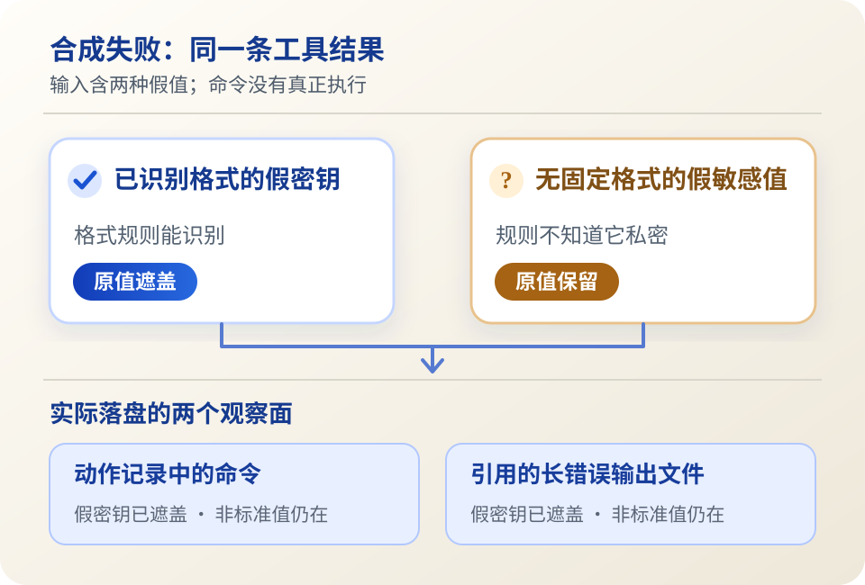

<ArticleCover image="/assets/error-log-boundary-20261102/failure-log.cover-v1.png" kicker="工程研究 · 失败与留痕" title="AI 报错时，日志会把什么一起留下？" summary="一次合成工具失败，让我们看到：熟悉的假密钥被遮盖了，另一段没有固定形态的敏感信息却随记录留下。" version="2026-11-02" languageHref="/en/research/2026-11-02-ai-failure-log-boundary" languageLabel="English" />

<ArticleTableScroll language="zh" />

# AI 报错时，日志会把什么一起留下？

让 AI 帮你运行一条命令，命令失败了。为了查清它究竟有没有执行、在哪里失败，系统留下命令、退出状态和错误输出，是很自然的事。但错误输出来自程序、服务和用户输入，里面也可能夹带不该出现在普通诊断记录里的内容。

于是工程上出现一个不太舒服的选择：**记录得太少，难以追查失败；记录得太全，又可能把私密内容长期留下。** 我们用自己的 CodeFlowMu 做了一次小实验，想知道现有留痕究竟站在哪一边。

## 为什么是这两天的变化引出了这个问题

11 月 1 日，[OpenAI Agents Python 的一项修订](https://github.com/openai/openai-agents-python/pull/5457)让断流错误带上请求与响应标识、事件数和最后事件类型，同时不把提问和模型输出塞进异常消息。它改善的是**定位线索**，并没有修好断流。[MCP TypeScript SDK 的追踪功能](https://github.com/modelcontextprotocol/typescript-sdk/pull/3115)也默认记录调用跨度和耗时，而不采集工具参数与结果。两者给出同一种思路：诊断可以先记录“何时、哪次、到哪一步”，不必先拿走整段正文。

但“打开脱敏”也不能保证所有观察者只看到脱敏内容。[LangGraph 的修订](https://github.com/langchain-ai/langgraph/pull/9486)明确区分了追踪器与其他回调处理器：某项追踪策略处理后的内容交给特定追踪器，其他处理器仍收到原始业务内容。11 月 2 日，[Orkas 的 IPC 修订](https://github.com/Orkas-AI/Orkas/pull/154)则在写日志的边界归纳失败文本，同时把完整错误回复留给调用者。它们处理的是各自产品的不同路径，不能据此说 CodeFlowMu 有同样的故障；但它们促使我们追问：**我们的失败信息最终流向了谁？**

CodeFlowMu 是我们开发的本地多 Agent 工作系统。它把工具调用写成动作证据，供之后核对“做过什么”。FCoP 是正式任务与报告账本；下面检查的是 CodeFlowMu 的动作日志，**不是** FCoP 对任务是否完成的判断。

## 一次失败，两种假敏感值

我们固定 CodeFlowMu V3.0.129 的源码，把一条**合成的、没有真正执行的**失败工具结果送进现有工具调用留痕入口。它报告非零退出；命令与错误文本中同时放了两段假值：一段长得像系统已认识的 API key，另一段是不带通用格式的私密标记。错误输出被填充到 4096 字符以上，触发长输出文件保存。我们随后读取动作记录和它指向的错误文件。

| 看哪里 | 已识别假密钥 | 非标准假敏感值 |
| --- | --- | --- |
| 动作记录里的命令 | 原值被遮盖 | 原值仍在 |
| 单独保存的长错误输出 | 原值被遮盖 | 原值仍在 |

<figure>
  <picture>
    <source media="(max-width: 640px)" srcset="/assets/error-log-boundary-20261102/failure-log.figure.mobile.zh.svg" />
    
  </picture>
  <figcaption>同一次合成失败的两个观察面。图示来自受控模块实验，不代表真实凭据外泄。</figcaption>
</figure>

这不是“脱敏完全没用”。它准确处理了已知格式，还会按敏感字段名遮盖结构化值。动作记录也没有只存一坨报错：它保留了 `failed`、失败类别 `unknown` 和长输出文件引用。然而，对一段没有可识别前缀、也没有落在已知敏感字段下的文字，格式规则无法凭空知道它私密。于是类别记录与完整原文在同一条留痕链里并存。

我们还运行了相关的 26 项现有测试，全部通过。测试覆盖了已识别 token、敏感字段与动作日志的既有行为；它们不曾承诺识别任意形态的私密内容。**测试通过，与这次探针观察到原文落盘，并不矛盾。**

## 留证据，是否等于保留原文

这次实验没有证明发生过数据外泄。假值没有连接真实服务；我们没有测试正式产品实例的文件读取权限、上传链路或保存期限。它只证明：在受测模块入口，某些未知形态的输入会写进本地动作记录与引用文件。把本机写盘直接说成线上泄漏，会越过证据。

更有用的追问是：审查者要验证一次失败，究竟需要什么？任务与调用身份、时间、退出状态、失败类别和可核对的引用，足以支持一部分判断；遇到“外部操作可能已经发生，但返回失败”的场景，完整输出又可能不可或缺。我们倾向于把**动作事实**和**详细原文**当作不同级别的材料，分别决定读取范围、保留时间和清理方式。这是待验证的设计方向，CodeFlowMu 尚未因此改变日志策略。

下一轮应先核对真实产品中谁可以读取这些文件、哪些审查流程真的需要原文、失败后是否有别的观察出口，再决定如何修改。公开的[双语实验记录与探针](https://github.com/joinwell52-AI/joinwell52/blob/main/research/manual-runs/2026-11-02-error-log-boundary/00-report.md)给出固定版本和完整边界；CodeFlowMu 受测源码为私有，公众不能独立复跑这一层。

给工程读者的问题是：**如果只留摘要，你会怎样证明一次失败没有掩盖未知的外部效果？如果保留原文，访问和删除应由谁控制？** 给普通使用者的问题更直接：AI 报错后，你希望产品明确告诉你，完整错误信息会被保存在哪里、保存多久吗？
