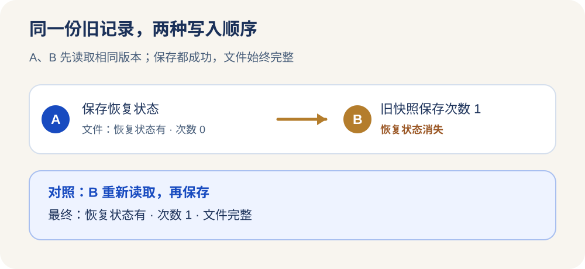

<ArticleCover image="/assets/session-write-boundary-20261103/session-write.cover-v1.png" kicker="工程研究 · 写入与并发" title="文件没写坏，为什么上一次更新还是没了？" summary="两次保存都成功，文件也完好；重新打开，却少了一项更改。" version="2026-11-03" languageHref="/en/research/2026-11-03-atomic-write-lost-update" languageLabel="English" />

<ArticleTableScroll language="zh" />

# 文件没写坏，为什么上一次更新还是没了？

想象你和同事同时打开一份工作记录。你标上“还在恢复”，同事填上“已调用一次工具”。你们都点了保存，屏幕都没有报错。再打开，工具次数是新的，“还在恢复”却不见了。文件既没有损坏，也没有写到一半；丢的是**其中一次决定**。

AI 团队的工作记录也会遇到这种区别。CodeFlowMu 是我们开发的本地多 Agent 工作系统，会为一次运行保存会话状态；FCoP 则把正式任务和交付报告保存成可查的文件。我们今天想确认一个很具体的问题：**“原子保存”究竟保证了文件完整，还是也保证了两个写者的更改都留下？**

## 为什么今天研究这个问题

[Google ADK 的一项 SQLite 修订](https://github.com/google/adk-python/commit/bc0b41871699a70a3bf1169bb7e7ff91d2db5e31)给了我们切口。旧路径在写事务开始前检查会话的更新时间；两个写者可能都看到同一个旧时间、都通过检查，然后相继提交。修订把检查与后续写入放进同一写锁，令后来者在前一位提交后重新面对“我拿的是旧状态”这个事实。这是 ADK 自己的数据库路径，不证明 CodeFlowMu 有同一故障。

后续定向核查又找到仍在评审的 [ADK #7942](https://github.com/google/adk-python/pull/7942)：它讨论不同会话并发改写共享的应用或用户状态时，旧副本会让已提交的键消失。作者报告了受控并发与单测结果，尚未完成真实 PostgreSQL/Redis 端到端验证。它处理的是**跨会话共享行**；下面我们测的是**单个会话的文件**。两者共同提示要问清“谁有权基于旧版写回”，但不能互相代证。

我们感兴趣，是因为自己的两个存储对象很不一样：**会话元数据**以同一个文件反复替换；**FCoP 报告**每次创建一个有独立名字的文件。如果只说“它们都落盘了”，就会掩盖保留历史与更新同一状态之间的差别。

## 两次成功保存，一份消失的状态

我们固定 CodeFlowMu V3.0.152 源码，在临时目录调用真实的 `SessionStore`，没有启动 Agent，也没有触碰生产任务。初始会话的工具次数为 0。A 和 B 各读取同一份旧记录；A 增加“受管作业仍在运行”的恢复状态并保存，B 在自己的旧记录上把工具次数改成 1 并保存。两次 `save()` 都成功返回。

| 观察点 | 恢复状态 | 工具次数 | 文件是否完整 |
| --- | --- | ---: | --- |
| A 保存后 | 有 | 0 | 是 |
| B 用旧快照保存后 | **没有** | 1 | 是，可解析 JSON |
| 对照：B 在 A 保存后重新读取再保存 | 有 | 1 | 是 |

这不是随机碰到的竞争；探针特意安排了“**两人先读，再依次写**”的顺序，让结果可重跑。更重要的是对照组：只改变 B 是否重新读取，结局便从“少一项”变为“两项都在”。[实验方法与固定版本](https://github.com/joinwell52-AI/joinwell52/blob/main/research/manual-runs/2026-11-03-session-write-boundary/00-report.md)保留了输入、脚本和限制。

<figure>
  <picture>
    <source media="(max-width: 640px)" srcset="/assets/session-write-boundary-20261103/write-sequence-mobile.zh.svg" />
    
  </picture>
  <figcaption>受控模块实验的确定性顺序，不表示真实运行中已发生这场竞争。</figcaption>
</figure>

CodeFlowMu 的写入帮助函数先写临时文件，再以重命名替换目标文件。这解决的是读者会不会见到半截 JSON。它没有询问“我写入时，这份记录是否仍是我读过的那一版”。因此，**文件完整性成立，更新不丢失却不能由此推出**。既有针对保存、读取和原子替换的 17 项测试全部通过；它们没有把两份旧快照作为冲突条件，绿灯和这次观察并不矛盾。

## FCoP 为什么留下了两份报告

我们又在另一个临时工作区，通过 FCoP 的真实 `Project` 接口建立一个合成任务，让执行者先后写两份报告。两份报告引用同一个任务，却获得不同的文件名；第一份和第二份的正文最后都能读到。

这只是一项顺序写入对照，不能证明并发编号、断电恢复或完整 CodeFlowMu 到 FCoP 流转都安全。但它说明两种对象承担不同责任：**报告是新证据，值得留住自己的身份；会话元数据是对当前状态的可变描述，必须定义旧版本写回时怎么办。** 即使某次会话状态投影丢了一个字段，也不能直接说正式 REPORT 文件丢了；反过来，REPORT 留存也不能证明会话状态正确。

## 真正需要追问的是谁决定胜出

当前 `SessionManager` 的取消路径会先读取会话，再等待 SDK 取消，最后写取消状态；自然结束路径也会读取、计算并保存终态。两条路径都有异步间隔，所以“若同时发生，谁的终态应被接受”是值得验证的问题。**本轮只证明 `SessionStore` 模块在旧快照写回时不会拒绝或合并；我们没有构造真实运行中的取消与自然结束竞态，更没有生产事故数据。** 因此本轮不把它列为已确认的产品故障或立即开发任务。

下一项实验应使用可控运行句柄，把取消和自然结束停在同一读后阶段，再放行写入，检查磁盘终态、报告引用和两方回执是否一致。届时才有资格决定：同一会话要单写者串行化、按版本拒绝旧写入，还是对某些字段做有定义的合并。选择任何一种之前，还要说清“取消已请求”“执行已结束”“报告已提交”哪个事实不能被后来的一次旧写覆盖。

读者也可以检查自己的系统：**保存成功**是指“文件没有坏”，还是指“我基于的版本仍然有效”？如果你遇过两次都显示已保存、重新打开却少一项更改，你希望系统怎样告知冲突？
