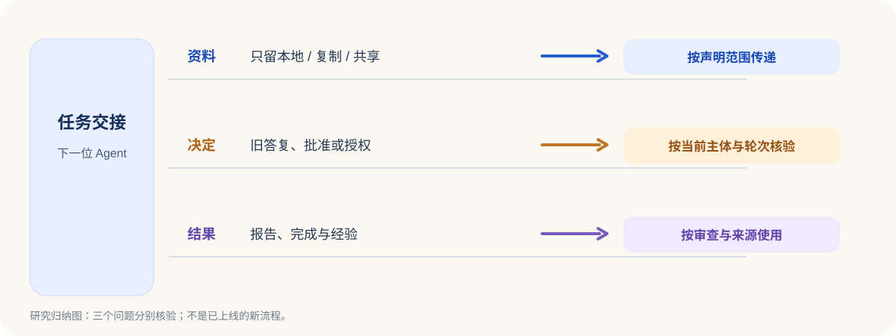

<ArticleCover image="/assets/handoff-boundaries-20261105/handoff-inheritance.cover-v1.png" kicker="工程研究 · 多 Agent 交接" title="换一个 AI 接手，哪些东西可以带走？" summary="我们跑了四套开源实现的局部入口，再对照 CodeFlowMu 的任务、审查和授权测试。任务能交出去，随任务移动的每一种东西却需要各自的依据。" version="2026-11-05" languageHref="/en/research/2026-11-05-what-an-agent-inherits" languageLabel="English" />

<ArticleTableScroll language="zh" />

# 换一个 AI 接手，哪些东西可以带走？

设想一项工作从开发 AI 交到测试 AI 手里。测试者打开同一个项目文件夹，看到了前一位留下的说明和报告，还能找到上一次对话。于是一个很自然的问题出现了：**这些东西都在，之前的批准也还有效吗？**

把任务交给下一位，只说明负责人变了。任务资料、工作区、正在等待的人工决定，以及日后会被记住的经验，分别有不同的来源和使用条件。我们在开发的 CodeFlowMu 是一个本地多 Agent 工作系统；它用 FCoP 保存任务、报告和评审。每天的外部研究动态里，[AG2、LangGraph、Paradev 和 Anthropic 的四条线索](https://joinwell52-ai.github.io/joinwell52/zh/runtime/daily-intelligence/2026-11-05)恰好从不同方向提出同一个工程问题：**交接时究竟继承了什么？**

我们因此固定版本，分别跑了四个可运行入口，再对照 CodeFlowMu 的现有代码和测试。这是四次边界实验，并非把四套产品接成了一个 AI 团队。[公开实验材料和复跑脚本](https://github.com/joinwell52-AI/joinwell52/blob/main/research/manual-runs/2026-11-05-handoff-boundaries/00-report.md)列出了输入、输出和限制。

## 第一件能带走的东西：任务资料

[AG2 1.3](https://github.com/ag2ai/ag2/releases/tag/v1.3.0)给委派变量三种范围：只留在当前任务、复制给子任务、让子任务共享。我们给父任务放入三项值，派生两个子任务，再让其中一个修改数据。结果很直观：本地值对子任务不可见；复制值被改成 `1` 后，父任务和另一子任务仍是 `0`；共享值被改成 `1` 后，三处都看到 `1`。子任务试图新建共享值则被拒绝。

这回答的是**资料如何交接**，尚未回答谁有权执行。AG2 的作用域 API 也不替应用同步并发写入。我们没有运行需要模型凭据的完整父子 Agent 对话，因此不能把这次变量实验说成整个委派链已验收。

## 第二件不能靠“还是同一会话”判断的东西：旧答复

在 [LangGraph 1.2.20](https://github.com/langchain-ai/langgraph/releases/tag/1.2.20) 的本地检查点图里，我们放入两个先后出现的人工问题：先批准计划，再批准执行。第一次问题拿到一个 ID；答复后，第二次问题拿到另一个 ID。故意提交不存在的 ID、已经回答过的第一题 ID，以及完成后重放第二题 ID，三次均被拒绝。只有两次分别答对当前问题，图才产生最终结果。

这个实验打开了版本中的内部严格恢复开关，使用的是进程内存储。它说明**一个答复可以绑定当前待处理的问题**；它没有证明远程部署默认具有相同保证。真正的企业审批还要核对批准者、目标、动作、时限和实际执行者。

## 第三件容易混淆的东西：工作区与会话

[Paradev 2.0.5](https://github.com/ParadevAI/Paradev/releases/tag/desktop-v2.0.5) 的自动化目标规划函数把“复用工作区”和“续接 Agent 会话”分成两个选项。我们从固定源码运行该函数：选择复用工作区，同时让 Agent 会话重新开始，是可行组合；没有固定工作区却要求续接时，规划器会打开复用。另一个更值得警惕的组合是：原目标已经复用工作区，改换主机后，规划结果仍保留复用与续接标志，同时列出新主机待核验。

这里观察到的是**规划输出**。Windows 没有该版本的官方桌面安装包，我们没有运行桌面应用或云端调度，也没有证明新主机已经通过核验，更没有证明旧授权能够跨主机使用。对企业系统来说，这三个状态必须分别说明：文件还在何处、Agent 对话能否续上、当前主体是否仍有权执行。

<figure>
  <picture>
    <source media="(max-width: 640px)" srcset="/assets/handoff-boundaries-20261105/handoff-inheritance-mobile.zh.svg" />
    
  </picture>
  <figcaption>研究归纳图。三个检查点分别有实验或 CodeFlowMu 测试依据；这张图是设计问题的整理，不是已经上线的新流程。</figcaption>
</figure>

## 最后才轮到“以后都记住”

Anthropic 的 [dreaming cookbook](https://github.com/anthropics/claude-cookbooks/pull/959)尝试从完成的会话整理长期记忆。我们运行它的官方辅助模块，读取仓库自带的 11 份示例记录。空输入、预算为零、文件超过上限都在蒸馏前被拒；一个仍在运行的分析线程也不会被计作已经覆盖输入。列表价估算约 0.70 美元，只是估算，没有发生模型账单。

由于没有调用付费 Managed Agents，我们并未生成或审查真实记忆。这个局部实验仍提醒我们：**一段旧内容被保存下来，与它适合成为下一位 Agent 的组织经验，是两道不同的判断。** 任务失败、报告待审、来源不明，都应继续跟着摘要走。

## 回到自己的 AI 团队

CodeFlowMu 的 PM、开发、测试和运维角色之间也有交接。我们在固定提交上跑了六组定向测试，共 77 项通过。这里最有区分力的不是总数，而是几项具体对照：执行者的报告写成 `done`，不会自动变成 PM 的审查决定；下游要求上游成功时，只有报告完成还不足以放行；旧任务轮次和旧修订的命令会被拒绝；技术自动化需要限域授权。另一个直接调用执行契约的探针显示，单独改变主机、工作区、角色或治理工具，都会得到对应的冲突字段。

一项旧端到端夹具在本机 Python 输出解析处中断，未计入这 77 项通过，也没有被用来判断产品故障；失败位置和复跑范围保留在证据页。

这些现有边界回答了**谁可以决定、哪些状态可以推动下一步**。它们尚未证明真实界面、模型对话、主机接管和外部工具效果在一次完整交接里都一致。因此，本轮没有把外部框架的做法直接写成 CodeFlowMu 缺陷或开发任务。

这轮研究给出一个更具体的下一步：让同一项任务真的走过 **PM 分派 → 执行者报告 → 审查者接手**；中途换工作区或主机、撤回一次批准、重放旧问题的答复，再逐层观察资料、当前授权与交付证据。若任何一层给出互相矛盾的结果，才有足够依据讨论修改。

对设计多 Agent 系统的读者，一个可立即检查的问题是：**你的“继续任务”按钮恢复的是文件、对话、待办，还是执行权？** 对普通使用者也一样：换一个 AI 接手时，你最希望它保留哪一项经历，又希望哪一项决定重新征求你？
