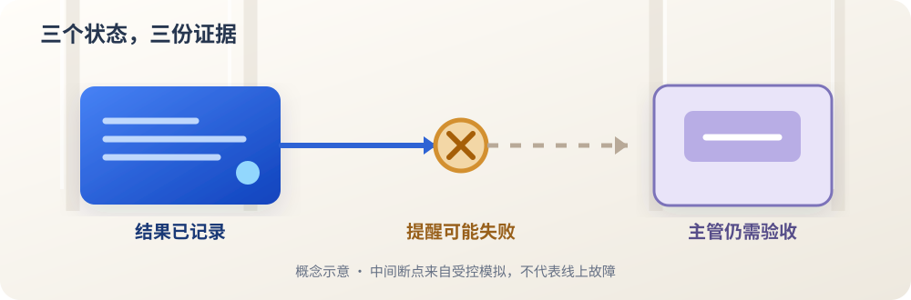

<ArticleCover image="/assets/async-supervisor-20261109/completion-signal.cover-v1.png" kicker="工程研究 · 异步协作" title="后台 AI 做完了，主管一定会知道吗？" summary="我们运行了异步 Agent 参考实现的完成通知入口，并对照 CodeFlowMu 的报告接收测试。员工做完、主管收到提醒、主管验收，是三份不同的证据。" version="2026-11-09" languageHref="/en/research/2026-11-09-when-worker-finishes" languageLabel="English" />

<ArticleTableScroll language="zh" />

# 后台 AI 做完了，主管一定会知道吗？

你交给一位同事一件工作，对方做完后把结果放进共享目录，却没来得及告诉你。文件在那里，工作也许已经结束；但如果你正在等一句“可以验收了”，这项工作对你来说仍像悬着。

多 Agent 系统也会遇到这道缝隙。一个负责与人沟通的主管 AI，可以让几个员工 AI 在后台继续工作。主管保持可联系，员工并行推进，听起来比一人排队处理所有任务更像真正的团队。问题是：**员工完成以后，结果在哪里？谁把消息送到主管面前？主管又凭什么说任务已交付？**

我们在开发的 CodeFlowMu 是一个本地多 Agent 协作系统，用 FCoP 文件记录任务、报告和评审。[11 月 9 日的研究动态](https://joinwell52-ai.github.io/joinwell52/zh/runtime/daily-intelligence/2026-11-09)收集了异步主管、后台任务、恢复和交付证据等线索。其中 [LangChain 的异步 Agent 文章](https://www.langchain.com/blog/agents-are-going-async)及其[参考仓库](https://github.com/langchain-ai/async-deep-agents/tree/6cafef62b2783a3d16edacd7df151ad1a33ee7a5)提出了一个很适合与我们工程对照的问题：主管能继续聊天时，如何知道后台员工已经完成？

## 做完与告知，是两条路径

参考实现给后台工作独立的任务身份和查询入口。主管可以主动检查任务，也可以由员工完成时通知它。但仓库说明写得很清楚：**主动完成通知是应用自行接入的可选组件**；Python 和 TypeScript 示例图里，这段接线默认被注释。只启动后台任务，并不会自然生出一条可靠的“请主管来验收”消息。

启用示例通知后，员工结束时会向主管的会话提交一条新消息，让主管醒来。这个设计很有启发：主管不必反复追问每个员工。不过，一条提醒与任务结果仍有不同的生存条件。提醒可能送不出去，结果却仍在任务记录中；提醒发出，也不代表主管已经核查了交付。

我们把[固定提交的真实 Python 通知模块](https://github.com/langchain-ai/async-deep-agents/blob/6cafef62b2783a3d16edacd7df151ad1a33ee7a5/graphs/python/src/middleware/completion_notifier.py)接到一个可控的远端客户端替身，不调用模型或云端服务。同一通知实例连续触发两次完成回调，只改变父级身份和第一次投递是否报错：[完整脚本与输入输出](https://github.com/joinwell52-AI/joinwell52/blob/main/research/manual-runs/2026-11-09-async-supervisor/00-report.md)可复跑。

| 条件 | 向主管投递的尝试 | 回调后的本地标记 |
| --- | ---: | --- |
| 有主管身份，投递成功 | 1 次 | 已通知 |
| 有主管身份，投递时抛出模拟错误 | 1 次，第二次回调未重试 | 已通知 |
| 缺少主管会话身份 | 0 次 | 未通知 |

最值得停一下的是第二行。参考模块先把内存标记改成“已通知”，随后尝试投递；投递失败被记为警告，下一次回调因为标记已设而不再发送。这里验证的是**这个参考模块在受控失败下的局部行为**。它不证明 LangChain 的云服务会丢任务结果；仓库也明确把通知错误处理留给采用者设计。但它足以说明：一个布尔标记不能同时回答“我试过发送”和“对方确实收到”。

<figure>
  
  <figcaption>机制示意：结果记录、提醒投递、主管验收是三步。琥珀色断点来自本轮模拟发送失败；这张图不是线上事故截图。</figcaption>
</figure>

## 我们自己的主管靠什么接手

再看 CodeFlowMu。它让员工以 FCoP REPORT 写回工作结果，由运行层接收报告并唤醒项目经理角色（PM）审查。这与上面的参考通知不是同一接口：报告是可检查的工件，唤醒是让主管来处理工件的动作。FCoP 规范定义任务位置和转换事件；谁在什么时候启动 PM、如何排队，属于运行层。

我们在 [CodeFlowMu-open 固定提交](https://github.com/joinwell52-AI/CodeFlowMu-open/tree/ed5634c718b9e238c44bb70851020c9793546fe6)上运行三组相关组件测试，**19 项全部通过**。具体通过的不是一句抽象的“通知可靠”：员工报告能够触发 PM 接收；PM 正忙时可排队并去重；同一任务线程的一批报告只起一次 PM 会话；迟到报告按报告 ID 幂等记录；没有报告时不误进审查。这些是已有能力的测试证据，不是本轮新开发的功能。

这也让我们收窄判断。参考实现的一次模拟投递失败，**不能推出 CodeFlowMu 有相同缺陷**。CodeFlowMu 的组件测试通过，也不能推出它在真实模型、界面、进程重启和网络断连中已经完成验收。两边的证据各自只覆盖自己跑过的入口。

## 下一步，谁来重新发现那个结果？

一项工作至少有三句不同的话：员工说“我做完了”，系统说“我已提醒主管”，主管说“我看过并接受”。把它们压成一个“完成”，最容易在等待审批、断线和恢复时误导人。

本轮最有价值的下一问，还没有被实验回答：**当 PM 正等人工批准时，员工写入完成报告；首次唤醒恰好失败，然后运行层重启。报告是否仍能被发现？主管是否只收到一次接收请求？原来的审批问题是否保持原样？** 这需要下一轮端到端对照。当前证据不足以生成 CodeFlowMu 开发任务。

如果你在设计 Agent 团队，可以先查自己的系统：任务结果存在哪里，提醒失败后靠什么重新发现，谁负责最后验收？如果你是使用者，你会希望后台员工做完就直接告诉你，还是先让主管核查后再给你一个有依据的结论？
