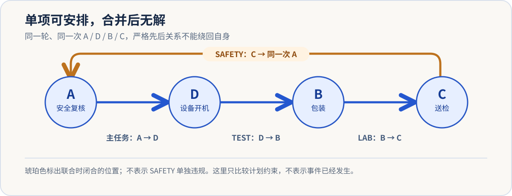
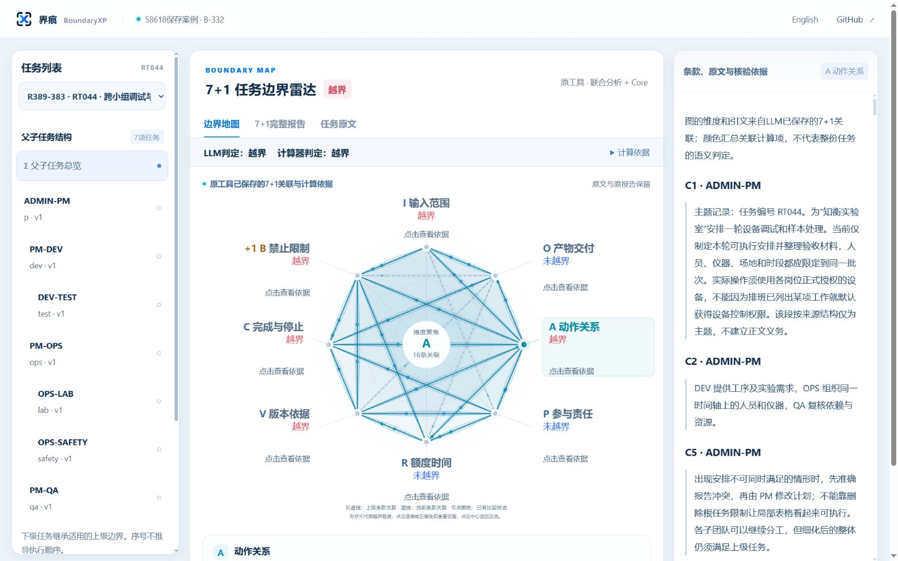

<ArticleCover image="/assets/boundaryxp-cycle-20261114/boundaryxp-cycle.cover-v1.png" kicker="产品观察 · AI 任务边界" title="界痕 BoundaryXP：让 AI 团队的任务边界看得见" summary="每个 AI 子任务都说可行，合并后却可能形成闭环。界痕用 7+1 关联、原文证据和确定性复核指出问题，现已提供论文、在线演示与 MCP 接入。" version="2026-11-14" languageHref="/en/research/2026-11-14-boundaryxp-local-global-cycle" languageLabel="English" />

<ArticleTableScroll language="zh" />

# 界痕 BoundaryXP：让 AI 团队的任务边界看得见

给 AI 团队一项工作，它会迅速分出策划、执行、检查等子任务。可如果每个成员都说“我的部分可行”，整项工作就一定能完成吗？

**界痕 BoundaryXP** 正是为这个问题而做的任务边界分析工具。它读取完整任务和子任务，把要求连到原文证据上，检查单项与组合方案，给出**越界、未越界或信息不全**的结论，并让人看见判断依据。它已经有[公开产品仓库](https://github.com/joinwell52-AI/BoundaryXP)、[7+1 方法论文](https://doi.org/10.5281/zenodo.24072738)、[交互演示](https://boundaryxp-workbench-demo.joinwell52.chatgpt.site/)和可接入 AI 宿主的 [MCP 安装包](https://github.com/joinwell52-AI/BoundaryXP/blob/main/docs/mcp/npm/INSTALL.zh-CN.md)。

## 一个案例，就能看出为什么需要界痕

一份实验室任务书要求安排同一轮的安全复核、设备开机、包装、送检。主任务规定：安全复核结束后才能开机。三个小组分别补上顺序：开机后才能包装，包装后才能送检，送检后才能开始安全复核。

每个小组的补充要求**单独与主任务合并**时都能安排；全部放在一起，却得到：

> 安全复核 → 开机 → 包装 → 送检 → 安全复核。

第一步必须等最后一步，计划没有可执行的起点。界痕公开的 [RT044 保存案例](https://github.com/joinwell52-AI/BoundaryXP/blob/main/docs/demo/reports/R389-383.zh.md)保留了一个主任务、六个子任务和十项查询：主任务与三条子顺序的单项检查分别可满足，**联合查询明确越界**。原文还锁定了“同一轮、同一次事件”，不能假设另有一次包装或复核来解开这个环。这是一份计划约束案例，不是现实实验室事故。

<figure>
  
  <figcaption>冲突出在四条要求的组合，不能据此认定某一个小组单独违规。</figcaption>
</figure>

**[打开 RT044 交互演示，查看任务树、7+1 雷达和原文依据 →](https://boundaryxp-workbench-demo.joinwell52.chatgpt.site/#case=R389-383&axis=A&view=radar&lang=zh)**

<figure>
  
  <figcaption>界痕工作台的公开演示截图：左边是任务树，中间汇总边界关联，右边可以追到具体条款。演示回放的是已保存结果，不会重新分析。</figcaption>
</figure>

界痕的价值不只是画出一个红色结论。它把**哪个要求来自哪段原文、指向哪一次事件、与哪个子任务相连**放在一起。接手计划的人可以定位必须修改的顺序，再重新核查；不必从三个孤立的“我这里没问题”里猜测全局冲突。

## 7+1：让任务要求能被连接、被追问

“7+1”不是八个评分，也不是八个 Agent。界痕把一项任务的要求整理为七类：**输入 I、交付 O、动作 A、责任 P、资源 R、版本依据 V、完成与停止 C**；另把**禁止边界 B**单独保留。读者可以把它理解为一张任务检查表：用什么、做什么、谁来做、按哪版规则、什么时候算完成，以及什么绝不能做。

但真正关键的是**关联**。在 RT044 里，测试组说的“包装”和送检组说的“包装”必须是同一个事件；安全组说的“复核”也必须是主任务规定的那一次。若把它们错连成不同对象，再精确的计算也会解错题。界痕把对象身份、先后条件和原文出处一起保留下来，才有条件检查跨岗位的整体方案。

遇到专业术语时，界痕还可绑定 **L2 行业语义库与 L3 企业语义库**，记录所选词库的版本和摘要，让“某个角色、设备或动作在这里究竟指什么”有可核对的解释依据。词库帮助理解任务，不会凭一个岗位名称自动授予业务权限。[词库工具说明](https://github.com/joinwell52-AI/BoundaryXP/blob/main/docs/mcp/TOOLS.md)与产品一起公开。

这也解释了为什么界痕不会只给出“通过/不通过”两个按钮。公开演示还有两种值得亲手比较的结果：

| 演示案例 | 界痕展示的问题 | 你会看到什么 |
| --- | --- | --- |
| [RT044：联合越界](https://boundaryxp-workbench-demo.joinwell52.chatgpt.site/#case=R389-383&axis=A&view=radar&lang=zh) | 单项可行，组合形成闭环 | 任务树、顺序依据和联合冲突 |
| [RT042：未越界](https://boundaryxp-workbench-demo.joinwell52.chatgpt.site/#case=R389-381&axis=R&view=radar&lang=zh) | 设备 10—11 点与 11—12 点的占用端点相接 | 明确释放时刻后，没有时间重叠 |
| [L23-050：信息不全](https://boundaryxp-workbench-demo.joinwell52.chatgpt.site/#case=R389-153&axis=P&view=radar&lang=zh) | “由他确认”没有唯一指明责任人 | 未知身份被保留，结论不被硬凑成通过 |

把这三例放在一起，产品立场很清楚：**已知冲突要指出；已知可行不要误报；缺少关键事实就诚实保留未知。**

## 从论文走到 Cursor、Codex：界痕已经有哪些入口？

[BXP 方法论文](https://doi.org/10.5281/zenodo.24072738)给出了 7+1 关联表示与边界核验的形式条件；[公开研究材料](https://github.com/joinwell52-AI/BoundaryXP/blob/main/docs/paper/materials/analysis625/REPORT.zh-CN.md)包含 625 组保存任务、3,219 个节点、3,469 项查询。我们在固定版本上重跑了分类脚本、六项选定数学见证和九项费用案例复算，均通过。[复核记录](https://github.com/joinwell52-AI/joinwell52/blob/main/research/manual-runs/2026-11-14-boundaryxp/00-report.md)列出命令与范围。这些数字展示了研究材料的规模和可追溯性；**625/625 是保存记录与现行标注的整体结论一致性，不是新任务准确率**。

对想试用的人，最直接的入口是[在线演示](https://boundaryxp-workbench-demo.joinwell52.chatgpt.site/)：点开案例，看父子任务、8 轴关联、原文依据与完整报告。它回放 B-332 已保存结果，适合先理解界痕如何表达一个判定。

想把界痕放进自己的 AI 工作流，可以查看 [BoundaryXP MCP 中文安装指南](https://github.com/joinwell52-AI/BoundaryXP/blob/main/docs/mcp/npm/INSTALL.zh-CN.md)。当前预发行版 **0.4.0-rc.6** 面向 Windows x64，通过标准 MCP 接入 Cursor、Codex 等兼容宿主，提供 **18 个工具、10 项资源和本地浏览器工作台**。安装包带编译后的 Core，无须另搭界痕服务器；新分析使用用户自行配置的模型 API。当前仓库公开了文档、论文、案例与发行包，Core 原实现源码仍单独维护。

实际使用顺序也有明确边界：先**导入并预览**完整父子任务；确认后**保存**项目；再明确提交一次模型分析，由 Core 对受支持的结构与操作数做确定性核验；最后查看**原文、模型判断、计算回执和未决项**。已保存的操作数还可零模型复算。界痕不会因为你“打开工作台”就自动发起分析，也不会把边界报告当成业务批准。[18 个工具的职责与副作用](https://github.com/joinwell52-AI/BoundaryXP/blob/main/docs/mcp/TOOLS.md)都能查。

## 界痕真正想留下什么

一个多 Agent 团队最容易丢失的，往往不是答案，而是**答案对应哪一版任务、哪段原文、哪一个对象，以及整项工作合起来还能不能做**。界痕把这些关系留下，让“为什么越界”“为什么未越界”“还缺什么信息”成为可以讨论、可以复核的问题。

它也有清楚的界线：确定性 Core 核验的是被表达出来的问题，不能自动证明模型读对了每句原文；公开演示是保存结果回放；分析结论本身不授予执行权限。正因为这些界线可见，产品才值得用真实任务继续检验。

**[先打开界痕交互演示 →](https://boundaryxp-workbench-demo.joinwell52.chatgpt.site/)**　·　[查看公开仓库](https://github.com/joinwell52-AI/BoundaryXP)　·　[阅读论文](https://doi.org/10.5281/zenodo.24072738)　·　[接入 MCP](https://github.com/joinwell52-AI/BoundaryXP/blob/main/docs/mcp/npm/INSTALL.zh-CN.md)

如果你正在让多个 Agent 协作，不妨拿一份真实但可公开的任务书来试：**每个子任务都说“可行”之后，谁检查过它们合在一起的边界？**
