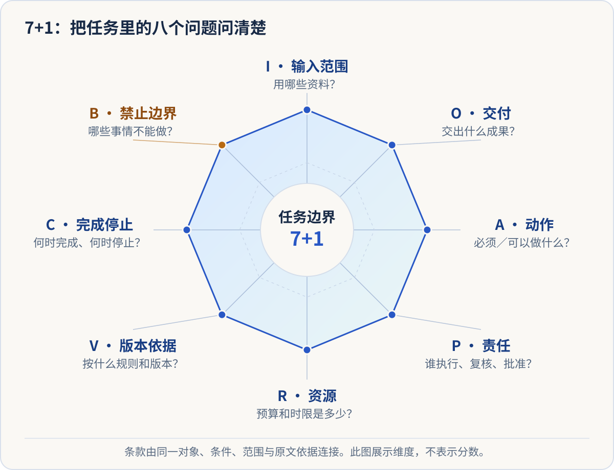
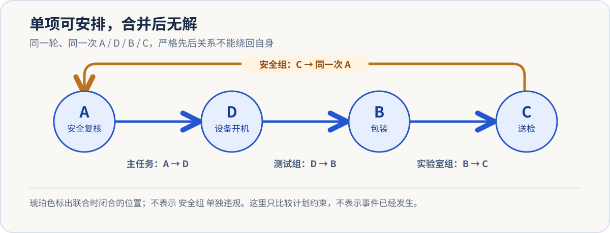
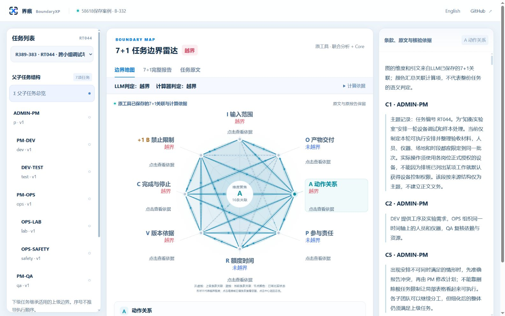

<ArticleCover image="/assets/boundaryxp-cycle-20261114/boundaryxp-radar.zh.cover-v7.png" kicker="项目研究 · AI 任务边界" title="界痕 BoundaryXP：让 AI 团队的任务边界看得见" summary="智能体会自己规划步骤、调用工具，也可能在分工中扩大任务范围。界痕用 7+1 整理要求，把预算、权限、先后顺序和跨任务关系交给数学方法检查，让越界判断有据可查。" version="初版 2026-11-14 · 修订 2026-11-16" languageHref="/en/research/2026-11-14-boundaryxp-local-global-cycle" languageLabel="English" />

<ArticleTableScroll language="zh" />

# 界痕 BoundaryXP：让 AI 团队的任务边界看得见

假设你把一项工作交给一组 AI Agent：

> 核对这批车辆的维修记录，找出异常，交一份报告。只查资料，不改系统。

执行中，一位 Agent 发现某条记录明显有误，打算直接修正数据库；另一位准备把附件下载到本地，交给同伴写报告。先别急着给两件事下同一个结论：**修正数据库明显违反“不改系统”；下载附件是否在允许范围内，还要看任务对资料、存放位置和使用方式的约定。**

如果子任务各自添加了工作顺序，单独看都能完成，合在一起却无法安排呢？冲突又该归到哪个层级？这些问题只靠“感觉”判断，很难统一，也很难追到原文。

界痕 BoundaryXP 要做的，是让任务边界可以检查、可以讨论，也能找到判断依据。它提出 **7+1 任务边界判定方法**：先整理自然语言里的八类要求及其关系，再用数学方法检查主任务、子任务和组合方案。[方法论文](https://doi.org/10.5281/zenodo.24072738)与[协议草案](https://github.com/joinwell52-AI/BoundaryXP/blob/4a843cd63b804cf2f0d3280e50689afca698d320/protocol/versions/0.4.0-draft.2/BXP-0001.zh-CN.md)均已公开。

## 为什么说清楚目标还不够？

智能体会根据目标规划步骤、调用工具，甚至继续分工。交代“要完成什么”之外，还需要说明：可以用哪些资料，允许做哪些动作，谁有权确认，能花多少资源，哪些事情明确不能做。工具账号能完成某个操作，也不代表**这项任务允许它这样做**。

这就是**任务边界**：在这一次交办中，什么必须履行，什么做法可以接受，什么条件尚未满足，什么行为不能发生。任务分给多个智能体后，这些要求仍要约束子方案，并接受整体检查。

## 7+1，先把任务里的八个问题问清楚

一份自然语言任务书，常把目标、权限、预算和验收要求写在同一段话里。7+1 给这些内容安排了清楚的位置：七类任务要求，加上一类独立保留的禁止边界。

| 维度 | 要问清楚的问题 |
| --- | --- |
| **I · 输入范围** | 可以使用哪些资料、系统和对象？范围到哪里？ |
| **O · 交付** | 要交出什么成果，交给谁？ |
| **A · 动作** | 必须做什么、允许做什么？针对哪个对象？ |
| **P · 责任主体与角色分工** | 谁执行、谁复核、谁批准、谁接收？ |
| **R · 资源** | 预算、时限、容量和数量上限是多少？ |
| **V · 版本依据** | 依据哪份规则、制度或证据？采用哪个版本和时间基准？ |
| **C · 完成停止** | 什么条件算完成？什么时候必须停止或上报？ |
| **B · 独立禁止边界** | 哪些动作、对象或效果明确禁止？有哪些明确的条件和例外？ |

<figure>
  
  <figcaption>7+1 用八个方向整理任务要求。轮廓用于展示维度，不表示评分；具体条款还要通过对象、条件和原文依据关联起来。</figcaption>
</figure>

例如，在前面的车辆维修核查任务中，“这批车辆的维修记录”限定输入，“异常报告”规定交付，“核对”规定动作，“不改系统”保留为明确禁令。如果任务没有说明报告交给谁，就应把这个问题留出来，不能替发出任务的人补写一个接收者。也不能把所有空栏一律判成失败；还要看缺少的信息是否影响这次判断。

**列出八栏只是开始，要求之间的关系同样重要。** 两个小组说的“预算”是不是同一笔钱？“验收通过后才能发布”中的验收，指的是哪个版本？子任务中的“设备一号”，是否就是主任务里的那台设备？这些关系决定后面的计算究竟在检查什么。

遇到行业术语和企业内部称呼时，L2 行业语义库、L3 企业语义库可以帮助核对含义和身份。例如，某个简称究竟指测试环境还是生产环境，需要有依据。词库的解释和岗位名称本身都不能增加授权。[八类视图与共享关系的定义](https://github.com/joinwell52-AI/BoundaryXP/blob/4a843cd63b804cf2f0d3280e50689afca698d320/protocol/versions/0.4.0-draft.2/BXP-0001.zh-CN.md#3-语义载体八类视图与共享结构)及[词库工具说明](https://github.com/joinwell52-AI/BoundaryXP/blob/4a843cd63b804cf2f0d3280e50689afca698d320/docs/mcp/TOOLS.md)给出了具体约定。

## 先自己判断：每个小组都能安排，合在一起呢？

界痕公开的 [RT044 保存案例](https://github.com/joinwell52-AI/BoundaryXP/blob/4a843cd63b804cf2f0d3280e50689afca698d320/docs/demo/reports/R389-383.zh.md)给出了一个多任务组合问题。这是一份实验室计划约束案例：同一轮工作里，安全复核、设备开机、包装、送检各发生一次。

主任务和三个小组分别提出要求：

| 来源 | 顺序要求 |
| --- | --- |
| 主任务 | 安全复核结束后，才能开机。 |
| 测试组 | 开机结束后，才能开始包装。 |
| 实验室组 | 包装结束后，才能开始送检。 |
| 安全组 | 送检结束后，才能开始这一次安全复核。 |

先试着回答三个问题：每个小组新增的要求，分别与主任务放在一起时能否安排？四条要求全部合并后呢？如果出现冲突，能否直接说某一个小组单独越界？你可以沿着箭头在纸上走一圈，再看结果。

### 合并后的结果

三个小组各自增加的那条顺序，**分别与主任务比较**，都能找到一种满足要求的安排。但三条一起加入，就形成了：

> **安全复核 → 开机 → 包装 → 送检 → 同一次安全复核。**

<figure>
  
  <figcaption>每条子顺序分别加入主任务时可以安排；全部合并后形成严格闭环。图中字母是本例事件编号，冲突属于组合方案。</figcaption>
</figure>

这个问题可以用很简单的数学关系说明：每个事件都要先开始、后结束，上一件事结束后下一件才能开始。沿着这些严格先后关系走一圈，最终会得到一个矛盾：安全复核必须在它自己开始之前开始。因此，不存在满足全部要求的时间安排。

原文已经限定“同一轮、同一次事件”，所以不能擅自假设“再做一次复核”或“另送一份样本”来解开这个环。需要由有权修改计划的人保留主任务要求，调整子方案中的顺序，再重新检查。

这也说明了多智能体任务为什么需要整体核验。局部可安排，只说明当时比较的那部分要求可以共同成立；它不能替代联合检查。这里应指出**组合方案越界**，并列出参与闭环的要求，不能把联合冲突直接归成每个小组各自单独越界。你刚才对第三问的判断，能否用这四条原文逐条说明？

## 从文字到数学，边界怎样算出来？

可以把任务边界理解为：**所有满足已明确要求的做法，组成的一个范围。** 子任务可以把工作安排得更具体，但适用的上级要求仍然有效。合并子任务时，还要检查共同预算、同一设备、交接条件和先后顺序。

先看一个用于说明原理的简化预算例子。主任务给整个团队 **500 元**，四项计划费用分别为 **180、160、120、80 元**。假定它们都占用同一笔预算，四项都要发生，没有重复计费或抵扣：

> **180 + 160 + 120 + 80 = 540 元 ＞ 500 元，超出 40 元。**

每一项单独看都不到 500 元，合起来仍然超支。这里真正需要进入计算的，除了四个数字，还有“共同占用同一笔预算”这个关系。如果漏掉最后一项，计算器会正确算出 460 元，却没有检查完整方案。

不同要求，可以采用不同的数学表达：

| 原文中的要求 | 可以怎样检查 | 核心在检查什么 |
| --- | --- | --- |
| 整个团队合计不超过 500 元 | 把同一范围内的支出相加，与总上限比较。 | 共享资源的总量约束。 |
| 只能读取指定的两份文件 | 比较拟读取的文件集合与允许范围，找出多出来的对象。 | 对象集合是否超出范围。 |
| 复核通过后才能发布 | 保留“复核通过”这个前置条件，检查方案是否允许绕过它。 | 条件依赖是否被破坏。 |
| 多个工序有严格先后关系 | 把工序和先后要求组成有向图，检查是否出现无法满足的闭环。 | 时间顺序是否矛盾。 |

同样的对象、数值和规则，能够被反复核对。数学方法让已经表达清楚的要求有共同的判据，也能指出具体冲突：多读了哪个文件，超出了多少预算，哪几条顺序不能同时成立。

不过，数学检查需要先知道它在检查哪道题。自然语言中的对象、否定、条件和范围，都应保留到表示中；有歧义的地方需要澄清或保留未知。**可复核的计算，加上可追溯的原文，才能让边界判断有意义。** 论文和协议讨论的正是从要求表示、形式模型到计算判定的这一过程。

## 越界、未越界、信息不全，各回答什么？

边界判定关心的是方案或已给出的行为事实与任务要求的关系。界痕公开演示中的三种结果，可以这样理解：

| 结果与案例 | 判断依据 | 这项结论说明什么 |
| --- | --- | --- |
| **越界：RT044** | 同一轮的严格先后要求形成闭环。 | 当前组合方案存在确定冲突，需要修改。 |
| **未越界：RT042** | 同一设备分别占用 10—11 点、11—12 点；规则明确到点释放、允许立即接入，清场也已计入。 | 在这些条件下，两段占用没有重叠。 |
| **信息不全：L23-050** | 林舟和赵清都参加会议，任务却只写“由他确认”，没有唯一指代依据。 | 最终确认人无法确定，需要补明身份。 |

RT042 中，两段设备占用可写成 **[10:00, 11:00)** 和 **[11:00, 12:00)**：左端包含、右端不包含。第一组在 11 点释放，第二组从 11 点开始，交集为空。这个结论依赖明确的释放与清场规则；只看到两个时间段还不够。[设备案例原文与计算](https://github.com/joinwell52-AI/BoundaryXP/blob/4a843cd63b804cf2f0d3280e50689afca698d320/docs/demo/reports/R389-381.zh.md)

L23-050 中，准备材料与请求澄清可以继续，最终确认人的身份仍需明确。现有文字不能因为某人的岗位更高，就替任务发出者选定他，也不能据此说已经有人违规完成了验收。[责任人案例原文与计算](https://github.com/joinwell52-AI/BoundaryXP/blob/4a843cd63b804cf2f0d3280e50689afca698d320/docs/demo/reports/R389-153.zh.md)

**“未越界”只针对本次所检查的要求与材料。** 它不等于工作已经完成、成果已经正确或业务批准已经取得。同样，存在未知信息也不必然阻止所有判断；如果已知费用已超过上限，而且其他费用只能增加、没有抵扣，剩余金额尚不明确也不能消除已经确定的超支。

## 方法、协议和工具，怎样相互支撑？

7+1 方法把任务要求及其关系组织成可比较的表示；BXP 协议进一步约定表示、依据、计算和结果的处理方式；BoundaryXP 工具负责把具体任务送入这一过程，展示原文、分析、计算回执和未决问题。协议草案与工具实现各有版本，当前实现范围以[实现状态说明](https://github.com/joinwell52-AI/BoundaryXP/blob/4a843cd63b804cf2f0d3280e50689afca698d320/protocol/IMPLEMENTATION.md)为准。

[公开研究材料](https://github.com/joinwell52-AI/BoundaryXP/blob/4a843cd63b804cf2f0d3280e50689afca698d320/docs/paper/materials/analysis625/REPORT.zh-CN.md)保存了 **625 组任务、3,219 个任务节点和 3,469 项查询**，涉及逻辑、数量、集合身份、依赖和复合约束。625 组保存结果的最终判定均与各自的现行标注一致，保存的模型整体判断也与程序汇总一致。逐项比较时，模型判断与程序结果仍有 **9 项差异**，包括 6 项标签编码差异和 3 项计算判断差异；另有 **3 项计算因指定输入缺失而未完成**。[统计口径与原始记录](https://github.com/joinwell52-AI/BoundaryXP/blob/4a843cd63b804cf2f0d3280e50689afca698d320/docs/paper/materials/evidence-r18/SOURCE-REPORT.md)

这些材料的作用，是让人检查方法怎样用于具体问题，冲突怎样定位，未知信息怎样影响结论。整组一致性衡量的是这些保存记录与现行标注的对应关系，不能外推为新任务准确率。

网站 [11 月 14 日的复核记录](https://github.com/joinwell52-AI/joinwell52/blob/ac13a5f8fabe7bc1fc1aa71ded19c5666fbf3625/research/manual-runs/2026-11-14-boundaryxp/00-report.md)还保存了摘要与分类核对、六项选定数学见证以及一个费用案例九项计算的复算结果。这些是有范围的历史复核，没有重新运行全部模型分析。本次修订沿用这些证据，并更新了产品接入信息。

## 怎样看报告，怎样分析自己的任务？

可以先打开[中文交互演示](https://boundaryxp-workbench-demo.joinwell52.chatgpt.site/#case=R389-383&axis=A&view=radar&lang=zh)，从 RT044 开始：点任务树里的一个节点，选中一个维度，再查看相关条款和原文。这样能看到一个结论究竟对应哪些任务要求。

<figure>
  
  <figcaption>公开演示工作台：任务树、7+1 视图和原文依据放在同一页面。截图与在线演示回放的是已保存案例，不会重新分析你的任务。</figcaption>
</figure>

分析自己的任务，可以按 [MCP 中文安装指南](https://github.com/joinwell52-AI/BoundaryXP/blob/main/docs/mcp/npm/INSTALL.zh-CN.md)接入 Cursor 或 Codex。截至 2026 年 11 月 16 日，公开预发行版为 **0.4.0-rc.9**，面向 Windows x64，提供 **21 个 MCP 工具、17 项资源**和本地浏览器工作台。新版增加了 L2 行业与 L3 企业自定义字典的格式说明、校验与导入功能，便于核对任务中的专业术语和内部称呼。安装与升级方式见中文安装指南及 [rc.9 发布说明](https://github.com/joinwell52-AI/BoundaryXP/releases/tag/mcp-v0.4.0-rc.9)。该版支持使用当前宿主的模型分析，无需另配一把模型 API 密钥；也可以选择独立 API 模式。宿主模式仍有模型参与，不能把“无需额外 API 密钥”理解成不使用模型服务。

实际使用时，先导入完整的主任务和子任务，检查任务树，再保存并明确提交分析。报告会保留模型的解释和计算内核对受支持操作数的复核结果，二者可以分别查看。对已保存的操作数，还可以不新增模型调用地复算。打开工作台本身不会提交一次新分析。[工具职责说明](https://github.com/joinwell52-AI/BoundaryXP/blob/4a843cd63b804cf2f0d3280e50689afca698d320/docs/mcp/TOOLS.md)

目前公开内容包括文档、协议、论文、研究案例和编译安装包；计算内核的原始实现源码仍在独立私有仓库维护。使用报告时，也应保留它的判断范围：计算能够核验已经表达出来的问题，原文是否被完整、准确地理解仍需检查；修改计划、业务批准和实际执行，仍由相应的责任人或业务系统决定。

## 现在，轮到你来检查边界

当任务交给一组智能体时，把各自的安排放回同一份任务，才能看出共同要求是否继续成立。界痕希望把这件事做得具体：指出是哪条要求、哪几个子任务、哪一项计算出了问题，让人能够据此修改，而不只收到一句“整体看起来可行”。

你可以从自己的任务开始：按 7+1 写下输入、交付、动作、责任、资源、版本依据、完成停止和禁止边界，再问一句：**两个子任务合在一起时，有没有出现单独检查时看不到的冲突？**

还有几个问题值得继续追问：下载附件的保存位置未写清楚时，哪些判断应暂留未知？行业词库或企业词库更新后，旧报告要怎样保留当时的词义依据？组合方案确有冲突时，谁有权调整顺序，又怎样证明上级要求没有被悄悄改掉？

如果你遇到难以表达的真实约束，或对某个保存案例的判定有异议，欢迎带着任务原文、版本和具体疑问到仓库讨论。也可以先打开演示，在雷达图里选一条要求，沿着报告回到原文，亲自检查 RT044 的闭环。**方法只有经得起使用者的核对与质疑，边界才会变得可靠。**

[查看公开仓库并讨论](https://github.com/joinwell52-AI/BoundaryXP) · [阅读方法论文](https://doi.org/10.5281/zenodo.24072738) · [打开交互演示](https://boundaryxp-workbench-demo.joinwell52.chatgpt.site/#case=R389-383&axis=A&view=radar&lang=zh) · [查看安装指南](https://github.com/joinwell52-AI/BoundaryXP/blob/main/docs/mcp/npm/INSTALL.zh-CN.md)

