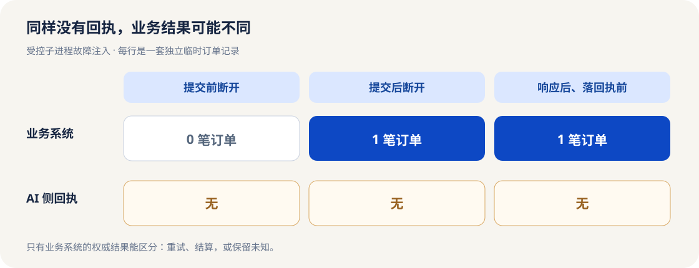

<ArticleCover image="/assets/order-receipt-20261114/order-receipt.cover-v1.png" kicker="工程研究 · 恢复结算" title="订单已经下了，AI 员工却只看见超时：该重试吗？" summary="服务端已经下单，AI 员工却只收到超时。我们在三个断点杀掉进程，并用无幂等键的盲重试作对照，寻找恢复时真正可信的证据。" version="2026-11-14" languageHref="/en/research/2026-11-14-order-receipt-lost" languageLabel="English" />

<ArticleTableScroll language="zh" />

# 订单已经下了，AI 员工却只看见超时：该重试吗？

假设一位数字员工替你下了订单，等了半分钟，只拿到“超时”。它没有收到订单编号，也没有写下成功回执。你让它再试一次，可能完成任务，也可能收到两份货。**超时说的是谁没收到消息，并没有告诉你订单是否成立。**

这不是凭空设想。[Paperclip 的一项修复](https://github.com/paperclipai/paperclip/pull/21522)记录了相近的真实工程事件：修改任务的请求已经在服务端提交，客户端却超过 30 秒才等到响应，因而记下“结果未知”。之后的运行一再被这条未知记录挡住。Paperclip 为它控制的写入增加服务端结果结算：有最终记录时恢复判断，确实未知时继续拦住。这启发我们追问另一层：**当 AI 员工调用的是外部业务系统，它能拿到什么证据？**

我们正在开发 CodeFlowMu，一个本地多 Agent 协作系统；FCoP 文件保存正式任务、报告和审查事实。订单却属于业务系统。即使任务文件写着“已执行”，也不能替业务系统证明下单成功；反过来，本地回执缺失也不能证明订单不存在。

## 让回执停在三个位置

我们做了一套隔离订单实验：一个子进程提交订单，另一个进程负责恢复；订单存入临时 SQLite 数据库。它不是 CodeFlowMu 的真实业务集成，也没有调用外网。我们分别在**提交前、提交后但响应前、响应后但本地回执前**强制退出子进程。恢复时先按同一个操作键查询业务记录，再决定是否重试。[脚本、方法和结果](https://github.com/joinwell52-AI/joinwell52/blob/main/research/manual-runs/2026-11-14-order-receipt-lost/00-report.md)可独立复跑。

| 中断点 | 恢复前真实订单 | AI 侧回执 | 据业务记录作出的决定 | 恢复后订单 |
| --- | ---: | --- | --- | ---: |
| 提交前 | 0 | 无 | 确认未提交后重试 | 1 |
| 提交后、响应前 | 1 | 无 | 查到原订单，直接结算 | 1 |
| 响应后、本地回执前 | 1 | 无 | 查到原订单，直接结算 | 1 |

<figure>
  
  <figcaption>受控实验的证据边界：三次本地回执都为空；真正区分能否重试的是业务系统中的订单记录。</figcaption>
</figure>

第一行和第二行在 AI 侧看起来一样：没有回执。业务系统里的事实却相反。这个差别决定了动作：第一行可以在可靠查询确认后补做；第二行如果再下单，就可能重复。实验中的操作键由数据库唯一索引保护，因而同一操作不会被插入两次。它是夹具提供的能力，不能假设任何外部服务都有。

我们还故意撤掉操作键，让程序在“已提交、响应丢失”后盲重试。结果不是一个抽象的风险提示，而是**实际出现 2 笔订单**。这只是确定性程序对照，不是模型自发犯错；它说明重试策略若只听客户端报错，就可能制造第二个业务效果。

## 哪个系统有资格说“已经完成”？

Paperclip 能用它自己的服务端最终记录结算它控制的那类操作。CodeFlowMu 现有源码则在原调用效果证据不全时保留 `unknown`，禁用自动重试；显式恢复也拒绝效果未知的路径。本轮恢复、审批绑定和审查作用域的 **18 项定向测试通过**。另有 9 项调用效果测试因 Windows 进程未以管理员身份运行，在私有目录初始化处停止，不能算通过。[验证范围与失败前置条件](https://github.com/joinwell52-AI/joinwell52/blob/main/research/manual-runs/2026-11-14-order-receipt-lost/00-report.md)已列明。

这两种实现都提醒我们区分三件事：**任务事实**说明员工承担了什么、报告了什么；**调用回执**说明程序观察到了什么；**业务记录**说明外部系统最终发生了什么。订单能否结算，关键在第三件事能否被可靠读取，并且能否绑定到原操作。本文没有发现 CodeFlowMu 的新缺陷，也没有证明它对任意外部业务系统都具备这种查询能力。

于是一个恢复决定可以写得很朴素：权威记录证明未提交，才重试；证明已提交，就读回原结果；证明不了，就保留未知并请人核查。**“让任务继续”并不总意味着再执行一次。**

下一步的问题更难：换一台执行机器接手，原操作键和查询资格是否仍在？独立验收看到的是业务系统里的那一笔订单，还是员工写得漂亮的成功报告？我们已为跨进程接手与规则验收做了有界夹具实验，但真实双 Host 与模型验收对照还未完成，不能替这两个问题预先作答。

如果你在使用 Agent 替人操作业务系统，最值得先问服务商一句：**“响应丢了以后，我能用原操作身份查到最终结果吗？”**如果答案是否定的，自动重试按钮就不该装成“继续工作”的唯一选项。
