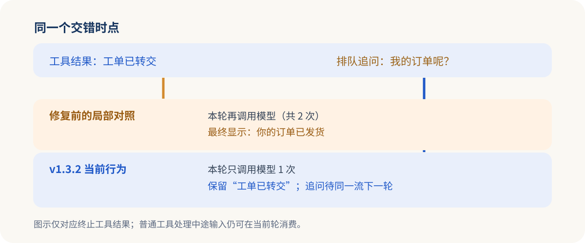

<ArticleCover image="/assets/handoff-turn-20261116/handoff-turn.cover.png" kicker="工程研究 · Agent 交接" title="工单刚转交，AI 的回答却变成“已发货”：新消息该算哪一轮？" summary="同一刻，工具返回“工单已转交”，用户追问订单。AG2 的修复前后局部对照显示：若本轮多调用一次模型，交接结果会被订单回答取代。我们又对照 CodeFlowMu 的输入投递边界。" version="2026-11-16" languageHref="/en/research/2026-11-16-handoff-new-message" languageLabel="English" />

<ArticleTableScroll language="zh" />

# 工单刚转交，AI 的回答却变成“已发货”：新消息该算哪一轮？

一位用户说：“我要找人工处理。”AI 调用工具，工具返回“工单已转交”。几乎同时，用户又问：“我的订单呢？”

如果 AI 在这一轮结束前顺手处理追问，屏幕上最后出现的可能是“你的订单已发货”。工单确实转交了，但这个交接结果被第二个回答盖过去。对用户而言，他刚要求的人工接手似乎没了下文；对接手的人而言，也很难从最终一句话看清上一轮究竟完成了什么。

这是 [AG2 贡献者 coder-abu 提出的修复](https://github.com/ag2ai/ag2/pull/3639)所处理的边界。AG2 是一个 Agent 开发框架；在这个案例中，工具可以明确要求“以我的结果结束本轮”，也可以把调用交给客户端处理。修复前，框架已经跳过了正常工具循环，却仍把运行中排队的新输入取出来，再调用一次模型。于是原本应保留的终止结果被新回答替换；客户端交接时，甚至可能在工具结果尚未回来之前继续问模型。上游修复让强制结束的结果先返回，新输入留在**同一消息流**的下一轮。

## 把“刚好同时”做成可重跑实验

我们固定 AG2 v1.3.2，使用它自己的脚本模型与事件订阅：第一个请求是“我要找人工”；终止工具返回 `Ticket escalated.`；工具结果到达时，立即排队 `What about my order?`。脚本模型为追问准备了 `Your order shipped.`。这两个英文句子是测试数据，不代表真实订单状态。

为了看清变更的作用，我们只把修复前的 `_execute_turn` 函数体放进当前版本的其余运行时，再与当前函数比较：

| 同一交错时点 | 本轮最终回复 | 本轮模型调用 |
| --- | --- | ---: |
| 修复前循环体 + 当前其余运行时 | `Your order shipped.` | 2 次 |
| v1.3.2 当前循环体 | `Ticket escalated.` | 1 次 |

我们还运行了 AG2 的三项相关上游回归：终止工具结果保留、客户端交接等结果回来再恢复、普通工具处理中途输入仍能在当前轮消费；三项均通过。这里的“修复前”只是**旧函数与当前其余组件的局部因果对照**，不是完整旧版发行包或真实模型服务的复现。[实验脚本、版本与结果](https://github.com/joinwell52-AI/joinwell52/blob/main/research/manual-runs/2026-11-16-turn-boundary/00-report.md)可复查。

这项修复也不是“新消息一律等下一轮”。普通工具仍在继续调用模型时，中途输入可以进入当前轮。区别在于：**工具已经决定本轮结束或等待客户端交接时，不能为了处理追问，把这一轮的结果又打开一次。**上游还提醒：如果适配器每次请求都新建消息流，队列归属需要单独处理，不能简单套用“下一轮会读到”。

## 回到我们的多 Agent 系统

CodeFlowMu 是我们开发的本地多 Agent 协作系统。它也会把人的新指令送给运行中的执行者，但这与 AG2 的消息流并不是同一个实现。我们的对照因此没有宣称“复现了同一个 bug”，而是问一个更基础的问题：**一条追问究竟被保存了、送到原生进程了，还是已经参与模型这一轮？**

本地探针穿过 CodeFlowMu 当前的真实投递方法。若进程在调用前已经结束，结果是 `not_live`，没有写入原生进程；若写入时进程结束、又没有原生送达回执，结果是 `unknown`，输入被保存，同一请求再次查看仍为未知，没有再写第二次。相关协调与投递目标回归 27 项通过。另两项完整集成用例需要受信任管理员测试环境，在前置条件处停止；**没有算作通过**。

这些结果证明受测局部没有把“保存输入”直接冒充“模型已收到”。它们没有证明真实 Host 在交接瞬间怎样安排轮次，更没有证明用户追问已成为正式任务的新授权。FCoP 记录的正式任务、报告和验收，是跨员工协作的事实；宿主里哪一轮消费聊天输入，是另一个边界。两者必须能关联，不能相互代证。

## 真正需要问的下一句

这轮研究没有确认 CodeFlowMu 产品缺陷，也没有形成开发评审项目。最有价值的下一轮实验，是在同一个真实 Host 中分别把追问放在**运行中、交接点、进程结束后**，同时核对最终回复、原生送达回执、模型调用次数，以及是否意外新开一个执行轮次。没有这组证据，就不该把 AG2 的修复直接写成我们的开发任务。

对设计多 Agent 系统的人，这个案例提出一个可争论的问题：当执行者已经给出交接结果，新输入应排在同一流的下一轮、要求重新投递，还是成为独立会话？不同产品可以选不同体验，但必须让用户知道**上一轮交了什么、这句话排到哪里、谁有权继续做**。

本文的 AG2 对照是固定版本、脚本模型和局部函数替换；CodeFlowMu 对照是受控子进程探针。完整源码版本、公开可重跑探针与受限产品证据的边界见[中英文实验记录](https://github.com/joinwell52-AI/joinwell52/blob/main/research/manual-runs/2026-11-16-turn-boundary/00-report.md)。
