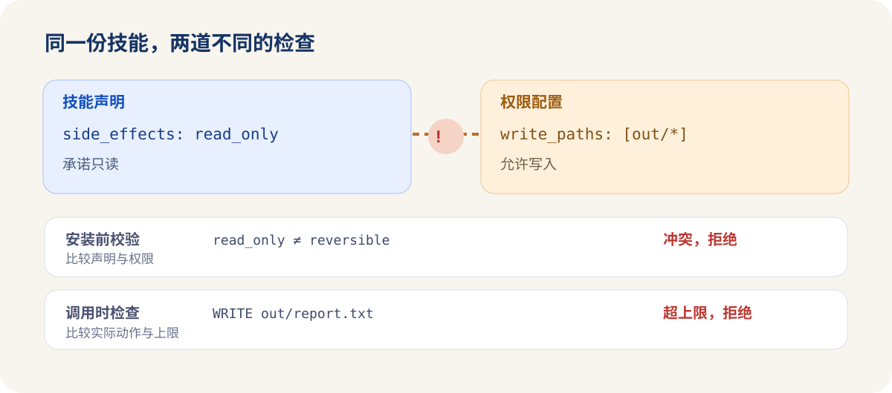

<ArticleCover image="/assets/skill-side-effect-20261119/skill-side-effect.cover.png" kicker="工程研究 · 技能边界" title="技能说“只读”，权限却允许写：谁说了算？" summary="一份技能卡片承诺只读，另一份权限文件却允许写入。我们让这两份说法在静态校验和实际动作入口相遇。" version="2026-11-19" languageHref="/en/research/2026-11-19-skill-says-read-only" languageLabel="English" />

<ArticleTableScroll language="zh" />

# 技能说“只读”，权限却允许写：谁说了算？

你给 AI 团队装了一个“代码审阅”技能。说明写得很克制：读一遍变更，指出风险，不修改文件。几天后你发现，它的权限配置里还有一行：允许写入 `out/*`。

这时真正需要回答的不是“作者是不是想让它写报告”，而是：**当技能的承诺与配置冲突，系统在安装前和调用时分别会怎样处理？** 如果只读是团队交办的边界，单凭“这是审阅技能”这几个字，不能证明一笔写入获准。

## 一份互相矛盾的技能

[Mansura Habiba 的 Bulbasaur 研究仓库](https://github.com/mansura-habiba/bulbasaur-skill-cli/pull/25)最近合入了一个具体做法：在技能配置中声明副作用上限，再用同一张操作成本表检查权限文件与调用时动作。它是作者自己的项目，不能称为 AGENTSAFE 的官方实现。

我们固定这次合入的版本，准备两份合成技能。两份都声明 `read_only`；第一份允许写 `out/*`，第二份把可写路径设为空。然后分别运行它的校验器，并向运行时判断器提出“读取文件”和“写出报告”两种操作。**探针只询问判断结果，没有真的改文件。**

| 技能与操作 | 安装前校验 | 动作时判断 |
| --- | --- | --- |
| 声称只读，却授予 `out/*` 写权限 | 失败：声明为 `read_only`，权限推导为可逆写入 | 写 `out/report.txt` 被副作用上限拒绝 |
| 同一份冲突配置 | 同上 | 读 `in/change.diff` 允许 |
| 声称只读，写权限列表为空 | 通过 | 写 `out/report.txt` 仍被空白名单拒绝 |

固定版本的上游副作用契约测试 13 项通过；我们另做的六项断言也通过。这里有两把不同的尺：**校验器比较“说要做什么”与“配置允许什么”**；运行时再比较“此刻想做什么”与实际允许的上限。把拒绝写入只留给其中一道检查，另一处的配置矛盾就可能被带进部署。

## 把同一道题带回 CodeFlowMu

CodeFlowMu 是我们开发的本地多 Agent 协作系统。它有技能登记，也有对具体工具动作生成事实并检查负向边界的路径。我们用当前固定版本做了两组**不执行工具**的对照。

第一组检查技能记录格式。一个工具标成 `low` 风险，同时列出写权限，schema 可以接受；另加 `side_effects: read_only` 字段会被拒绝。也就是说，当前格式**没有表达 Bulbasaur 那种副作用上限**。这不能被说成“低风险技能可随便写”——风险等级与“只读承诺”原本不是同一个字段，格式合法也不是动作授权。

第二组只改变拟调用的工具名，对同一个受保护源码路径分别提出读取与写入。实际操作事实分类器把前者判为 `read`，没有受保护写入匹配；把后者判为 `write`，命中 `NEG.PROTECTED.BOUNDARY.WRITE`。六项断言通过。它说明 CodeFlowMu 的**动作事实检查不会因为技能叫“审阅”就把写操作当成读操作**。但这只到事实分类，尚不是完整审批或真正执行。当前技能挂载器还明确处于 stub 模式；我们没有复现“一个已上线的只读技能实际写了文件”。

## 三份证据要在同一次调用上对齐

对一个多 Agent 团队，可以把问题拆成三句：这项任务允许什么？这份技能承诺与配置允许什么？这次工具调用实际上要改变什么？它们来自不同地方，不应互相冒名顶替。

Bulbasaur 的实验给了我们一个可借鉴的检查顺序：先发现声明与权限的冲突，再在动作发生前重新判断。CodeFlowMu 当前已经能识别受测动作的种类与受保护目标，但本轮没有证明技能声明、任务授权与每次调用已在一条线上相交。因此我们**没有确认产品缺陷，也没有把它列成开发项目**。要评审开发价值，下一步得先在真实技能接入中验证：技能版本、授予的权限、FCoP 正式任务边界与操作事实，能否指向同一次动作。

如果你的团队也在使用 AI 技能，拿一份最普通的“只读”技能，试着把**声明、权限、一次实际请求**并排放在桌上。哪一栏只能靠人猜？那就是值得补证据的位置。完整版本与结果见[公开实验报告](https://github.com/joinwell52-AI/joinwell52/blob/main/research/manual-runs/2026-11-19-skill-side-effects/00-report.md)。
