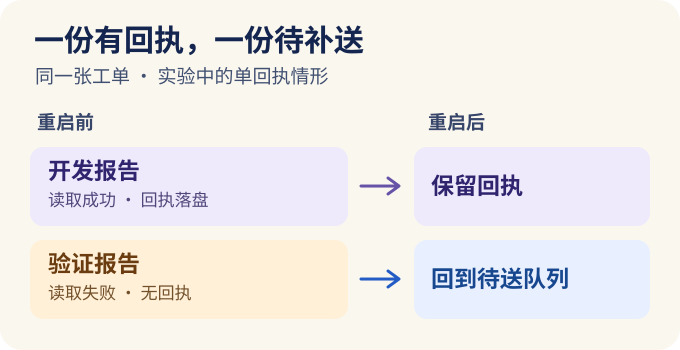

<ArticleCover image="/assets/digital-employee-handoff-20261122/handoff.cover.png" kicker="数字员工 · 协作交接" title="两名数字员工交报告，重启后补送哪份？" summary="同一张工单有两份报告，项目主管只确认了一份。三组重启对照表明，逐份回执可以让系统找回尚未完成的交接。" version="2026-11-22" languageHref="/en/research/2026-11-22-digital-employee-handoff-receipts" languageLabel="English" />

<ArticleTableScroll language="zh" />

# 两名数字员工交报告，重启后补送哪份？

在我们的受控实验里，一张工单有两份报告。开发员交代改了什么，测试员交代查了什么。项目主管读到了开发报告，读取验证报告时却失败了。接着系统重启。两份文件都还在，主管的待办里应该出现哪一份？

我们用这个场景检验 CodeFlowMu。它是我们开发的多智能体协作系统，项目主管也是数字员工，负责分派任务、接收报告、向委托人汇报。如果两份都重送，主管就要重复处理已经接收的材料。如果两份都跳过，测试员的报告就可能留在目录里，等不到人处理。**交接的进度，要能追到每一份报告。**

## 同样两份文件，三种恢复结果

我们在临时项目中写入同一工单的两份合成报告，让系统把它们排入忙碌主管的待送队列。三组实验使用相同的文件，唯一变化是第一个进程退出前成功确认了几份。随后启动一个全新的进程，打开同一个项目。

| 退出前的成功读取回执 | 新进程补送的报告 |
| --- | --- |
| 没有 | 开发报告、验证报告 |
| 只有开发报告 | 只有验证报告 |
| 两份都有 | 0 份 |

我们在每组都先模拟一次验证报告读取失败，确认这次失败没有写入回执。只确认一份的那组重启后，开发报告和它的回执一起保留在磁盘上，验证报告独自回到待送队列。

## 主管需要两种记录

报告文件记录员工交了什么，回执记录主管在这张工单里接收过哪一份。在这条受测路径上，系统收到对应报告的读取成功事件后，把回执按文件写到磁盘。新进程启动时，逐份检查现存报告，把缺少回执的报告重新排队。旧队列可以消失，交接进度仍能从磁盘重建。

这是在 CodeFlowMu Runtime 3.1.11 上做的进程重启实验。报告监视、派发和回执存储运行的都是实际组件，读取事件来自模拟主管会话。图中的“补送”指重新排队。模型如何使用报告、主管是否验收，以及验收对应哪一版成果，仍需在岗位工作流里继续验证。

## 如果交来的是第二版呢？

在 CrewAI 的一个修复中，员工改写了同一路径的文件，第二次保存却命中缓存，拿回第一版的链接。CodeFlowMu 的实验回答了“哪份报告需要补送”，这个例子则问“报告指向哪一版成果”。这两个问题接起来，才有了下一轮要查的交付证据。 [CrewAI 原始修复](https://github.com/crewAIInc/crewAI/pull/9595)

可以拿团队的一张工单做检查：两人交件后，让主管只确认其中一份，再重启。先看未确认的那份是否回到待办，再让执行者提交成果第二版，检查主管和验收员最终看到的是哪一版。假如验收员只签了第一版，你的系统会把第二版显示成什么状态？
