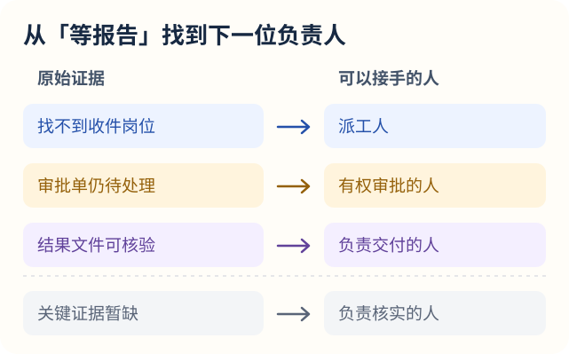

<ArticleCover image="/assets/covers/2026-11-23-digital-employee-handoff-triage.png" kicker="数字员工 · 协作交接" title="数字员工迟迟没交报告，主管该找谁？" summary="同一张对账工单在 CodeFlowMu 本地跑了九次。任务没送达、等待审批、已有结果但没交报告，都可能得到同一个队列结果。" version="2026-11-23" languageHref="/en/research/2026-11-23-digital-employee-handoff-triage" languageLabel="English" />

<ArticleTableScroll language="zh" />

# 数字员工迟迟没交报告，主管该找谁？

一张对账工单发出去，午后仍然没有报告。你会再派一次，去找审批人，还是请同事把做好的结果交上来？三个做法都合理，但要看工作停在了哪一步。如果账已经对完，再派一次就会重做。如果岗位根本没收到，催交也等不到结果。

这个问题来自我们对 AG2 的一次研究。它的工作流可以在下一位参与者长时间没回应时记录超时。我们想知道，主管发现自己等太久后，能不能判断**下一步该找谁**。为此，我们用同一张对账工单，在本地多智能体协作系统 CodeFlowMu 里设置了三种停点，每种跑了三轮。[AG2 的轮次超时变更](https://github.com/ag2ai/ag2/pull/3703)

## 同一张工单，三种停点

我们让任务分别停在投递、审批和交付三个位置。调度、审批落盘和会话结算走 CodeFlowMu 的实际代码。模型由测试适配器代替，第三种情形由探针在临时目录写出一份可以核对的结果。

| 工单停在哪里 | 实验里找到了什么 | 主管此时该找谁 |
|---|---|---|
| 没送到岗位 | 调度记录明确说找不到收件岗位。三轮都没有启动会话 | 找派工人核对收件岗位，再决定要不要补派 |
| 在等审批 | 员工会话已启动。审批单仍处于待审批状态，所请求的操作尚未执行 | 找有权处理这张申请的人 |
| 做完了，报告没交 | 会话已结束。结果文件里账面与实收都是 120，差额为 0。正式报告目录仍为空 | 找交付人核对已有结果并补报告 |

我们把九次运行的会话和报告事实交给仓库里的报告队列函数。九次都返回“等报告”。更值得注意的是，**等审批和做完没交的六次，连原因都一样：会话结束，没有报告。**在这两种情况下都等着，审批人可能永远不知道有人在等他，交付人也不知道已经可以整理现有结果了。

*前三行依据本地实验。虚线下是关键证据缺失时的建议处理方式。*

## 让交接记录指向下一位负责人

“等报告”可以描述主管此刻看到的情况。要决定下一步，交接记录至少得回答两个问题：现在轮到谁，凭什么这样判断？一次明确的投递失败指向派工人。一张与工单对应、仍有效的待审批单指向审批人。一份可以按工单核对的工件，则给交付人提供了已有成果。

最难处理的是证据缺了一条。假如审批单暂时读不到，单凭会话结束就把工作推给交付人，可能跳过仍未完成的审批。假如结果文件读不到，“运行结束”也只够确认这次会话已经收尾。此时可以把下一步交给负责查证的人，并留下具体问题，例如“请核实这次审批是否仍在等待”或“请确认本轮结果是否已落盘”。

这组本地对照验证了 CodeFlowMu 的底层记录与一个单独调用的队列函数。真实宿主、完整产品界面和业务验收仍待验证。九次记录均为受控实验，说明这三种停点可以产生相同的队列提示，无法据此估计发生频率。 这组本地对照固定在 CodeFlowMu Runtime 3.1.11。 [查看 9 次实验的逐轮证据](/assets/digital-employee-handoff-20261123/controlled-runs.json)

下次遇到一直没回音的数字员工，试问一句：**如果再过十分钟依然没有报告，谁能根据现有记录接手，而不用从头再做一遍？** 对交接系统来说，更难的一关是当审批单、运行记录和结果文件里有一项暂时不可读时，怎样既有人负责查证，又避免重复执行。
