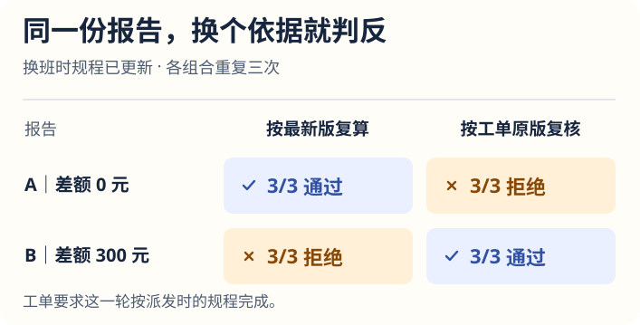

<ArticleCover image="/assets/covers/2026-11-24-sop-version-handoff-reader-v2.png" kicker="数字员工 · 交接与验收" title="AI 数字员工接班，为什么复核也会判错？" summary="同一笔租金，两份报告的算式都正确，复核却把结果判反了。一组交接实验，追问数字员工该沿用哪版规程、何时可以改变，以及哪些旧成果还能继续使用。" version="2026-11-24" languageHref="/en/research/2026-11-24-sop-version-handoff" languageLabel="English" />

<ArticleTableScroll language="zh" />

# AI 数字员工接班，为什么复核也会判错？

一张租金对账工单，应收 3,000 元，银行到账 2,700 元，另有 300 元暂定减免，申请尚未正式获批。

派工时的规程 V1 只认可正式批准的减免，因此这张单应当保留 300 元差额，等待确认。午后发布了 V2，允许把暂定减免也算进去。但工单留着一句明确的约定：**本轮按派发时的规程完成。**

换班后，两份报告摆在复核者面前：

| 报告 | 计算过程 | 结论 |
|---|---|---|
| 零差额报告 | 3,000 − 2,700 − 300 | 账已对平 |
| 300 元差额报告 | 3,000 − 2,700 | 减免仍待确认 |

按照工单约定，应当通过第二份。可在我们的实验里，按最新版重新计算的复核程序，恰好作出了相反判断：零差额报告通过，保留 300 元差额的报告被拒绝。

两份报告的减法都算得通。区别在于，哪一版规程适用于这张工单。**执行和复核共同采用了一个未经确认的前提：规程发布了新版，这张在办工单就应该跟着改变。**

我们用这笔合成账开展了一组交接实验：由测试程序模拟对账和复核岗位，实际调用 CodeFlowMu 的任务等产品接口，通过 FCoP 保存工单、报告和复核记录。本轮没有调用大模型。实验先检查交接材料和产品接口能否支持明确的任务约定，再为真实 Agent 的自主执行与复核提出可检验的问题。实验说明与资料附于文末。

## 复核重新算了一遍，为什么还会错？

复核程序打开 V2 后，看到暂定减免可以抵扣，就从 3,000 元中减去到账的 2,700 元，再减去 300 元，得到零。它随后用这个结果核对报告，自然接受零差额、拒绝 300 元差额。

计算过程中没有出现加减错误。复核漏掉的是一个更早的问题：**这张工单是否已经获准改用 V2？**

为观察这个差别，实验设置了两种执行方式：一种直接读取当前发布的规程，另一种沿工单找回指定版本。分别在规程未更新、派工后更新到 V2 的条件下运行，每个组合重复三次，共产生 12 份报告。每份报告再接受两种复核：按当前规程复算金额，或按工单指定版本检查。

六次未更新的基线运行中，当前版就是工单指定的 V1。六份报告都留下 300 元差额，两种复核方式也都给出通过判定。这种平日看起来顺畅的流程，并没有暴露版本问题。

在另外六次更新对照中，直接读取 V2 的三次提交了零差额报告，找回 V1 的三次提交了 300 元差额报告。最新版复核通过了前三份，拒绝了后三份；按工单复核则拒绝前三份、通过后三份，结果与派工约定相符。[逐轮结果](/assets/sop-handoff-20261124/controlled-runs.json)

*图中 A 为零差额报告，B 为保留 300 元差额的报告；每个组合重复三次。这里比较的是两套复核策略：最新版策略只复算金额，工单版策略还检查版本和文件指纹，各项检查的作用尚未分别测量。*

这组对照显示，重新计算可以检查算式，却仍可能遗漏规则的适用范围。如果执行和复核都把“最新发布”当成“本单适用”，第二次计算就会重复第一个错误前提。

## 接班者需要找回怎样的规程？

这个问题最初来自 StaffDeck 的一处修复。它的旧数据库迁移逻辑可能改变规程编号，使已经发布的引用无法按原编号找回内容。修复保留公开编号，并在关联明确、没有冲突时恢复被旧逻辑改过的编号；新增回归测试则检查，数据库重新初始化后，原编号仍能找到规程，员工也仍能看到它。[修复与回归测试](https://github.com/OpenBMB/StaffDeck/commit/389d5d331cf40eb5f0aae83c4fa24f4ed10b0003)

这项修复关注的是规程能否持续被找到。我们由此提出了另一个问题：即使编号一直有效，它今天打开的内容，是否适用于昨天派发、今天接手的工作？这一版本对照在 CodeFlowMu 中另行构造，并不是对 StaffDeck 版本治理能力的测试。

对接班者而言，查找规程至少涉及四件事：

| 要确认的事情 | 要回答的问题 |
|---|---|
| 规程标识 | 找的是哪份规程？ |
| 内容版本 | 读到的是哪一次发布的内容？ |
| 适用依据 | 为什么这张工单可以采用这一版？ |
| 原文可取回 | 需要核对时，能否实际读到对应内容？ |

缺件测试单独检查了最后一项。我们保留工单中的 V1 引用和文件指纹，也保留可打开的 V2，只拿走 V1 原文。程序最终没有生成报告或复核记录，工单保持进行中。[缺件记录](/assets/sop-handoff-20261124/controlled-runs.json)

这个结果提醒我们：接班记录可以指出缺哪份材料，却不能凭一个指纹恢复规程条款。缺少适用原文时，应先补足依据；直接改读新版，会把“材料缺失”变成另一次未经确认的规则变更。

## 如果这张工单本来就要改用新版呢？

工单约定沿用 V1 时，接班者需要找回 V1。但组织也可能决定，让一张正在办理的工单改按新规程继续。此时，交接要解决的问题又多了一层：哪张单获准改变，已经完成的工作还有哪些可以沿用？

续验使用两张独立工单，分别称为“待批工单”和“获批工单”。交班前，两张单都已核验 2,700 元的合成银行流水，按 V1 判断暂定减免可抵扣 0 元，并由另一测试身份复核、保存相关记录。两张单都还没有提交最终报告。

V2 发布后，管理员测试身份只批准其中一张改用新版，决定明确写着：**保留已有流水核验，按 V2 重做减免判断。** 另一张申请仍待审批。随后，更换执行和复核测试身份，重新通过任务接口读取工单及交班记录。

| 接班后的结果 | 待批工单 | 获批工单 |
|---|---|---|
| 使用的规程 | V1 | V2 |
| 再次核验银行流水 | 0 次 | 0 次 |
| 重新执行减免判断 | 0 次 | 1 次 |
| 重新复核减免判断 | 0 次 | 1 次 |
| 复核确认的差额 | 300 元 | 0 元 |

记录显示，两张单各自的交接检查点在前后的文件指纹一致，流水核验都没有再次调用；获批工单只增加了一次减免判断和一次对应复核。两张单都保存了报告，并读回了正式复核记录。[成对续验结果](/assets/sop-handoff-20261124/selective-migration-runs.json)

两张单都能读到新版，却只有获批的那张改变了减免判断；两张单都更换了执行与复核身份，却都保留了原有流水核验。结果随具体工单上的决定变化，已经完成的工作也随交接保留下来。

在这组成对实验中，保留与重做的项目已经由决定明确列出，脚本负责执行。真实 Agent 能否自己识别变化涉及哪些步骤，是下一阶段需要验证的能力。

## 旧结果留下来了，就一定还能用吗？

假设银行后来撤回了那笔 2,700 元到账，原来的核验文件没有被改动，文件指纹当然仍然相同。但“这笔款已经到账”的旧结论，已经不能直接支持现在的对账结果。

因此，保留一份记录之后，还需要判断它在当前条件下是否成立。

在本例中，流水核验依据银行原件及核验条件；减免判断依据申请、批准状态和适用规程；最终差额依据前两项结果。如果只有减免口径发生变化，流水事实和核验条件仍然成立，就有理由沿用已有流水核验。若到账被撤回，受影响的就是另一部分工作。

文件指纹帮助我们确认记录内容有没有变化。原始材料、核验条件和适用规则，则帮助我们判断记录里的结论还能不能用。**接班者知道旧结果为什么成立，才有依据决定继续使用还是重新核验。**

## 数字员工接班，需要接过哪些依据？

两轮实验把交接需要的信息逐步展开了：先要知道本轮工作的约定，再要知道哪些决定改变了约定，最后还要知道已有结果是在什么条件下得到的。

对于执行 Agent，接手一张工单后，首先应当能查清要交付什么、原来采用哪版规程，以及是否存在对本任务、本轮生效的变更。一个新版文件的存在，无法单独说明当前工作是否应该跟着改变。

接下来，它要查看前面已经完成的工作。每项结果都应能追到原始材料、核验记录和当时的判断依据。这样，接手者才有条件决定哪些结果可以继续使用，哪些需要重做，哪些暂时缺少材料。

复核 Agent 面对的则是一份具体报告。它需要把报告中的金额、规则和证据重新联系起来，检查这些依据是否支持结论。执行者写下“流水已核验”，是一项需要核对的陈述；相应的原件和操作记录，才让这句话能够被检查。

在本次实现中，FCoP 将工单、报告和复核记录保存为可以相互引用的文件，CodeFlowMu 负责通过产品接口组织读取、提交和决定查询。岗位工作指引可以告诉 Agent 怎样查证，MCP 工具提供实际读取材料、执行操作和提交结果的入口。

这些部分各自提供判断所需的条件。操作回执可以表明工具返回过 V1 原文；减免是否符合 V1，仍需要结合条款检查。对账和复核岗位也因此有不同的职责：一方提出有依据的结果，另一方重新查证这些依据能否支持该结果。

## 当所有 Agent 都说“对”，谁来检查前提？

回到这笔账。工单要求沿用 V1 时，300 元应该留下；针对本单的换版决定生效后，这 300 元才可以按 V2 抵扣。同一笔业务、同样的金额，结论可以不同。判断的关键，是结果所依赖的规则和决定是否适用于当前任务。

这给多智能体协作留下了一个值得追问的问题：**多个 Agent 得出相同答案，究竟是经过独立查证后的相互印证，还是同一个前提被重复接受？** 执行者和复核者若都默认“最新版就是适用版”，更多次计算仍可能重复已有结论。要判断复核是否独立，还需要看它重新确认了哪些依据，以及它能否发现执行者遗漏的前提。

接班还提出了另一个问题。我们希望数字员工能够自主理解任务、选择方法，并决定哪些已有成果可以继续使用。这些能力让它有机会应对变化，也意味着它对任务的理解会影响实际行动。**当接手的 Agent 调整做法时，怎样判断它是在继续履行原来的任务，还是已经重新定义了任务？** 本例中，针对具体工单生效的决定给出了区分依据。面对更长的任务链、多次转派和多轮规则更新，这类依据需要随着工作继续传递。

这些问题还会影响我们怎样评价数字员工。复核者提出正确异议，可能让流程暂时停下来，也可能避免任务沿着错误前提继续推进。分歧本身并不能说明谁更可靠，反对意见同样需要证据；但一次有依据的暂停、补证或重新核验，应当能够在团队的评价中得到体现。

这笔账中的 300 元，最终把问题留给了数字员工系统的设计者：**如果系统把“快速完成”和“一致通过”视为成功，那么那位查明依据、坚持说“先停一下”的数字员工，会被认定为更可靠，还是更低效？**

---

## 附件：实验说明与资料

### 实验范围

第一轮包含 12 次执行、24 次复核判定，其中按工单指定版本进行的复核写入了 12 份正式复核记录；另有 1 次旧规程原件缺失测试。第二轮是两张工单的一组成对续验。

实验采用合成账目和测试身份，任务、报告等流程通过实际产品接口运行。规程解释、业务计算及选择哪些步骤重做，由测试程序完成，本轮没有调用大模型。

每个组合重复三次，用于检查受控路径的结果是否一致，不用于估计真实 Agent 的准确率。记录中的正常工单处于审查阶段，不等同于最终业务验收。

### 原有实验资料

以下继续引用原文章已经公开的资料：

- [12 次执行与 1 次缺件测试的逐轮记录](/assets/sop-handoff-20261124/controlled-runs.json)：工单指定版本、实际使用版本、文件指纹、报告金额、两种复核判定，以及报告和复核记录是否写入。
- [两张工单的成对续验记录](/assets/sop-handoff-20261124/selective-migration-runs.json)：改用新版的决定状态、交接前后的检查点指纹、交接后的核验调用次数，以及报告与复核记录状态。
- [StaffDeck 公开规程编号修复与回归测试](https://github.com/OpenBMB/StaffDeck/commit/389d5d331cf40eb5f0aae83c4fa24f4ed10b0003)：本文所引用的规程标识稳定性修复。

### 版本记录

两份结果摘要记录的 CodeFlowMu 产品代码基线为 `0d2d4e742ef2f3cb48e3ce09cc47f0c03053dc5f`，FCoP 为 `4.0.5`；第一轮同时记录 FCoP MCP 为 `4.0.5`。这些是公开结果摘要中的版本信息。
