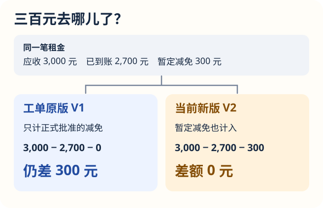

<ArticleCover image="/assets/covers/2026-11-24-sop-version-handoff.png" kicker="数字员工 · 交接与验收" title="数字员工换班时，规程更新了，这笔账该怎么算？" summary="同一张工单、同一笔租金，规程一更新，300 元差额变成 0。12 次对照揭示了独立复算也会漏掉的版本错误。" version="2026-11-24" languageHref="/en/research/2026-11-24-sop-version-handoff" languageLabel="English" />

<ArticleTableScroll language="zh" />

# 数字员工换班时，规程更新了，这笔账该怎么算？

交班前，项目主管打开租金对账报告。最下面一行写着：**差额 0 元。** 旁边是复核结果：**通过。**

他准备签收，忽然想起早班留下的那份减免申请。三千元租金只到账两千七，剩下三百元还在等人批准。他点开申请，仍然是“暂定”。

晚班没看错流水，复核员也确实自己算了一遍。那三百元去哪儿了？

## 流水没变，变的是“这笔钱算不算”

把这笔账重放一遍。早班按照原版规程，只能抵扣已经批准的减免。银行到账 2,700 元，获准抵扣 0 元，剩余 300 元还得有人跟进。换班时，规程换了新版，允许把暂定减免也计进去。银行台账和减免申请一字未改，报表底下的 300 却变成了 0。

如果这是新版生效后发的一张新工单，零差额可能就是正确答案。偏偏早班留下的工单写得很清楚：**这一次按派发时的规程做完。** 晚班按眼下看到的版本算出了零，QA 又用同一版复算了一遍。两个人没有抄彼此的答案，却一起遗漏了同一件事：这张工单约定用什么口径。

这一幕是我们用合成数据搭出的实验。它的起点是 StaffDeck 的一处更新：数据库重启后，同一个公开规程编号仍能查到。这个改进让流程引用更稳定，也让我们想到另一个问题：接手人凭着原编号找到了规程，打开的还是早班读过的那一份吗？ [StaffDeck 的变更与回归测试](https://github.com/OpenBMB/StaffDeck/commit/389d5d331cf40eb5f0aae83c4fa24f4ed10b0003)

*本地实验采用相同账目。两版相差 300 元，因为暂定减免在两版下的可抵扣资格不同。*

## 把那份「正确」的报告拿回来再审一次

我们在 CodeFlowMu 的本地环境里，让同一张对账工单走完创建、领取和提交。换班与复核由实验程序驱动。前六次不改规程，接手人无论点开当前版、还是从工单取回原版，都留下三百元差额，两种复核也全都通过。只看这一组，你很难发现两条路径有什么区别。

接着把规程更新到 V2。三次让接手人读当前版，三次让他从工单取回 V1。我们请复核程序分别按当前版重算，再按工单原版审同一份正式报告。结果是两组报告在复核桌上换了位置。

| 换班时发生了什么 | 接手人读到的规程 | 报告差额 | QA 只按当前版复算 | QA 按工单原版复核 |
|---|---|---:|---|---|
| 规程未变，6 次 | 两种读法都拿到 V1 | 300 元 | 6 份通过 | 6 份通过 |
| 规程更新，3 次 | 当前 V2 | 0 元 | 3 份通过 | 3 份拒绝 |
| 规程更新，3 次 | 工单绑定的 V1 | 300 元 | 3 份拒绝 | 3 份通过 |

最容易想到的结果，是用新版的复核员放过了三份零差额报告。更有意思的是，当他看到三份按老规程做对的结果，反而全退了回去。第二双眼睛确实做了自己的计算，可只要两双眼睛都盯着最新页面，**复核就可能把一次口径变化当成执行者算错。**

实验里，QA 用自己的身份读回已提交的报告，核对任务与执行轮次，再回到工单取规程。按原版复核的结果写入正式记录，并引用具体的报告。因此我们可以指出，哪一笔暂定减免被带进了算式，哪一次拒绝来自用了不适用这张工单的版本。

## 交班时，能不能把旧规程也交过去？

还有一次，我们把旧版原文拿走，留下编号、文件摘要，以及能打开的最新版。接手程序知道自己缺哪一版，却拿不回那份原文。工单停在进行中，没有交报告。**指纹能告诉你手里的文件对不对，不能替你找回丢掉的文件。** 对晚班来说，交接除了告诉他“这单做到哪儿了”，还得让他点得开前一班实际使用的依据。

实验用到了正式任务和报告端口，复核策略和规程归档由探针模拟，真实模型、桌面换班和企业验收仍需验证。 [查看 12 次对照及 1 次缺件测试的逐轮记录](/assets/sop-handoff-20261124/controlled-runs.json)

再想一步。假如这次更新的是一项必须当晚生效的安全检查，晚班就不能只拿着早班规程继续。早班已经做过的部分要能解释清楚，晚班也要知道该从哪一步补做。回到开头那位主管，他接下来真正需要的是两条记录：**谁决定这张工单要切换版本，以及切换前的结果还可以用到哪里。** 明天再换一位复核员，能不能从记录里找到答案？
