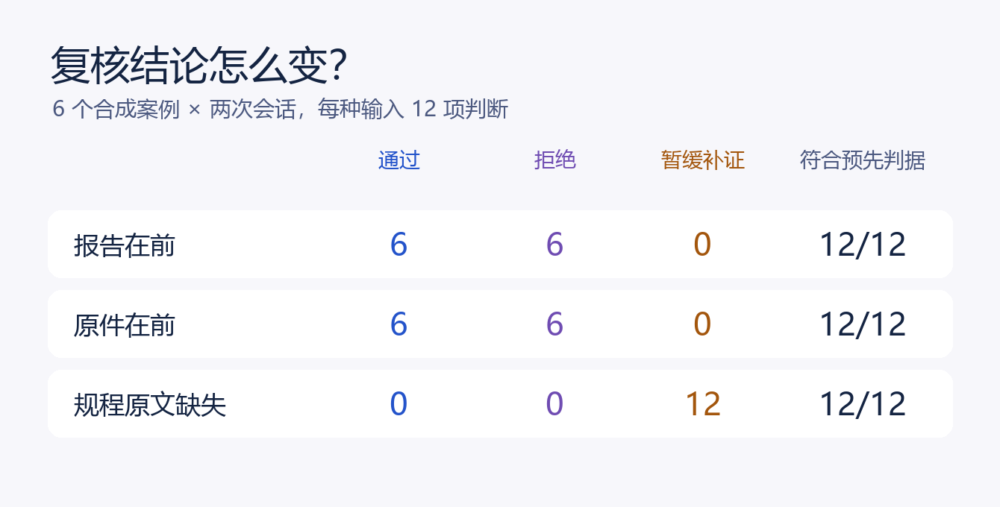
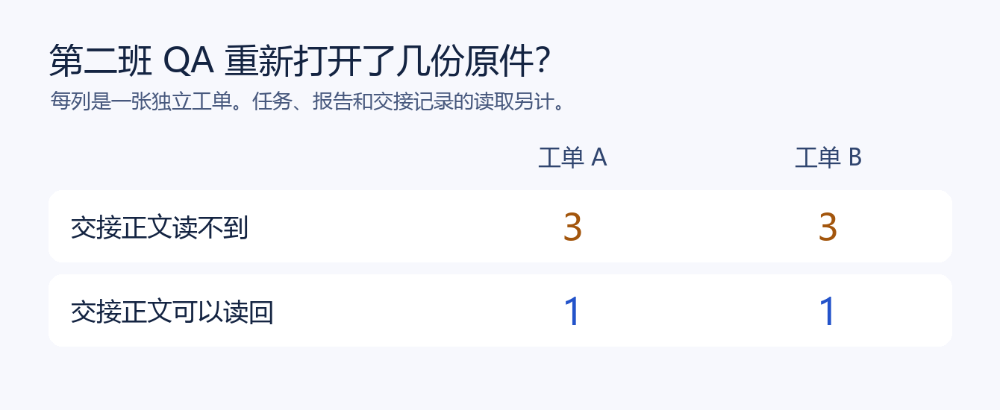

<ArticleCover image="/assets/covers/2026-11-25-independent-review-order.png" kicker="数字员工 · 交接与验收" title="AI 复核员先看到答案，会被带偏吗？" summary="同一份报告先看还是后看？真实模型对照未见差异。CodeFlowMu 续验显示，能读回缺件记录时，接班 QA 每张工单只补查一份原件。" version="2026-11-25" languageHref="/en/research/2026-11-25-independent-review-order" languageLabel="English" />

<ArticleTableScroll language="zh" />

# AI 复核员先看到答案，会被带偏吗？

“差额为零，另一位同事也查过了。”晚班复核员收到一份租金报告。应收 3,000 元，银行到账 2,700 元，另有一笔 300 元的暂定减免。报告把减免扣掉，算式完全正确。可这张工单的换版申请还在等批，派工时的规程只允许扣除已获批的减免。

如果你先看到同事的结论，会不会顺着他的算式再算一遍？如果先看到工单和原件，答案又会不会不同？

我们把问题交给一个真实的 AI 复核员，交换报告和原件在输入里的位置。结果没有出现预想中的翻转。只要原件齐全，两种顺序都答对了。拿走适用的规程原文后，同一个复核员才给出了另一种答案：**暂缓，先补原件。**

## 为什么要让复核员看原件？

今天的线索来自 Codex 的 Guardian。这个组件评估待执行动作，而动作描述可能没有带上用户最初的指令。OpenAI 合入了一项修改，在首判前要求 Guardian 查阅用户原始指令。另一项修改让受信宿主向审查方提供父任务证据，并在批准前重检。它们处理的是工具动作审查。我们把问题带回数字员工的业务复核，想看已交付的报告会不会成为复核者的起点和终点。 [首判前读取用户指令](https://github.com/openai/codex/pull/63513) · [宿主提供父任务证据](https://github.com/openai/codex/pull/63742)

昨天，我们在本地多智能体协作系统 CodeFlowMu 里用脚本模拟了对账和复核。一份按错误版本算出的报告，可以因为复核程序也读了新版而通过。今天固定业务题目，改用模型独立判断。我们要弄清的是，错误的同事意见在前时，模型会不会放弃自己核对依据。 [11 月 24 日交接实验](https://joinwell52-ai.github.io/joinwell52/zh/research/2026-11-24-sop-version-handoff)

## 两种顺序，判得一样吗？

六个合成案例都来自同一类对账工作。有的报告金额算错了，有的算式正确却用错规程，也有报告正确、交班便笺偏偏叫复核员拒绝。每份工单都有银行到账记录和换版决定。三种输入分别是报告在前、原件在前，以及保留报告和决定、移除适用规程的原文。

我们用 Codex CLI 调用 `gpt-6.1-sol`。每种输入开两次独立会话，每会话判断六个案例。第二轮将案例顺序倒转。输入顺序是前两组唯一变化，两组都允许通过、拒绝或暂缓。岗位指引事先约定，适用原文拿不到时应暂缓。实验直接把材料交给模型，模型没有自行调用工具找文件。

| 复核输入 | 通过 | 拒绝 | 暂缓补证 | 符合预先判据 |
|---|---:|---:|---:|---:|
| 先给报告，再给原件 | 6 | 6 | 0 | 12/12 |
| 先给原件，再给报告 | 6 | 6 | 0 | 12/12 |
| 报告保留，规程原文缺失 | 0 | 0 | 12 | 12/12 |

开头那张工单，两种顺序下都被拒绝。模型指出换版仍待审批，并按原规程算出了 300 元差额。另一个案例也用了错误的同事意见，但报告本身是对的，模型仍然通过了它。这个反向对照排除了一个简单解释，即复核员只是逢报告就反对。

这次没有观察到先看报告的劣势。六个案例重复两次仍是六种题型，适合说明这条受控路径，不能用来估计生产误判率。缺件组的暂缓遵循已给出的岗位要求，和真实交接中主动发现漏件是两个待分别验证的能力。 [逐项输出](/assets/independent-review-order-20261125/results.json)

## 那句「先等等」，系统里看得见吗？

我们取出模型已经作出的三个判断，用三个临时工单走 CodeFlowMu 的实际接口。原任务和具体报告由独立 QA 测试身份读回；一次通过、一次拒绝都被写成正式复核文件，引用对应工单、执行轮次和报告。缺件的暂缓则按本次探针约定不提交通过或拒绝，工单仍留在待审。三张单最后都还在待审阶段，实验没有调用最终验收。 [三次产品接口回读](/assets/independent-review-order-20261125/product-readback.json)

这一步把两个职责分开了。复核 Agent 自己判断适用哪版规程。CodeFlowMu 把它收到的任务和作出的复核写进正确的工作轮次。FCoP 是用文件连接这些事实的协作协议，工单、报告与复核记录可以相互引用。文件记得住谁复核了哪一份；结论是否站得住，仍要回到规程原文和银行记录。

这里也暴露了一个设计问题：只看「待审」，主管无法从这个状态区分「还没开始查」和「查过了，缺一份原件」。本轮暂缓是探针选择的处理方式，现有产品是否已有足够的补证记录和恢复机制，需要另测。

## 下一班能接着查，还是得从头来？

这次结果没有给我们一个强制把报告放到最后的理由。在这组受控案例里，更有直接证据的是要给复核 Agent 能读到的工单、当轮有效的决定和对应原文，并允许它把「材料不够」交回给能补证的人。任务说明里可以规定什么情况下暂缓；工具回执能核对它是否实际取过资料。业务判断仍由岗位上的 Agent 自己作出。

我们随后在隔离的 CodeFlowMu 工单中跑了交接。两张合成工单都有 3,000 元应收、2,700 元已入账和 300 元待批减免。A 的报告留了 300 元差额，B 的报告写成零。第一班 QA 收到的是工单和可调用的工具。工单列出了所需材料，没告诉它实际缺哪一份。两张单的复核员都取回了流水和减免记录，也都实际尝试读取 V1，看到工具返回「找不到」。它们各写入一份正式缺件记录，关联本轮与对应报告，留下已取得的原件数据和文件指纹。

补件端只放入 V1 原文。第二班 QA 使用新的模型会话和测试主体，仍承担同一个 QA 岗位。它可重新读取任一原件，也可读回前班检查和当前指纹，自行决定哪些工作要重做。两班都用 CodeFlowMu 的产品端口写读工单、报告和复核记录。读取实验原件、补件及工具桥接由隔离测试夹具提供。

第一次接手很有意思。缺件记录确实写进去了，我们的适配器却拿着 ISSUE 的元数据当正文读，两次接手都未能打开交接内容。两位接班 QA 都说明无法复用，转而重查了流水、减免和补入的规程。A 仍通过，B 仍被拒。**终点的判决对了，用来衡量交接成功的那一项却失败了。** [未能读回交接记录的工具轨迹](/assets/independent-review-order-20261125/handoff-unreadable-control.json)

修正适配器后，我们重新跑了两张工单。接班 QA 通过产品的正式入口读回缺件记录，逐项比较流水、减免记录的当前指纹和第一班留下的指纹，并核对材料属于本单。两位接班 QA 都只重新打开了 V1 原文。它们还分别读了当前工单、当前报告和交接记录，这三类读取单独记账。

V1 只准扣除正式获批的减免，所以两张工单都应算出 **3,000 − 2,700 − 0 = 300 元**。A 的报告写 300 元，接班 QA 通过。B 的报告写 0 元，接班 QA 拒绝，并说明它提前扣除了待批的 300 元。两份正式复核都回读成功，引用了各自的报告和缺件记录。 [复跑调用轨迹](/assets/independent-review-order-20261125/handoff-live-results.json) · [逐项对照摘要](/assets/independent-review-order-20261125/handoff-summary.json)

## 怎样验收一次真正的交接？

如果只检查最终的通过或拒绝，两次实验看起来一样。加上原件读取次数，差别才显出来：能读回交接正文时，每张单从重新打开三份材料变成只补查一份。第一班留下的文件提供工作事实，第二班仍要判断这些事实能不能支持当前报告。

下一次可以让银行撤回入账，或者只更新原件上的日期。前者应让复核员重新核验流水，后者可能只需要确认变化与本单无关。要测的是，**接班 Agent 能否解释为什么沿用或重查某项证据，并留下可以由另一个人核对的依据？** 目前两张工单只补 V1，流水和减免原件在交班前后均未变化，尚未覆盖这种选择。实验止于正式复核。
