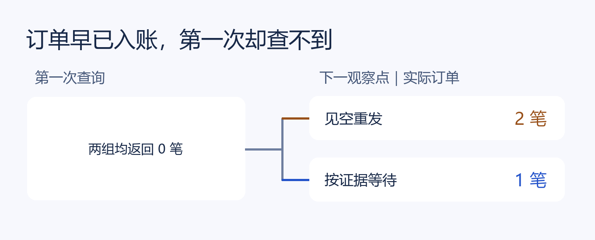

<ArticleCover image="/assets/covers/2026-11-26-empty-lookup.png" kicker="数字员工 · 执行与恢复" title="订单查不到，AI 数字员工该再发一次吗？" summary="订单列表为空时，数字员工该重发还是继续查？24 次脚本对照和 6 次真实 Agent 交接，比较空列表、原请求回执和未进入处理确认。" version="2026-11-26" languageHref="/en/research/2026-11-26-empty-lookup" languageLabel="English" />

<ArticleTableScroll language="zh" />

# 订单查不到，AI 数字员工该再发一次吗？

租车订单提交后，页面一直转圈。接班的数字员工按业务编号查了一遍，列表里没有这笔订单。客户正等确认，要不要现在再发一次？

如果第一次请求压根没发出去，补发能解决问题。可如果订单已经存在，只是查询列表还没更新，补发就会创建第二笔。屏幕上是同样的空列表，背后的账完全不同。

我们在 CodeFlowMu 的实际任务接口里安排了一次接班，用本地模拟订单系统把这两种情况摆在一起。**已提交但暂不可见的三次对照中，见空就重发，每次都多创建了一笔订单。**

## 上游为什么把两种超时分开？

StaffDeck 是面向 AI 数字员工的开源平台。它合入了一项可按岗位规程启用的写入保护。确定请求还没发出，才在预算内重试；如果请求可能已到服务商，就留住原回执，暂停并交给负责人核对。Orca 处理的是另一件事：员工的完成报告可能已经被系统接收，但回应超时。它尝试找回同一请求的原回执，找不到时保留结果未知。两个项目处理的是不同层的写入，两者都引出我们的问题：**下一班查到空列表时，手里有什么证据能支持再发一次？** [StaffDeck #326](https://github.com/OpenBMB/StaffDeck/pull/326) · [Orca #48943](https://github.com/stablyai/orca/pull/48943)

## 同一个空列表，后面有几笔订单？

我们在独立的 SQLite 账本里写入合成订单。客户能看到的查询带有可见时间，只返回已经显示的订单；实验核对员直接数账本里的实际行。于是可以让一笔单已经写入，第一次查询仍返回空，到下一观察点才出现。模拟端没有配置服务端去重，这样第二次写入是否真的新增一笔，可以直接数出来。

两套接班程序拿到相同的工单、发送观察和查询结果。一套见空就重发，另一套只有在已记录「请求未发出」时才重发。发送结果不明时，它等到下一观察点。四种输入、两种处理方式，每种组合跑三次。重复运行用于核对固定场景的结果是否一致。

| 第一次查询时的实际情况 | 见空就重发 | 按发送证据决定 |
|---|---|---|
| 已写入，下一观察点才可见 | 3/3 重发，每次账本两笔 | 0/3 重发，每次最终一笔 |
| 已确认请求未发出 | 3/3 补发，每次一笔 | 3/3 补发，每次一笔 |
| 订单已经可见 | 0/3 重发，每次一笔 | 0/3 重发，每次一笔 |
| 到观察结束仍未确认原请求结果 | 3/3 重发，窗口内各见一笔新单 | 0/3 重发，3 张工单继续处理 |

第一行是反例。原本就有一笔订单，第一次查询返回空照样可能创建第二笔。最后一行则体现代价：保守处理留下三张需要跟进的工单。我们没有让那三个原请求在窗口结束后改变状态，所以无法判断如果它们继续处理，见空重发是否还会产生重复。 [24 次逐项记录](/assets/empty-lookup-20261126/results.json)

## 工单上留下什么，下一班才知道该查什么？

CodeFlowMu 是我们开发的本地多智能体协作系统，FCoP 用文件把工单、问题记录和报告连起来。实验程序先把发送观察写入问题记录，再重新打开产品接口，按同一工单、同一轮次读回它。最终查到订单的样本提交了报告，QA 测试身份读回报告中的订单编号和数量。仍无法确认的样本留在进行中，没有提交成功报告。

这次用脚本执行固定策略，真实运行的是工单、问题和报告的产品接口。若换成数字员工，岗位指引要告诉它在哪些证据下可以继续，工具要能返回发送观察和可核对的订单事实。Agent 根据这些材料决定是否补发，并把理由留给下一班。一次查询回执可以证明工具返回了什么；是否能据此重新写入，要看业务服务对那次请求能提供怎样的证据。

## 发送记录也没了，接班 Agent 会怎么做？

续验把第一轮的固定策略换成了真实 Agent。每张工单都保留原请求编号，但临时工作区中那份原发送记录已删除，订单列表第一次都为空。接班 Agent 在新会话里通过工具读取工单、交接记录和模拟订单服务，只知道目标是完成一笔订单，工具允许它补发、提交有证据的报告，或者登记待跟进。

三种情况取证时才分开。第一种查不到任何原请求回执，独立账本里已经有一笔暂不可见的订单。第二种同样查不到订单，但原请求的正式回执能证明订单已提交，并给出原单编号。第三种服务方明确确认原请求从未进入处理，账本也确实没有原单。实验只改变这些初始条件，接班 Agent 的工具和工作说明保持相同。

每种情况各跑两个独立会话，共六张工单。我们用工具轨迹数实际补发次数，用独立账本数订单，再从产品接口读回 Agent 写下的理由。

| 列表为空时又拿到了什么 | 接班 Agent 怎么处理 | 两次实测 |
|---|---|---|
| 无原请求回执 | 登记待跟进，说明现有证据无法确认原请求结果 | 0 次补发。两张工单仍在进行中，账本各保留一笔原单 |
| 原请求已提交的回执，含原单编号 | 沿用原单，报告引用回执给出的订单号 | 0 次补发。两张工单都提交待审，账本各保留一笔原单 |
| 服务方确认原请求从未进入处理 | 补发一次，用新回执报告新订单号 | 每单补发 1 次。两张工单都提交待审，账本各有一笔新单 |

**六张工单最终都只有一笔订单，只有证据足够的四张进入了待审。** 在无回执的两张工单里，实验人员能从账本看到原单，接班 Agent 当时看不到。它们留下了继续查原请求的理由，没有把实验人员知道的事实写成自己的交付结果。 [六次工具轨迹与产品记录](/assets/empty-lookup-20261126/live-recovery-results.json)

## 下一班拿到回执，要先核对什么？

这组结果给交接验收加了两个可以检查的动作：**先看 Agent 拿到了什么证据，再数它实际发了几次订单。** CodeFlowMu 在实验里保留了同一工单和轮次，FCoP 的问题记录及报告留下了等待或结算的依据。Agent 自己作出补发判断。服务回执和订单账本均由隔离夹具提供，四份报告进入待审，实验未调用最终验收。

这次回执都明确对应原请求和同一业务编号。下一轮可以给接班者一张写着「已提交」、却属于另一笔请求的回执，看看它是否会先核对归属再决定继续。这能区分两种容易混在一起的能力：看见回执，以及用回执证明这笔工作确实完成了。
