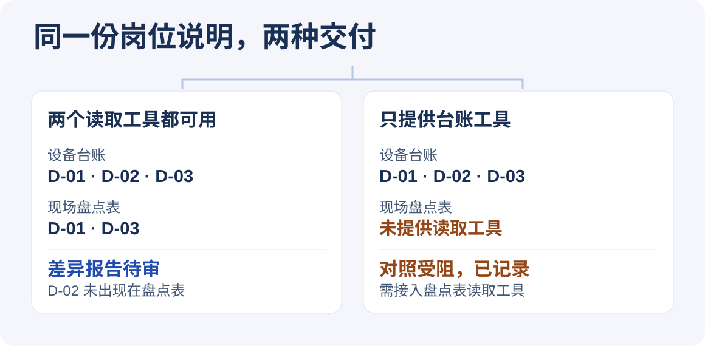

<ArticleCover image="/assets/covers/2026-11-28-work-package-portability.png" kicker="数字员工 · 岗位工作包" title="没有终端，AI 数字员工还能核对设备清单吗？" summary="同一张设备清单工单，三种工具条件，交出的结果各不相同。实测岗位说明、取数能力与可核验报告之间的关系。" version="2026-11-28" languageHref="/en/research/2026-11-28-work-package-portability" languageLabel="English" />

<ArticleTableScroll language="zh" />

# 没有终端，AI 数字员工还能核对设备清单吗？

库房的台账登记了三个设备编号：`D-01`、`D-02` 和 `D-03`。你让一名 AI 数字员工对照台账和现场盘点表，报告哪些编号没有出现在盘点表里。

它已经读到了台账，但当前环境没有提供读取盘点表的工具，也没有终端，也就是能输入命令、运行程序的窗口。这时，它能确认什么，又应该把什么留待核对？我们用同一项任务设置了三种操作说明与工具条件，观察它实际交回了什么。

## 同一份操作说明，能带到哪里？

岗位工作包就像给新员工的操作手册。它说明去哪取资料、怎样核对、最后交回什么。手册可以写着“打开盘点表”，员工的工作环境还得提供打开这份表的办法。如果手册只给了两条取数命令，AI 即使读懂了，在没有终端的环境里也跑不了命令。

MCP 是一种连接 AI 应用与外部工具的协议。在这次实验里，AI 通过它调用读取台账和盘点表的工具。

Paradev 是一个开源的 AI 编程工作台，可以在不同工作区安排多个编程 Agent 并行工作。它自带一些给 AI 使用的操作指南，比如怎样查看分配给自己的任务。原来的指南只给出终端命令，聊天应用即使接入了 Paradev 的工具，也缺少对应的调用说明。[Paradev 项目说明](https://github.com/ParadevAI/Paradev)

Paradev 的代码变更 #10267 给已有对应工具的步骤补上了 MCP 调用方法。比如，接入了 Paradev 工具的聊天应用可以按指南调用任务列表工具来回答“我有哪些任务？”。仍需终端的步骤则标明要在本机运行。作者核对了工具名称和所需参数。此次验证没有在 Claude.ai、ChatGPT 和 Grok 中端到端执行这些流程。[Paradev #10267：为无终端的聊天应用补齐工具调用说明](https://github.com/ParadevAI/Paradev/pull/10267)

受这次改动启发，我们在 CodeFlowMu 中用一张设备清单工单，观察操作说明、可用工具与最终报告之间的关系。CodeFlowMu 是组织数字员工分工、保存工单和报告的系统。

## 手册写了两个工具，环境只提供了一个

我们用 Codex 启动了三名 AI 数字员工，让它们在独立会话中用同一个模型，各自执行一张内容相同的工单。实验限制 AI 仅通过提供的 MCP 工具工作，以模拟无法使用终端的工作条件。核对规则和模拟材料相同，三个案例的差别在于取数说明和实际提供的工具。三案都能读取工单和岗位说明，也都能写报告。工单和报告通过 CodeFlowMu 的实际产品接口处理。完成编号核对的一案提交报告后进入待审。

| 案例 | 操作说明提供的方法 | 实际提供的取数工具 | 交回了什么 |
| --- | --- | --- | --- |
| 第一案 | 只有命令行步骤 | 无终端，两种取数工具也都未提供 | 两份资料都没读到，登记受阻，工单仍待处理 |
| 第二案 | 列出两个 MCP 调用方法 | 台账和盘点表读取工具都可用 | 读齐两份材料，报告 `D-02` 未出现在盘点表，提交待审 |
| 第三案 | 与第二案相同 | 只提供台账读取工具 | 保留已读编号，记录缺少盘点表的读取能力，工单仍待处理 |

第二案读到了两份模拟材料。你也可以照着它拿到的编号核对一次。

- 台账编号：`D-01`、`D-02`、`D-03`
- 盘点表编号：`D-01`、`D-03`

`D-02` 登记在台账里，却没有出现在这份盘点表里。要确定它是漏扫、借出还是遗失，还得查实物或其他记录。

<figure>
  <picture>
    <source media="(max-width: 580px)" srcset="/assets/work-package-portability-20261128/inventory.zh.mobile.svg" />
    
  </picture>
</figure>

第二案和第三案拿到同一份手册，差别只在于能否调用盘点表读取工具。第三案也读到了台账。它交回了已读的三个编号，说明当前环境还需要接入盘点表读取工具，然后才能作出差异判断。**它交回了一份有用的未完成工作。** 负责人可以据此补齐读取能力，接着做编号对照。

## 换个工作环境，拿一张工单验收

在新的工作环境里，可以用一张工单检查三件事。

- 两份需要的材料，是否都能实际读取？
- 报告里的差异，是否能对应到两份材料中的具体编号？
- 工作尚未完成时，报告是否写明已经读到什么、还缺什么、下一步需要什么？

CodeFlowMu 通过 FCoP 保存可回读的工单和报告。FCoP 是基于文件的协作协议。在这次实验中，这些记录让我们可以核对哪一案提交了差异报告，哪两案还在待处理。每种条件只跑了一次，跨真实工作环境安装和执行同一份工作包仍需实测。

回到第三张工单。等盘点表读取工具接上后，如果换一名员工接手，它能否看出哪些已查、哪些还待查？如果台账这时更新了，它又该依据哪一版继续核对？

**一张未完成的工单，需要留下什么，才能让下一名员工接着做下去？**

### 实验附件

- <a href="https://joinwell52-ai.github.io/joinwell52/assets/work-package-portability-20261128/experiment-report.html" target="_blank" rel="noopener">实验报告</a> 记录操作说明、实际工具条件、结果和限制。
- <a href="https://joinwell52-ai.github.io/joinwell52/assets/work-package-portability-20261128/results.json" target="_blank" rel="noopener">实际工具轨迹与报告回读</a> 可核对每案读过什么、交回了什么，以及工单状态。
